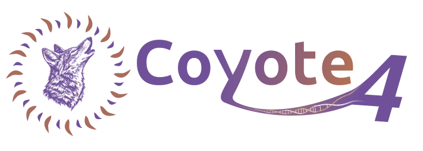

<!-- badges:start -->

### Build and validation

[Quality Checks](https://github.com/SMD-Bioinformatics-Lund/coyote3/actions/workflows/quality.yml)  

### Core Stack

              

### Domain & Capabilities

    

### Security & Governance

 
<!-- badges:end -->

Coyote4 is a clinical genomics application for reviewing DNA and RNA findings,
recording interpretations and preparing reports. Developed at the Section for
Molecular Diagnostics (SMD), Lund, it combines assay-specific analysis, controlled
access and traceable report snapshots.

## Getting started

| Task | Documentation |
| --- | --- |
| Review findings and prepare a report | [Clinical review](docs/user-guide/clinical-review-workflow.md) |
| Try synthetic samples in an isolated environment | [Demo installation](docs/deployment/demo-installation.md) |
| Install at a center | [Installation guide](docs/deployment/first-installation.md) |
| Upgrade an existing installation | [Upgrade procedure](docs/deployment/application-upgrades.md) |
| Configure an assay | [Assay setup](docs/administration/assay-setup.md#step-by-step-add-a-new-assay) |
| Submit samples from a pipeline | [Submission guide](docs/api/submit-sample.md) |
| Develop or troubleshoot | [Developer setup](docs/getting-started/developer-environment.md) · [Troubleshooting](docs/operations/troubleshooting.md) |

The [documentation index](docs/README.md) organizes user guides, configuration,
operations and technical references. Each deploying center is responsible for
validating its clinical configuration and approving its use.

## Architecture

The React interface calls the FastAPI API. Clinical workflows and contracts live
in the independent `coyote` core; the MongoDB adapter implements its persistence
interfaces. Celery and Redis handle background work. `smd-reports` renders HTML
and PDF reports from the reviewed findings, comment and configuration snapshot.

| Component | Responsibility |
| --- | --- |
| [Core](core/README.md) | Domain rules, application workflows and portable contracts |
| [API](api/README.md) and [Mongo](adapters/mongo/README.md) | HTTP host and persistence, distributed together as `coyote-server` |
| [Frontend](frontend/README.md) | Clinical review and administration interface |
| [pyClient](clients/python/README.md) | Independent Python HTTP client |
| [Relay](services/relay/README.md) | Ingestion workers and pipeline submission tools |
| [Atlas](services/atlas/README.md) | Reference resources and publication |
| [Demo](services/demo/README.md) | Synthetic data and guarded demonstration installation |

Each component owns its documentation and tests. Root `tests/` covers composed
behavior; `deploy/`, `docker/` and `scripts/` contain maintained operational tools.
See the [architecture](docs/architecture/application-architecture.md) and
[packaging decision](docs/architecture/decisions/0004-installable-application-packages.md).

## Configuration

The API loads the deployment environment and distributes typed settings to each
component. Start with [deploy/env/example.env](deploy/env/example.env); keep private
connections, credentials and storage settings outside Git. Center contact,
vocabulary and presentation settings live in a separately reviewed configuration
directory. Assays, gene lists, users and published rules are persisted resources.

See [configuration ownership](docs/configuration/README.md) and the
[environment reference](docs/deployment/configuration-reference.md).

## Development and releases

The uv workspace installs packages in editable mode, so source changes do not
require rebuilding wheels. Follow [editable development](docs/sdk/uv-development.md)
for setup and reload commands, and [test selection](docs/testing/test-strategy-and-quality-gates.md)
for component checks. GitHub CI runs fast smoke tests; broader validation is performed
for substantive changes and release candidates.

Contributions follow issue → focused branch → PR into `dev`. Releases use a reviewed
PR from `dev` into `master`, semantic versioning and an immutable version tag.
See [CONTRIBUTING.md](CONTRIBUTING.md) and the [release workflow](docs/project/releasing.md).

## License and attribution

Coyote4 and its Python packages use [GNU GPL version 3 only](LICENSE.txt).
Copyright holder and original developer: **Ram Nanduri**, affiliated with
**Sektion för molekylär diagnostik (SMD), Lund, Region Skåne, Sweden**.
Contributors: **Viktor Henmyr** and **Sailendra Pradhananga**.

See [LICENSING.md](LICENSING.md), [COPYRIGHT.txt](COPYRIGHT.txt) and [NOTICE.txt](NOTICE.txt).
Report vulnerabilities privately through [SECURITY.md](SECURITY.md); use synthetic
examples in the [issue tracker](https://github.com/SMD-Bioinformatics-Lund/coyote3/issues).
