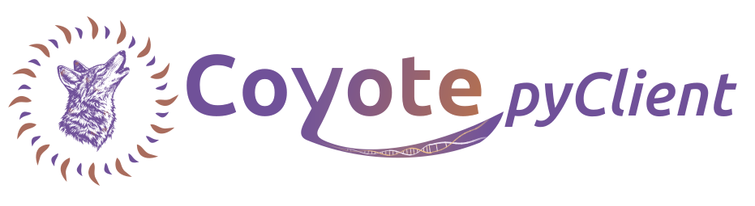

<!-- badges:start -->
  
<!-- badges:end -->

Synchronous and asynchronous access to a running Coyote API. The client provides authentication, typed resources, pagination, reports and structured errors. It communicates through HTTP and imports neither the core, database adapter nor server.

## Documentation

Start with the [package guide](docs/README.md).

- [Getting started](docs/getting-started.md): install the package and make a first use.
- [Usage](docs/usage.md): understand its supported workflow.
- [Configuration](docs/configuration.md): supply the inputs this package owns.
- [Reference](docs/reference.md): find entry points, interfaces and errors.
- [Development](docs/development.md): edit, test and build the package.

## Package identity

The distribution is `coyote-pyclient`; the Python namespace is `coyote_pyclient`.
Its version, dependencies and build configuration belong to
[pyproject.toml](pyproject.toml). See [CHANGELOG.md](CHANGELOG.md) for changes.
Client 1.x targets the Coyote4 `/api/v1` HTTP contract. The client version is
independent of the application version; Coyote3's Flask routes are not supported.

See [contributing](CONTRIBUTING.md) for local checks and
[releasing](docs/releasing.md) for package validation and release steps.

Badges describe package metadata and technology, not clinical validation.
GNU GPL version 3 only; see [LICENSE.txt](LICENSE.txt) and
[COPYRIGHT.txt](COPYRIGHT.txt) for copyright and affiliation, with additional
notices in [NOTICE.txt](NOTICE.txt).
