# Samples, findings, annotations and reports

<!-- GENERATED: scripts/docs/export_collection_dependencies.py -->

[Relationship guide](README.md) · [All collections](inventory.md)

Arrows run from the referencing field to the target. Snapshot and historical-actor
links preserve provenance; they do not require a live target on every read.

## primary.anno_vep

Binding: `anno_vep_collection`.

Immutable transcript consequence vault keyed by variant identity and VEP version.

Shared transcript vault in PRIMARY, not the knowledgebase database. Unique index: (simple_id_hash, vep_version). Not owned by one sample; never delete it just because one sample is removed.

Declared top-level fields: `created_by`, `updated_by`, `system_installed`, `simple_id`, `simple_id_hash`, `vep_version`, `variant_class`, `CSQ`.

[Field types and validation](../mongodb-collections.md#anno_vep). `_id` may also be retained by an open collection model.

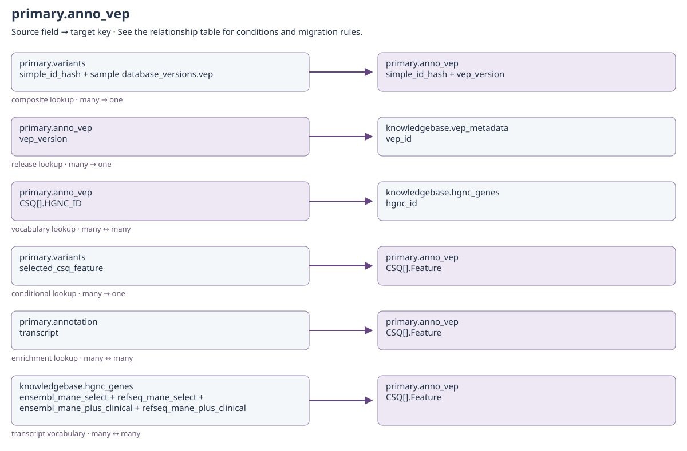

[Open full-size diagram](../../assets/diagrams/collection-dependencies/primary-anno-vep.svg)

### Outgoing dependencies

| Source field | Target key | Relationship / multiplicity | Migration and resolution semantics | Evidence |
| --- | --- | --- | --- | --- |
| [primary.anno_vep](clinical.md#primary-anno-vep): `vep_version` | [knowledgebase.vep_metadata](knowledgebase.md#knowledgebase-vep-metadata): `vep_id` | release lookup; many → one | Canonical VEP version used to interpret consequence codes and transcript provenance. | [S22](#s22) |
| [primary.anno_vep](clinical.md#primary-anno-vep): `CSQ[].HGNC_ID` | [knowledgebase.hgnc_genes](knowledgebase.md#knowledgebase-hgnc-genes): `hgnc_id` | vocabulary lookup; many ↔ many | Optional transcript-level HGNC identity. SYMBOL is a display/matching symbol, not an ObjectId. | [S22](#s22) |
| [primary.anno_vep](clinical.md#primary-anno-vep): `created_by + updated_by` | [identity.users](identity.md#identity-users): `username` | historical actor; many → historical identity | Only populated actor fields apply. Preserve system and historical usernames even if no current account exists; never substitute the migration user. | [S20](#s20) |

### Incoming references and migration impact

| Source field | Target key | Relationship / multiplicity | Migration and resolution semantics | Evidence |
| --- | --- | --- | --- | --- |
| [primary.variants](clinical.md#primary-variants): `simple_id_hash + sample database_versions.vep` | [primary.anno_vep](clinical.md#primary-anno-vep): `simple_id_hash + vep_version` | composite lookup; many → one | Use the owning sample's VEP release. Validate simple_id as well; never merge transcripts across releases. | [S6](#s6) |
| [primary.variants](clinical.md#primary-variants): `selected_csq_feature` | [primary.anno_vep](clinical.md#primary-anno-vep): `CSQ[].Feature` | conditional lookup; many → one | Select within the already resolved variant/version vault record; a transcript name alone is not a unique vault key. | [S18](#s18) |
| [primary.annotation](clinical.md#primary-annotation): `transcript` | [primary.anno_vep](clinical.md#primary-anno-vep): `CSQ[].Feature` | enrichment lookup; many ↔ many | Resolve the correct genomic identity and VEP release first, then the matching transcript. Annotation does not store anno_vep._id. | [S23](#s23) |
| [knowledgebase.hgnc_genes](knowledgebase.md#knowledgebase-hgnc-genes): `ensembl_mane_select + refseq_mane_select + ensembl_mane_plus_clinical + refseq_mane_plus_clinical` | [primary.anno_vep](clinical.md#primary-anno-vep): `CSQ[].Feature` | transcript vocabulary; many ↔ many | Transcript accessions guide selection/enrichment. Matching depends on accession versions and the selected VEP record, not a global transcript ObjectId. | [S19](#s19) |

## primary.annotation

Binding: `annotations_collection`.

Classification or text annotation with nomenclature-specific finding identity.

No SAMPLE_ID, sample_oid or variant_oid foreign key exists here. Nomenclature p/c/g uses protein/cDNA/genomic identity; cn uses variant; f/t use ordered gene1/gene2 plus variant. Preserve namespace, assay scope, author, timestamps and class versus text. VEP 103 is a migration-specific source requirement, not a universal runtime version.

Declared top-level fields: `created_by`, `updated_by`, `system_installed`, `_id`, `variant`, `hgvsp`, `hgvsc`, `genomic`, `genomic_hash`, `gene`, `gene1`, `gene2`, `asp_group`, `diagnosis_id`, `asp_id`, `namespace`, `author`, `nomenclature`, `transcript`, `time_created`, `class`, `text`.

[Field types and validation](../mongodb-collections.md#annotation). `_id` may also be retained by an open collection model.

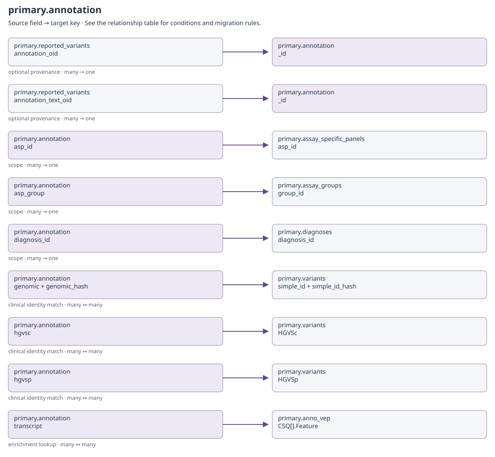

[Open full-size diagram](../../assets/diagrams/collection-dependencies/primary-annotation.svg)

### Outgoing dependencies

| Source field | Target key | Relationship / multiplicity | Migration and resolution semantics | Evidence |
| --- | --- | --- | --- | --- |
| [primary.annotation](clinical.md#primary-annotation): `asp_id` | [primary.assay_specific_panels](configuration.md#primary-assay-specific-panels): `asp_id` | scope; many → one | Annotation scope also includes namespace (clinical/sandboxed). asp_id may be null; base diagnosis is implicit. | [S23](#s23) |
| [primary.annotation](clinical.md#primary-annotation): `asp_group` | [primary.assay_groups](configuration.md#primary-assay-groups): `group_id` | scope; many → one | Annotation scope also includes namespace (clinical/sandboxed). asp_id may be null; base diagnosis is implicit. | [S23](#s23) |
| [primary.annotation](clinical.md#primary-annotation): `diagnosis_id` | [primary.diagnoses](configuration.md#primary-diagnoses): `diagnosis_id` | scope; many → one | Annotation scope also includes namespace (clinical/sandboxed). asp_id may be null; base diagnosis is implicit. | [S23](#s23) |
| [primary.annotation](clinical.md#primary-annotation): `genomic + genomic_hash` | [primary.variants](clinical.md#primary-variants): `simple_id + simple_id_hash` | clinical identity match; many ↔ many | Not a foreign key to one finding: match according to nomenclature, gene/transcript and interpretation scope. An annotation can apply across samples. | [S23](#s23) |
| [primary.annotation](clinical.md#primary-annotation): `hgvsc` | [primary.variants](clinical.md#primary-variants): `HGVSc` | clinical identity match; many ↔ many | Not a foreign key to one finding: match according to nomenclature, gene/transcript and interpretation scope. An annotation can apply across samples. | [S23](#s23) |
| [primary.annotation](clinical.md#primary-annotation): `hgvsp` | [primary.variants](clinical.md#primary-variants): `HGVSp` | clinical identity match; many ↔ many | Not a foreign key to one finding: match according to nomenclature, gene/transcript and interpretation scope. An annotation can apply across samples. | [S23](#s23) |
| [primary.annotation](clinical.md#primary-annotation): `transcript` | [primary.anno_vep](clinical.md#primary-anno-vep): `CSQ[].Feature` | enrichment lookup; many ↔ many | Resolve the correct genomic identity and VEP release first, then the matching transcript. Annotation does not store anno_vep._id. | [S23](#s23) |
| [primary.annotation](clinical.md#primary-annotation): `created_by + updated_by + author` | [identity.users](identity.md#identity-users): `username` | historical actor; many → historical identity | Only populated actor fields apply. Preserve system and historical usernames even if no current account exists; never substitute the migration user. | [S20](#s20) |

### Incoming references and migration impact

| Source field | Target key | Relationship / multiplicity | Migration and resolution semantics | Evidence |
| --- | --- | --- | --- | --- |
| [primary.reported_variants](clinical.md#primary-reported-variants): `annotation_oid` | [primary.annotation](clinical.md#primary-annotation): `_id` | optional provenance; many → one | Selected classification or annotation text source. Retain the saved wording/tier even when a source changes. | [S18](#s18) |
| [primary.reported_variants](clinical.md#primary-reported-variants): `annotation_text_oid` | [primary.annotation](clinical.md#primary-annotation): `_id` | optional provenance; many → one | Selected classification or annotation text source. Retain the saved wording/tier even when a source changes. | [S18](#s18) |

## primary.biomarkers

Binding: `biomarkers_collection`.

Sample biomarker results with absent optional assays removed after validation.

Declared top-level fields: `created_by`, `updated_by`, `system_installed`, `SAMPLE_ID`, `name`, `MSIS`, `MSIP`, `HRD`, `TMB`.

[Field types and validation](../mongodb-collections.md#biomarkers). `_id` may also be retained by an open collection model.

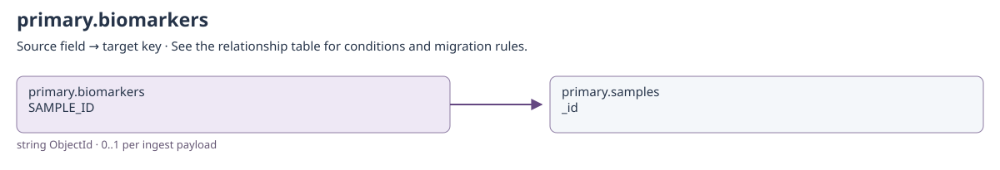

[Open full-size diagram](../../assets/diagrams/collection-dependencies/primary-biomarkers.svg)

### Outgoing dependencies

| Source field | Target key | Relationship / multiplicity | Migration and resolution semantics | Evidence |
| --- | --- | --- | --- | --- |
| [primary.biomarkers](clinical.md#primary-biomarkers): `SAMPLE_ID` | [primary.samples](clinical.md#primary-samples): `_id` | string ObjectId; 0..1 per ingest payload | SAMPLE_ID stores str(samples._id), not samples.name. Multiple evidence rows may share a sample; preserve the original sample ObjectId and remap only with a complete identity map. | [S20](#s20) |
| [primary.biomarkers](clinical.md#primary-biomarkers): `created_by + updated_by` | [identity.users](identity.md#identity-users): `username` | historical actor; many → historical identity | Only populated actor fields apply. Preserve system and historical usernames even if no current account exists; never substitute the migration user. | [S20](#s20) |

### Incoming references and migration impact

No cross-collection business reference is declared in this catalog for this direction.

## primary.cnvs

Binding: `cnvs_collection`.

Sample-scoped copy-number interval with ratio, genes, probes, and callers.

Declared top-level fields: `created_by`, `updated_by`, `system_installed`, `SAMPLE_ID`, `chr`, `start`, `end`, `size`, `ratio`, `type`, `nprobes`, `genes`, `callers`.

[Field types and validation](../mongodb-collections.md#cnvs). `_id` may also be retained by an open collection model.

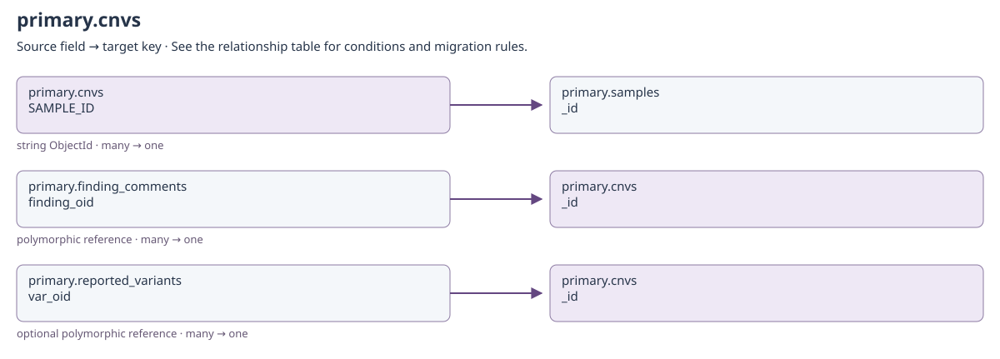

[Open full-size diagram](../../assets/diagrams/collection-dependencies/primary-cnvs.svg)

### Outgoing dependencies

| Source field | Target key | Relationship / multiplicity | Migration and resolution semantics | Evidence |
| --- | --- | --- | --- | --- |
| [primary.cnvs](clinical.md#primary-cnvs): `SAMPLE_ID` | [primary.samples](clinical.md#primary-samples): `_id` | string ObjectId; many → one | SAMPLE_ID stores str(samples._id), not samples.name. Multiple evidence rows may share a sample; preserve the original sample ObjectId and remap only with a complete identity map. | [S20](#s20) |
| [primary.cnvs](clinical.md#primary-cnvs): `created_by + updated_by` | [identity.users](identity.md#identity-users): `username` | historical actor; many → historical identity | Only populated actor fields apply. Preserve system and historical usernames even if no current account exists; never substitute the migration user. | [S20](#s20) |

### Incoming references and migration impact

| Source field | Target key | Relationship / multiplicity | Migration and resolution semantics | Evidence |
| --- | --- | --- | --- | --- |
| [primary.finding_comments](clinical.md#primary-finding-comments): `finding_oid` | [primary.cnvs](clinical.md#primary-cnvs): `_id` | polymorphic reference; many → one | Only when finding_type=cnv; verify the finding's SAMPLE_ID also equals str(sample_oid). | [S8](#s8) |
| [primary.reported_variants](clinical.md#primary-reported-variants): `var_oid` | [primary.cnvs](clinical.md#primary-cnvs): `_id` | optional polymorphic reference; many → one | Target depends on analysis_type/finding_type. Snapshot-only measurements can have no var_oid; preserve the captured result. | [S18](#s18) |

## primary.d4_coverage

Binding: `d4_coverage_collection`.

D4-derived transcript, exon, CDS, and probe coverage for one sample.

Declared top-level fields: `created_by`, `updated_by`, `system_installed`, `genes`, `SAMPLE_ID`, `sample`.

[Field types and validation](../mongodb-collections.md#d4_coverage). `_id` may also be retained by an open collection model.

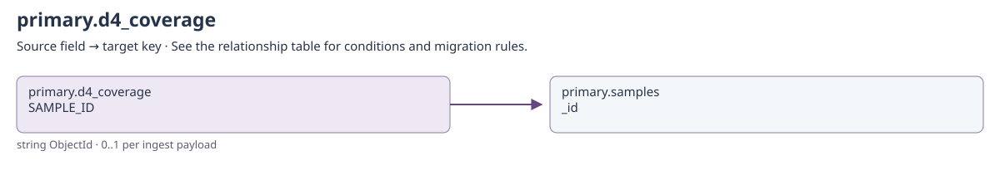

[Open full-size diagram](../../assets/diagrams/collection-dependencies/primary-d4-coverage.svg)

### Outgoing dependencies

| Source field | Target key | Relationship / multiplicity | Migration and resolution semantics | Evidence |
| --- | --- | --- | --- | --- |
| [primary.d4_coverage](clinical.md#primary-d4-coverage): `SAMPLE_ID` | [primary.samples](clinical.md#primary-samples): `_id` | string ObjectId; 0..1 per ingest payload | SAMPLE_ID stores str(samples._id), not samples.name. Multiple evidence rows may share a sample; preserve the original sample ObjectId and remap only with a complete identity map. | [S20](#s20) |
| [primary.d4_coverage](clinical.md#primary-d4-coverage): `created_by + updated_by` | [identity.users](identity.md#identity-users): `username` | historical actor; many → historical identity | Only populated actor fields apply. Preserve system and historical usernames even if no current account exists; never substitute the migration user. | [S20](#s20) |

### Incoming references and migration impact

No cross-collection business reference is declared in this catalog for this direction.

## primary.finding_comments

Binding: `finding_comments_collection`.

Finding-level comment with retained display identity and hiding metadata.

Declared top-level fields: `created_by`, `updated_by`, `system_installed`, `sample_oid`, `sample_name`, `finding_oid`, `finding_type`, `nomenclature`, `variant`, `hgvsp`, `hgvsc`, `genomic`, `genomic_hash`, `gene`, `transcript`, `gene1`, `gene2`, `author`, `text`, `hidden`, `hidden_by`, `time_created`, `time_hidden`.

[Field types and validation](../mongodb-collections.md#finding_comments). `_id` may also be retained by an open collection model.

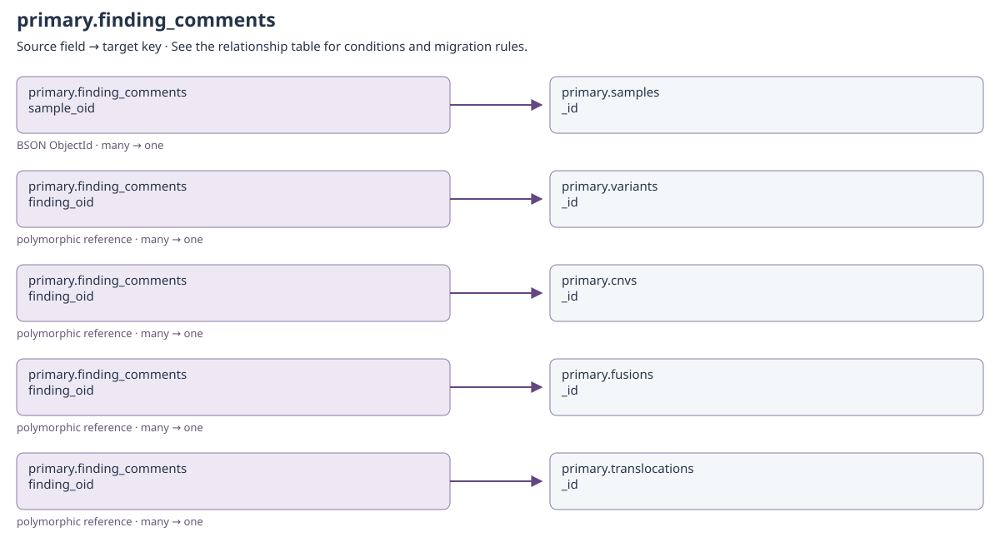

[Open full-size diagram](../../assets/diagrams/collection-dependencies/primary-finding-comments.svg)

### Outgoing dependencies

| Source field | Target key | Relationship / multiplicity | Migration and resolution semantics | Evidence |
| --- | --- | --- | --- | --- |
| [primary.finding_comments](clinical.md#primary-finding-comments): `sample_oid` | [primary.samples](clinical.md#primary-samples): `_id` | BSON ObjectId; many → one | Stored owner reference; sample_name is display/search provenance, not the identity join. | [S9](#s9) |
| [primary.finding_comments](clinical.md#primary-finding-comments): `finding_oid` | [primary.variants](clinical.md#primary-variants): `_id` | polymorphic reference; many → one | Only when finding_type=small_variant; verify the finding's SAMPLE_ID also equals str(sample_oid). | [S8](#s8) |
| [primary.finding_comments](clinical.md#primary-finding-comments): `finding_oid` | [primary.cnvs](clinical.md#primary-cnvs): `_id` | polymorphic reference; many → one | Only when finding_type=cnv; verify the finding's SAMPLE_ID also equals str(sample_oid). | [S8](#s8) |
| [primary.finding_comments](clinical.md#primary-finding-comments): `finding_oid` | [primary.fusions](clinical.md#primary-fusions): `_id` | polymorphic reference; many → one | Only when finding_type=fusion; verify the finding's SAMPLE_ID also equals str(sample_oid). | [S8](#s8) |
| [primary.finding_comments](clinical.md#primary-finding-comments): `finding_oid` | [primary.translocations](clinical.md#primary-translocations): `_id` | polymorphic reference; many → one | Only when finding_type=translocation; verify the finding's SAMPLE_ID also equals str(sample_oid). | [S8](#s8) |
| [primary.finding_comments](clinical.md#primary-finding-comments): `created_by + updated_by + author + hidden_by` | [identity.users](identity.md#identity-users): `username` | historical actor; many → historical identity | Only populated actor fields apply. Preserve system and historical usernames even if no current account exists; never substitute the migration user. | [S20](#s20) |

### Incoming references and migration impact

No cross-collection business reference is declared in this catalog for this direction.

## primary.fusions

Binding: `fusions_collection`.

Sample-scoped gene-pair fusion with caller evidence and review flags.

Declared top-level fields: `created_by`, `updated_by`, `system_installed`, `SAMPLE_ID`, `gene1`, `gene2`, `genes`, `fp`, `irrelevant`, `interesting`, `blacklisted`, `calls`.

[Field types and validation](../mongodb-collections.md#fusions). `_id` may also be retained by an open collection model.

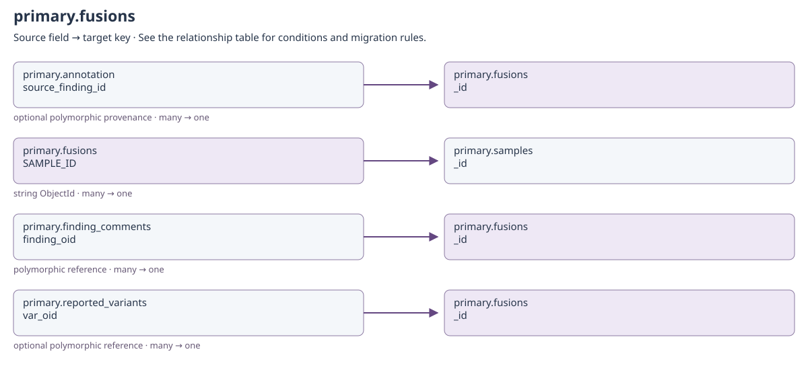

[Open full-size diagram](../../assets/diagrams/collection-dependencies/primary-fusions.svg)

### Outgoing dependencies

| Source field | Target key | Relationship / multiplicity | Migration and resolution semantics | Evidence |
| --- | --- | --- | --- | --- |
| [primary.fusions](clinical.md#primary-fusions): `SAMPLE_ID` | [primary.samples](clinical.md#primary-samples): `_id` | string ObjectId; many → one | SAMPLE_ID stores str(samples._id), not samples.name. Multiple evidence rows may share a sample; preserve the original sample ObjectId and remap only with a complete identity map. | [S20](#s20) |
| [primary.fusions](clinical.md#primary-fusions): `created_by + updated_by` | [identity.users](identity.md#identity-users): `username` | historical actor; many → historical identity | Only populated actor fields apply. Preserve system and historical usernames even if no current account exists; never substitute the migration user. | [S20](#s20) |

### Incoming references and migration impact

| Source field | Target key | Relationship / multiplicity | Migration and resolution semantics | Evidence |
| --- | --- | --- | --- | --- |
| [primary.finding_comments](clinical.md#primary-finding-comments): `finding_oid` | [primary.fusions](clinical.md#primary-fusions): `_id` | polymorphic reference; many → one | Only when finding_type=fusion; verify the finding's SAMPLE_ID also equals str(sample_oid). | [S8](#s8) |
| [primary.reported_variants](clinical.md#primary-reported-variants): `var_oid` | [primary.fusions](clinical.md#primary-fusions): `_id` | optional polymorphic reference; many → one | Target depends on analysis_type/finding_type. Snapshot-only measurements can have no var_oid; preserve the captured result. | [S18](#s18) |

## primary.pgx

Binding: `pgx_collection`.

Sample-scoped PGX payload preserved from the declared ingest result.

Declared top-level fields: `created_by`, `updated_by`, `system_installed`, `SAMPLE_ID`.

[Field types and validation](../mongodb-collections.md#pgx). `_id` may also be retained by an open collection model.

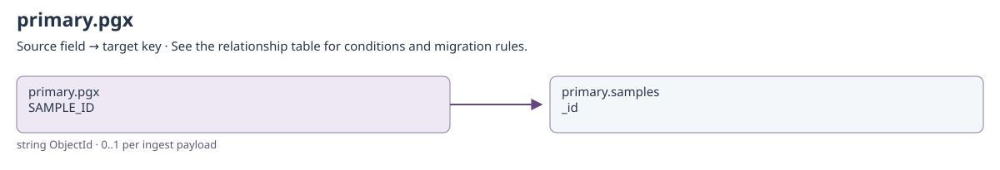

[Open full-size diagram](../../assets/diagrams/collection-dependencies/primary-pgx.svg)

### Outgoing dependencies

| Source field | Target key | Relationship / multiplicity | Migration and resolution semantics | Evidence |
| --- | --- | --- | --- | --- |
| [primary.pgx](clinical.md#primary-pgx): `SAMPLE_ID` | [primary.samples](clinical.md#primary-samples): `_id` | string ObjectId; 0..1 per ingest payload | SAMPLE_ID stores str(samples._id), not samples.name. Multiple evidence rows may share a sample; preserve the original sample ObjectId and remap only with a complete identity map. | [S20](#s20) |
| [primary.pgx](clinical.md#primary-pgx): `created_by + updated_by` | [identity.users](identity.md#identity-users): `username` | historical actor; many → historical identity | Only populated actor fields apply. Preserve system and historical usernames even if no current account exists; never substitute the migration user. | [S20](#s20) |

### Incoming references and migration impact

No cross-collection business reference is declared in this catalog for this direction.

## primary.reported_variants

Binding: `reported_variants_collection`.

Immutable, explicitly typed finding included in a saved report.

Declared top-level fields: `created_by`, `updated_by`, `system_installed`, `_id`, `report_id`, `report_num`, `sample_name`, `report_oid`, `sample_oid`, `assay`, `assay_group`, `diagnosis`, `environment`, `analysis_type`, `analysis_intent`, `finding_type`, `var_oid`, `annotation_oid`, `annotation_text_oid`, `sample_comment_oid`, `simple_id`, `simple_id_hash`, `genes`, `gene`, `gene1`, `gene2`, `transcript`, `hgvsc`, `hgvsp`, `genomic`, `nomenclature`, `variant`, `var_type`, `tier`, `region`, `chromosome`, `start`, `end`, `size`, `cnv_type`, `ratio`, `nprobes`, `source_id`, `position`, `ref`, `alt`, `breakpoint`, `breakpoint_1`, `breakpoint_2`, `fusion`, `effect`, `spanning_pairs`, `spanning_reads`, `longest_anchor`, `callers`, `classification`, `text`, `biomarker`, `result`, `pgx_result`, `diplotype`, `phenotype`, `activity_score`, `recommendation`, `created_on`.

[Field types and validation](../mongodb-collections.md#reported_variants). `_id` may also be retained by an open collection model.

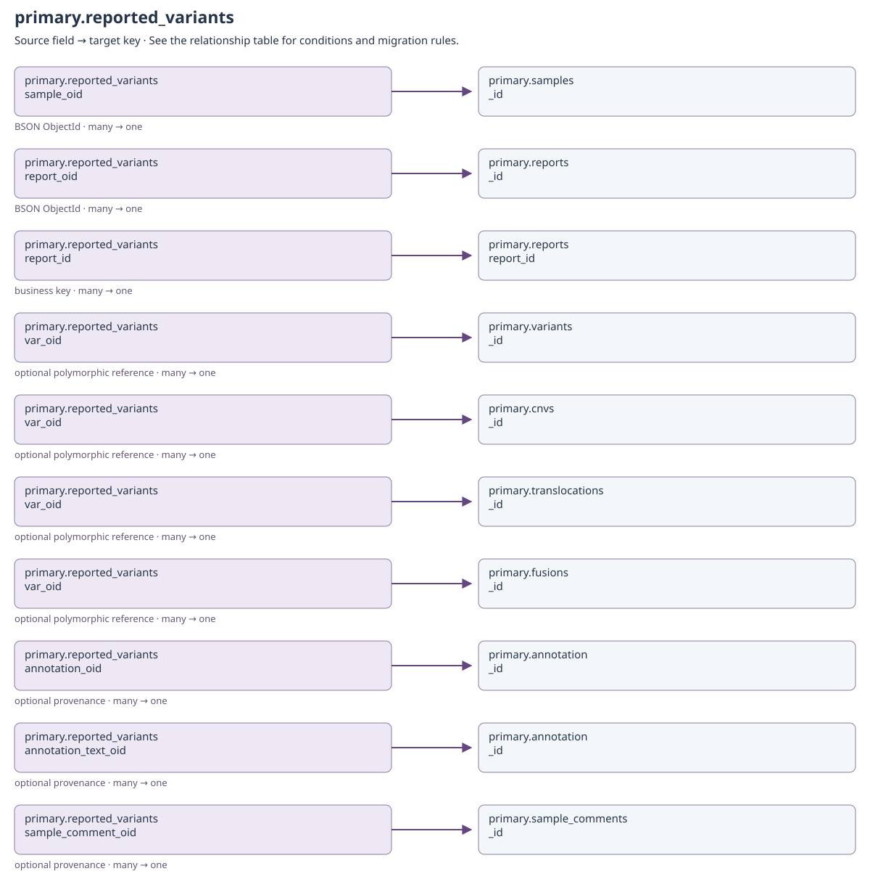

[Open full-size diagram](../../assets/diagrams/collection-dependencies/primary-reported-variants.svg)

### Outgoing dependencies

| Source field | Target key | Relationship / multiplicity | Migration and resolution semantics | Evidence |
| --- | --- | --- | --- | --- |
| [primary.reported_variants](clinical.md#primary-reported-variants): `sample_oid` | [primary.samples](clinical.md#primary-samples): `_id` | BSON ObjectId; many → one | Stored owner reference; sample_name is display/search provenance, not the identity join. | [S11](#s11) |
| [primary.reported_variants](clinical.md#primary-reported-variants): `report_oid` | [primary.reports](clinical.md#primary-reports): `_id` | BSON ObjectId; many → one | Exact report owner, accompanied by report_id and report_num. Never rebuild saved findings by querying current annotations. | [S11](#s11) |
| [primary.reported_variants](clinical.md#primary-reported-variants): `report_id` | [primary.reports](clinical.md#primary-reports): `report_id` | business key; many → one | Human/report export identity; retain together with report_oid and sample_oid. | [S18](#s18) |
| [primary.reported_variants](clinical.md#primary-reported-variants): `var_oid` | [primary.variants](clinical.md#primary-variants): `_id` | optional polymorphic reference; many → one | Target depends on analysis_type/finding_type. Snapshot-only measurements can have no var_oid; preserve the captured result. | [S18](#s18) |
| [primary.reported_variants](clinical.md#primary-reported-variants): `var_oid` | [primary.cnvs](clinical.md#primary-cnvs): `_id` | optional polymorphic reference; many → one | Target depends on analysis_type/finding_type. Snapshot-only measurements can have no var_oid; preserve the captured result. | [S18](#s18) |
| [primary.reported_variants](clinical.md#primary-reported-variants): `var_oid` | [primary.translocations](clinical.md#primary-translocations): `_id` | optional polymorphic reference; many → one | Target depends on analysis_type/finding_type. Snapshot-only measurements can have no var_oid; preserve the captured result. | [S18](#s18) |
| [primary.reported_variants](clinical.md#primary-reported-variants): `var_oid` | [primary.fusions](clinical.md#primary-fusions): `_id` | optional polymorphic reference; many → one | Target depends on analysis_type/finding_type. Snapshot-only measurements can have no var_oid; preserve the captured result. | [S18](#s18) |
| [primary.reported_variants](clinical.md#primary-reported-variants): `annotation_oid` | [primary.annotation](clinical.md#primary-annotation): `_id` | optional provenance; many → one | Selected classification or annotation text source. Retain the saved wording/tier even when a source changes. | [S18](#s18) |
| [primary.reported_variants](clinical.md#primary-reported-variants): `annotation_text_oid` | [primary.annotation](clinical.md#primary-annotation): `_id` | optional provenance; many → one | Selected classification or annotation text source. Retain the saved wording/tier even when a source changes. | [S18](#s18) |
| [primary.reported_variants](clinical.md#primary-reported-variants): `sample_comment_oid` | [primary.sample_comments](clinical.md#primary-sample-comments): `_id` | optional provenance; many → one | Source sample comment for this saved report item. | [S18](#s18) |
| [primary.reported_variants](clinical.md#primary-reported-variants): `created_by + updated_by` | [identity.users](identity.md#identity-users): `username` | historical actor; many → historical identity | Only populated actor fields apply. Preserve system and historical usernames even if no current account exists; never substitute the migration user. | [S20](#s20) |

### Incoming references and migration impact

No cross-collection business reference is declared in this catalog for this direction.

## primary.reports

Binding: `reports_collection`.

Saved report reference with sample scope and filter/configuration snapshots.

Declared top-level fields: `created_by`, `updated_by`, `system_installed`, `sample_oid`, `sample_name`, `asp_id`, `diagnosis_id`, `environment`, `report_num`, `report_id`, `report_type`, `report_name`, `filepath`, `author`, `time_created`, `filters_snapshot`, `aspc`, `clinical_rule_source`, `resolution_snapshot`, `artifacts`, `sample_version`.

[Field types and validation](../mongodb-collections.md#reports). `_id` may also be retained by an open collection model.

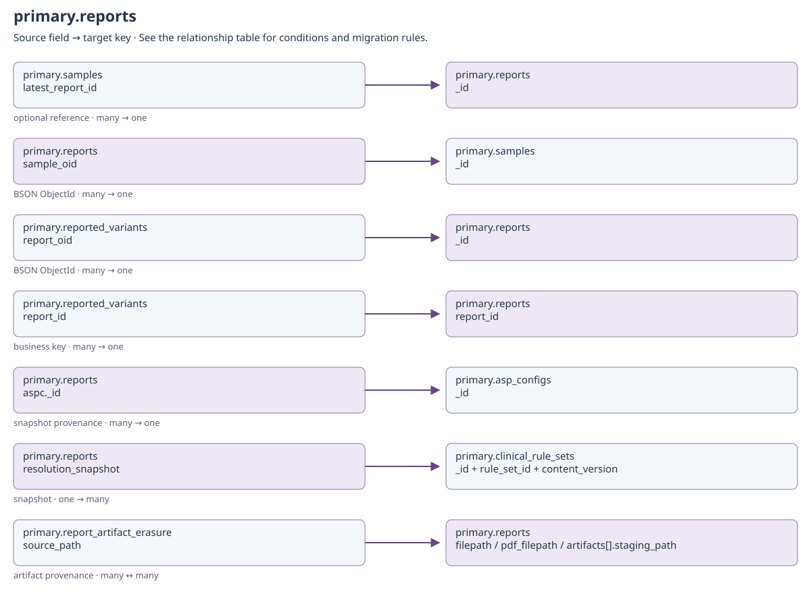

[Open full-size diagram](../../assets/diagrams/collection-dependencies/primary-reports.svg)

### Outgoing dependencies

| Source field | Target key | Relationship / multiplicity | Migration and resolution semantics | Evidence |
| --- | --- | --- | --- | --- |
| [primary.reports](clinical.md#primary-reports): `sample_oid` | [primary.samples](clinical.md#primary-samples): `_id` | BSON ObjectId; many → one | Stored owner reference; sample_name is display/search provenance, not the identity join. | [S12](#s12) |
| [primary.reports](clinical.md#primary-reports): `aspc._id` | [primary.asp_configs](configuration.md#primary-asp-configs): `_id` | snapshot provenance; many → one | Report's applied configuration receipt, not today's sample configuration. | [S12](#s12) |
| [primary.reports](clinical.md#primary-reports): `resolution_snapshot` | [primary.clinical_rule_sets](workflows.md#primary-clinical-rule-sets): `_id + rule_set_id + content_version` | snapshot; one → many | Nested captured rule resolution and evidence; hashes and content remain tied to the saved report. This object is not a scalar foreign key. | [S12](#s12) |
| [primary.reports](clinical.md#primary-reports): `created_by + updated_by + author` | [identity.users](identity.md#identity-users): `username` | historical actor; many → historical identity | Only populated actor fields apply. Preserve system and historical usernames even if no current account exists; never substitute the migration user. | [S20](#s20) |

### Incoming references and migration impact

| Source field | Target key | Relationship / multiplicity | Migration and resolution semantics | Evidence |
| --- | --- | --- | --- | --- |
| [primary.samples](clinical.md#primary-samples): `latest_report_id` | [primary.reports](clinical.md#primary-reports): `_id` | optional reference; many → one | BSON ObjectId of latest saved report; absent before reporting. Backfill only after reports are restored. | [S12](#s12) |
| [primary.reported_variants](clinical.md#primary-reported-variants): `report_oid` | [primary.reports](clinical.md#primary-reports): `_id` | BSON ObjectId; many → one | Exact report owner, accompanied by report_id and report_num. Never rebuild saved findings by querying current annotations. | [S11](#s11) |
| [primary.reported_variants](clinical.md#primary-reported-variants): `report_id` | [primary.reports](clinical.md#primary-reports): `report_id` | business key; many → one | Human/report export identity; retain together with report_oid and sample_oid. | [S18](#s18) |
| [primary.report_artifact_erasure](operations.md#primary-report-artifact-erasure): `source_path` | [primary.reports](clinical.md#primary-reports): `filepath / pdf_filepath / artifacts[].staging_path` | artifact provenance; many ↔ many | Captured path, not a live foreign key after deletion; root/device/inode safeguards must still agree on recovery. | [S10](#s10) |

## primary.rna_classification

Binding: `rna_classification_collection`.

Sample classifier results tied to the classifier version.

Declared top-level fields: `created_by`, `updated_by`, `system_installed`, `classifier_results`, `classifier_version`, `SAMPLE_ID`.

[Field types and validation](../mongodb-collections.md#rna_classification). `_id` may also be retained by an open collection model.

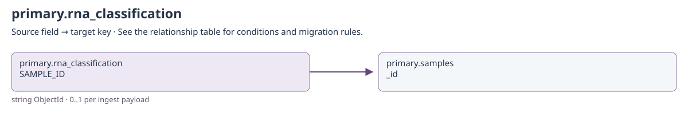

[Open full-size diagram](../../assets/diagrams/collection-dependencies/primary-rna-classification.svg)

### Outgoing dependencies

| Source field | Target key | Relationship / multiplicity | Migration and resolution semantics | Evidence |
| --- | --- | --- | --- | --- |
| [primary.rna_classification](clinical.md#primary-rna-classification): `SAMPLE_ID` | [primary.samples](clinical.md#primary-samples): `_id` | string ObjectId; 0..1 per ingest payload | SAMPLE_ID stores str(samples._id), not samples.name. Multiple evidence rows may share a sample; preserve the original sample ObjectId and remap only with a complete identity map. | [S20](#s20) |
| [primary.rna_classification](clinical.md#primary-rna-classification): `created_by + updated_by` | [identity.users](identity.md#identity-users): `username` | historical actor; many → historical identity | Only populated actor fields apply. Preserve system and historical usernames even if no current account exists; never substitute the migration user. | [S20](#s20) |

### Incoming references and migration impact

No cross-collection business reference is declared in this catalog for this direction.

## primary.rna_expression

Binding: `rna_expression_collection`.

Sample and reference gene-expression entries tied to an expression version.

Declared top-level fields: `created_by`, `updated_by`, `system_installed`, `sample`, `reference`, `expression_version`, `SAMPLE_ID`.

[Field types and validation](../mongodb-collections.md#rna_expression). `_id` may also be retained by an open collection model.

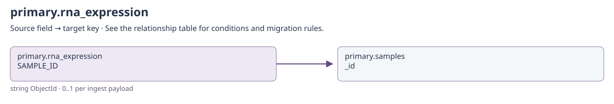

[Open full-size diagram](../../assets/diagrams/collection-dependencies/primary-rna-expression.svg)

### Outgoing dependencies

| Source field | Target key | Relationship / multiplicity | Migration and resolution semantics | Evidence |
| --- | --- | --- | --- | --- |
| [primary.rna_expression](clinical.md#primary-rna-expression): `SAMPLE_ID` | [primary.samples](clinical.md#primary-samples): `_id` | string ObjectId; 0..1 per ingest payload | SAMPLE_ID stores str(samples._id), not samples.name. Multiple evidence rows may share a sample; preserve the original sample ObjectId and remap only with a complete identity map. | [S20](#s20) |
| [primary.rna_expression](clinical.md#primary-rna-expression): `created_by + updated_by` | [identity.users](identity.md#identity-users): `username` | historical actor; many → historical identity | Only populated actor fields apply. Preserve system and historical usernames even if no current account exists; never substitute the migration user. | [S20](#s20) |

### Incoming references and migration impact

No cross-collection business reference is declared in this catalog for this direction.

## primary.rna_qc

Binding: `rna_qc_collection`.

RNA alignment, splicing, gene-body coverage, and provider-genotype metrics.

Declared top-level fields: `created_by`, `updated_by`, `system_installed`, `tot_reads`, `mapped_pct`, `multimap_pct`, `mismatch_pct`, `canon_splice`, `non_canon_splice`, `splice_ratio`, `genebody_cov`, `genebody_cov_slope`, `provider_genotypes`, `provider_called_genotypes`, `flendist`, `sample_id`, `SAMPLE_ID`.

[Field types and validation](../mongodb-collections.md#rna_qc). `_id` may also be retained by an open collection model.

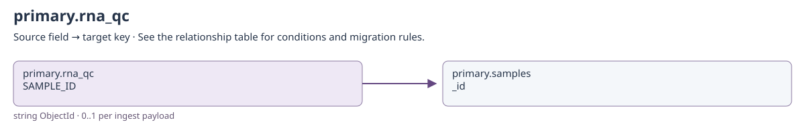

[Open full-size diagram](../../assets/diagrams/collection-dependencies/primary-rna-qc.svg)

### Outgoing dependencies

| Source field | Target key | Relationship / multiplicity | Migration and resolution semantics | Evidence |
| --- | --- | --- | --- | --- |
| [primary.rna_qc](clinical.md#primary-rna-qc): `SAMPLE_ID` | [primary.samples](clinical.md#primary-samples): `_id` | string ObjectId; 0..1 per ingest payload | SAMPLE_ID stores str(samples._id), not samples.name. Multiple evidence rows may share a sample; preserve the original sample ObjectId and remap only with a complete identity map. | [S20](#s20) |
| [primary.rna_qc](clinical.md#primary-rna-qc): `created_by + updated_by` | [identity.users](identity.md#identity-users): `username` | historical actor; many → historical identity | Only populated actor fields apply. Preserve system and historical usernames even if no current account exists; never substitute the migration user. | [S20](#s20) |

### Incoming references and migration impact

No cross-collection business reference is declared in this catalog for this direction.

## primary.sample_comments

Binding: `sample_comments_collection`.

Sample-level comment with authorship and hiding metadata.

Declared top-level fields: `created_by`, `updated_by`, `system_installed`, `sample_oid`, `sample_name`, `author`, `text`, `hidden`, `hidden_by`, `time_created`, `time_hidden`.

[Field types and validation](../mongodb-collections.md#sample_comments). `_id` may also be retained by an open collection model.

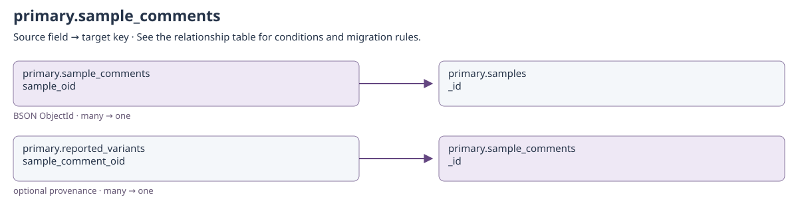

[Open full-size diagram](../../assets/diagrams/collection-dependencies/primary-sample-comments.svg)

### Outgoing dependencies

| Source field | Target key | Relationship / multiplicity | Migration and resolution semantics | Evidence |
| --- | --- | --- | --- | --- |
| [primary.sample_comments](clinical.md#primary-sample-comments): `sample_oid` | [primary.samples](clinical.md#primary-samples): `_id` | BSON ObjectId; many → one | Stored owner reference; sample_name is display/search provenance, not the identity join. | [S13](#s13) |
| [primary.sample_comments](clinical.md#primary-sample-comments): `created_by + updated_by + author + hidden_by` | [identity.users](identity.md#identity-users): `username` | historical actor; many → historical identity | Only populated actor fields apply. Preserve system and historical usernames even if no current account exists; never substitute the migration user. | [S20](#s20) |

### Incoming references and migration impact

| Source field | Target key | Relationship / multiplicity | Migration and resolution semantics | Evidence |
| --- | --- | --- | --- | --- |
| [primary.reported_variants](clinical.md#primary-reported-variants): `sample_comment_oid` | [primary.sample_comments](clinical.md#primary-sample-comments): `_id` | optional provenance; many → one | Source sample comment for this saved report item. | [S18](#s18) |

## primary.samples

Binding: `samples_collection`.

Sample ingest contract linking clinical scope, files, filters, and case/control metadata.

case_id, control_id, case.id and control.id describe sample material/case-control identifiers; they are not self-references to samples._id. The primary samples collection and BAM-service samples collection are different namespaces.

Declared top-level fields: `created_by`, `updated_by`, `system_installed`, `name`, `version`, `asp_id`, `diagnosis_id`, `environment`, `current_aspc_id`, `current_aspc_name`, `aspc_resolution`, `genome_build`, `database_versions`, `case_id`, `control_id`, `sample_no`, `paired`, `asp_family`, `asp_category`, `sex`, `platform`, `read_mode`, `read_technology`, `pipeline`, `pipeline_version`, `files`, `missing_expected_files`, `analysis_intents`, `filters`, `case`, `control`, `ingest_status`, `reported`, `latest_report_id`, `latest_report_on`, `time_added`, `ingested_by`, `ingest_source`.

[Field types and validation](../mongodb-collections.md#samples). `_id` may also be retained by an open collection model.

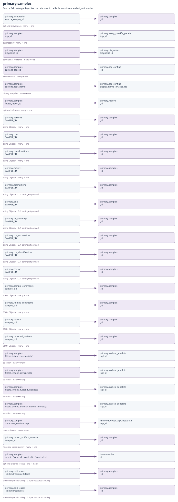

[Open full-size diagram](../../assets/diagrams/collection-dependencies/primary-samples.svg)

### Outgoing dependencies

| Source field | Target key | Relationship / multiplicity | Migration and resolution semantics | Evidence |
| --- | --- | --- | --- | --- |
| [primary.samples](clinical.md#primary-samples): `asp_id` | [primary.assay_specific_panels](configuration.md#primary-assay-specific-panels): `asp_id` | business key; many → one | Sample assay context. Do not replace with display_name. | [S21](#s21) |
| [primary.samples](clinical.md#primary-samples): `diagnosis_id` | [primary.diagnoses](configuration.md#primary-diagnoses): `diagnosis_id` | conditional reference; many → one | Named diagnosis only; base is an implicit scope. Preserve aspc_resolution.resolved_diagnosis_id separately when configuration falls back to base. | [S21](#s21) |
| [primary.samples](clinical.md#primary-samples): `current_aspc_id` | [primary.asp_configs](configuration.md#primary-asp-configs): `_id` | exact revision; many → one | Applied configuration document identity. Do not replace with the newest revision or with aspc_id. | [S21](#s21) |
| [primary.samples](clinical.md#primary-samples): `current_aspc_name` | [primary.asp_configs](configuration.md#primary-asp-configs): `display_name (or aspc_id)` | display snapshot; many → one | Not a join key: ingestion stores display_name, falling back to aspc_id. Use current_aspc_id for exact configuration resolution. | [S14](#s14) |
| [primary.samples](clinical.md#primary-samples): `latest_report_id` | [primary.reports](clinical.md#primary-reports): `_id` | optional reference; many → one | BSON ObjectId of latest saved report; absent before reporting. Backfill only after reports are restored. | [S12](#s12) |
| [primary.samples](clinical.md#primary-samples): `filters.{intent}.snv.snvlists[]` | [primary.insilico_genelists](configuration.md#primary-insilico-genelists): `isgl_id` | selection; many ↔ many | Only supported analysis/intent sections apply. Runtime list content comes from the applied ASPC's gene_list_release; this is not permission to substitute the newest live list. | [S24](#s24) |
| [primary.samples](clinical.md#primary-samples): `filters.{intent}.cnv.cnvlists[]` | [primary.insilico_genelists](configuration.md#primary-insilico-genelists): `isgl_id` | selection; many ↔ many | Only supported analysis/intent sections apply. Runtime list content comes from the applied ASPC's gene_list_release; this is not permission to substitute the newest live list. | [S24](#s24) |
| [primary.samples](clinical.md#primary-samples): `filters.{intent}.fusion.fusionlists[]` | [primary.insilico_genelists](configuration.md#primary-insilico-genelists): `isgl_id` | selection; many ↔ many | Only supported analysis/intent sections apply. Runtime list content comes from the applied ASPC's gene_list_release; this is not permission to substitute the newest live list. | [S24](#s24) |
| [primary.samples](clinical.md#primary-samples): `filters.{intent}.translocation.fusionlists[]` | [primary.insilico_genelists](configuration.md#primary-insilico-genelists): `isgl_id` | selection; many ↔ many | Only supported analysis/intent sections apply. Runtime list content comes from the applied ASPC's gene_list_release; this is not permission to substitute the newest live list. | [S24](#s24) |
| [primary.samples](clinical.md#primary-samples): `database_versions.vep` | [knowledgebase.vep_metadata](knowledgebase.md#knowledgebase-vep-metadata): `vep_id` | release lookup; many → one | Normalize equivalent numeric release labels with vep_metadata_release; preserve nonzero minor versions. | [S17](#s17) |
| [primary.samples](clinical.md#primary-samples): `case.id / case_id + control.id / control_id` | [bam.samples](operations.md#bam-samples): `id` | optional external lookup; one → many | Use authorized case/control identifiers, never the primary sample ObjectId. Returns BAM paths; configured ASP folders can supply alignments without BAM service. | [S16](#s16) |
| [primary.samples](clinical.md#primary-samples): `created_by + updated_by` | [identity.users](identity.md#identity-users): `username` | historical actor; many → historical identity | Only populated actor fields apply. Preserve system and historical usernames even if no current account exists; never substitute the migration user. | [S20](#s20) |

### Incoming references and migration impact

| Source field | Target key | Relationship / multiplicity | Migration and resolution semantics | Evidence |
| --- | --- | --- | --- | --- |
| [primary.variants](clinical.md#primary-variants): `SAMPLE_ID` | [primary.samples](clinical.md#primary-samples): `_id` | string ObjectId; many → one | SAMPLE_ID stores str(samples._id), not samples.name. Multiple evidence rows may share a sample; preserve the original sample ObjectId and remap only with a complete identity map. | [S20](#s20) |
| [primary.cnvs](clinical.md#primary-cnvs): `SAMPLE_ID` | [primary.samples](clinical.md#primary-samples): `_id` | string ObjectId; many → one | SAMPLE_ID stores str(samples._id), not samples.name. Multiple evidence rows may share a sample; preserve the original sample ObjectId and remap only with a complete identity map. | [S20](#s20) |
| [primary.translocations](clinical.md#primary-translocations): `SAMPLE_ID` | [primary.samples](clinical.md#primary-samples): `_id` | string ObjectId; many → one | SAMPLE_ID stores str(samples._id), not samples.name. Multiple evidence rows may share a sample; preserve the original sample ObjectId and remap only with a complete identity map. | [S20](#s20) |
| [primary.fusions](clinical.md#primary-fusions): `SAMPLE_ID` | [primary.samples](clinical.md#primary-samples): `_id` | string ObjectId; many → one | SAMPLE_ID stores str(samples._id), not samples.name. Multiple evidence rows may share a sample; preserve the original sample ObjectId and remap only with a complete identity map. | [S20](#s20) |
| [primary.biomarkers](clinical.md#primary-biomarkers): `SAMPLE_ID` | [primary.samples](clinical.md#primary-samples): `_id` | string ObjectId; 0..1 per ingest payload | SAMPLE_ID stores str(samples._id), not samples.name. Multiple evidence rows may share a sample; preserve the original sample ObjectId and remap only with a complete identity map. | [S20](#s20) |
| [primary.pgx](clinical.md#primary-pgx): `SAMPLE_ID` | [primary.samples](clinical.md#primary-samples): `_id` | string ObjectId; 0..1 per ingest payload | SAMPLE_ID stores str(samples._id), not samples.name. Multiple evidence rows may share a sample; preserve the original sample ObjectId and remap only with a complete identity map. | [S20](#s20) |
| [primary.d4_coverage](clinical.md#primary-d4-coverage): `SAMPLE_ID` | [primary.samples](clinical.md#primary-samples): `_id` | string ObjectId; 0..1 per ingest payload | SAMPLE_ID stores str(samples._id), not samples.name. Multiple evidence rows may share a sample; preserve the original sample ObjectId and remap only with a complete identity map. | [S20](#s20) |
| [primary.rna_expression](clinical.md#primary-rna-expression): `SAMPLE_ID` | [primary.samples](clinical.md#primary-samples): `_id` | string ObjectId; 0..1 per ingest payload | SAMPLE_ID stores str(samples._id), not samples.name. Multiple evidence rows may share a sample; preserve the original sample ObjectId and remap only with a complete identity map. | [S20](#s20) |
| [primary.rna_classification](clinical.md#primary-rna-classification): `SAMPLE_ID` | [primary.samples](clinical.md#primary-samples): `_id` | string ObjectId; 0..1 per ingest payload | SAMPLE_ID stores str(samples._id), not samples.name. Multiple evidence rows may share a sample; preserve the original sample ObjectId and remap only with a complete identity map. | [S20](#s20) |
| [primary.rna_qc](clinical.md#primary-rna-qc): `SAMPLE_ID` | [primary.samples](clinical.md#primary-samples): `_id` | string ObjectId; 0..1 per ingest payload | SAMPLE_ID stores str(samples._id), not samples.name. Multiple evidence rows may share a sample; preserve the original sample ObjectId and remap only with a complete identity map. | [S20](#s20) |
| [primary.sample_comments](clinical.md#primary-sample-comments): `sample_oid` | [primary.samples](clinical.md#primary-samples): `_id` | BSON ObjectId; many → one | Stored owner reference; sample_name is display/search provenance, not the identity join. | [S13](#s13) |
| [primary.finding_comments](clinical.md#primary-finding-comments): `sample_oid` | [primary.samples](clinical.md#primary-samples): `_id` | BSON ObjectId; many → one | Stored owner reference; sample_name is display/search provenance, not the identity join. | [S9](#s9) |
| [primary.reports](clinical.md#primary-reports): `sample_oid` | [primary.samples](clinical.md#primary-samples): `_id` | BSON ObjectId; many → one | Stored owner reference; sample_name is display/search provenance, not the identity join. | [S12](#s12) |
| [primary.reported_variants](clinical.md#primary-reported-variants): `sample_oid` | [primary.samples](clinical.md#primary-samples): `_id` | BSON ObjectId; many → one | Stored owner reference; sample_name is display/search provenance, not the identity join. | [S11](#s11) |
| [primary.report_artifact_erasure](operations.md#primary-report-artifact-erasure): `sample_id` | [primary.samples](clinical.md#primary-samples): `_id` | historical string identity; many → one | Work is intentionally processed after sample/report deletion, so the parent can be absent. Preserve pending filesystem cleanup until reconciled. | [S10](#s10) |
| [primary.edit_leases](operations.md#primary-edit-leases): `_id (kind=sample-filters)` | [primary.samples](clinical.md#primary-samples): `_id` | encoded operational key; 0..1 per resource kind/key | Length-prefixed encoded identity; not a plain target ObjectId. Expiry/release makes the target editable again; no document backfill is needed. | [S15](#s15) |
| [primary.edit_leases](operations.md#primary-edit-leases): `_id (kind=samples)` | [primary.samples](clinical.md#primary-samples): `_id` | encoded operational key; 0..1 per resource kind/key | Length-prefixed encoded identity; not a plain target ObjectId. Expiry/release makes the target editable again; no document backfill is needed. | [S15](#s15) |

## primary.translocations

Binding: `transloc_collection`.

Sample-scoped structural variant with breakend, genotype, and annotation fields.

Declared top-level fields: `created_by`, `updated_by`, `system_installed`, `SAMPLE_ID`, `CHROM`, `POS`, `END`, `source_records`, `REF`, `ALT`, `FILTER`, `FORMAT`, `ID`, `QUAL`, `GT`, `INFO`, `fp`, `irrelevant`, `interesting`, `blacklisted`.

[Field types and validation](../mongodb-collections.md#translocations). `_id` may also be retained by an open collection model.

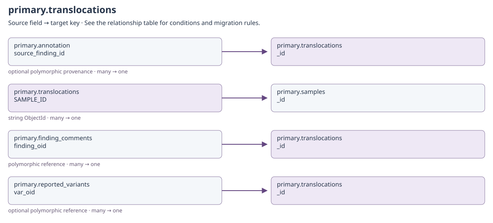

[Open full-size diagram](../../assets/diagrams/collection-dependencies/primary-translocations.svg)

### Outgoing dependencies

| Source field | Target key | Relationship / multiplicity | Migration and resolution semantics | Evidence |
| --- | --- | --- | --- | --- |
| [primary.translocations](clinical.md#primary-translocations): `SAMPLE_ID` | [primary.samples](clinical.md#primary-samples): `_id` | string ObjectId; many → one | SAMPLE_ID stores str(samples._id), not samples.name. Multiple evidence rows may share a sample; preserve the original sample ObjectId and remap only with a complete identity map. | [S20](#s20) |
| [primary.translocations](clinical.md#primary-translocations): `created_by + updated_by` | [identity.users](identity.md#identity-users): `username` | historical actor; many → historical identity | Only populated actor fields apply. Preserve system and historical usernames even if no current account exists; never substitute the migration user. | [S20](#s20) |

### Incoming references and migration impact

| Source field | Target key | Relationship / multiplicity | Migration and resolution semantics | Evidence |
| --- | --- | --- | --- | --- |
| [primary.finding_comments](clinical.md#primary-finding-comments): `finding_oid` | [primary.translocations](clinical.md#primary-translocations): `_id` | polymorphic reference; many → one | Only when finding_type=translocation; verify the finding's SAMPLE_ID also equals str(sample_oid). | [S8](#s8) |
| [primary.reported_variants](clinical.md#primary-reported-variants): `var_oid` | [primary.translocations](clinical.md#primary-translocations): `_id` | optional polymorphic reference; many → one | Target depends on analysis_type/finding_type. Snapshot-only measurements can have no var_oid; preserve the captured result. | [S18](#s18) |

## primary.variants

Binding: `variants_collection`.

Sample-scoped small variant with selected consequence and hashed genomic identity.

Declared top-level fields: `created_by`, `updated_by`, `system_installed`, `SAMPLE_ID`, `CHROM`, `POS`, `REF`, `ALT`, `ID`, `QUAL`, `FILTER`, `INFO`, `GT`, `gnomad_frequency`, `gnomad_max`, `exac_frequency`, `thousandG_frequency`, `variant_class`, `selected_csq_feature`, `genes`, `transcripts`, `HGVSc`, `HGVSp`, `consequence_terms`, `simple_id`, `simple_id_hash`, `cosmic_ids`, `dbsnp_id`, `pubmed_ids`, `hotspots`, `fp`, `irrelevant`, `interesting`.

[Field types and validation](../mongodb-collections.md#variants). `_id` may also be retained by an open collection model.

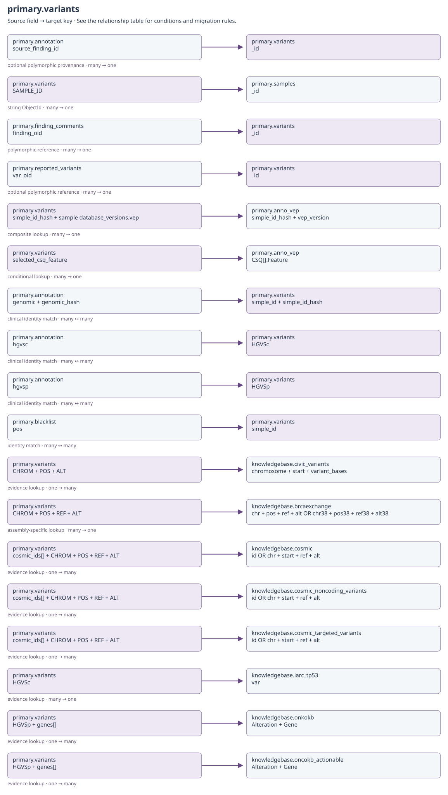

[Open full-size diagram](../../assets/diagrams/collection-dependencies/primary-variants.svg)

### Outgoing dependencies

| Source field | Target key | Relationship / multiplicity | Migration and resolution semantics | Evidence |
| --- | --- | --- | --- | --- |
| [primary.variants](clinical.md#primary-variants): `SAMPLE_ID` | [primary.samples](clinical.md#primary-samples): `_id` | string ObjectId; many → one | SAMPLE_ID stores str(samples._id), not samples.name. Multiple evidence rows may share a sample; preserve the original sample ObjectId and remap only with a complete identity map. | [S20](#s20) |
| [primary.variants](clinical.md#primary-variants): `simple_id_hash + sample database_versions.vep` | [primary.anno_vep](clinical.md#primary-anno-vep): `simple_id_hash + vep_version` | composite lookup; many → one | Use the owning sample's VEP release. Validate simple_id as well; never merge transcripts across releases. | [S6](#s6) |
| [primary.variants](clinical.md#primary-variants): `selected_csq_feature` | [primary.anno_vep](clinical.md#primary-anno-vep): `CSQ[].Feature` | conditional lookup; many → one | Select within the already resolved variant/version vault record; a transcript name alone is not a unique vault key. | [S18](#s18) |
| [primary.variants](clinical.md#primary-variants): `CHROM + POS + ALT` | [knowledgebase.civic_variants](knowledgebase.md#knowledgebase-civic-variants): `chromosome + start + variant_bases` | evidence lookup; one → many | One CIViC lookup branch; alternatives use selected transcript SYMBOL/HGVSc or gene/variant description. Reference-build compatibility still needs validation. | [S2](#s2) |
| [primary.variants](clinical.md#primary-variants): `CHROM + POS + REF + ALT` | [knowledgebase.brcaexchange](knowledgebase.md#knowledgebase-brcaexchange): `chr + pos + ref + alt OR chr38 + pos38 + ref38 + alt38` | assembly-specific lookup; many → one | The sample genome build chooses the 37 or 38 key set; unsupported build returns no match. | [S1](#s1) |
| [primary.variants](clinical.md#primary-variants): `cosmic_ids[] + CHROM + POS + REF + ALT` | [knowledgebase.cosmic](knowledgebase.md#knowledgebase-cosmic): `id OR chr + start + ref + alt` | evidence lookup; one → many | Use product/build availability checks and exact allele predicates. CosmicDoc's minimal schema omits ref/alt used by the richer repository records; inspect imported product shape. | [S3](#s3) |
| [primary.variants](clinical.md#primary-variants): `cosmic_ids[] + CHROM + POS + REF + ALT` | [knowledgebase.cosmic_noncoding_variants](knowledgebase.md#knowledgebase-cosmic-noncoding-variants): `id OR chr + start + ref + alt` | evidence lookup; one → many | Use product/build availability checks and exact allele predicates. CosmicDoc's minimal schema omits ref/alt used by the richer repository records; inspect imported product shape. | [S3](#s3) |
| [primary.variants](clinical.md#primary-variants): `cosmic_ids[] + CHROM + POS + REF + ALT` | [knowledgebase.cosmic_targeted_variants](knowledgebase.md#knowledgebase-cosmic-targeted-variants): `id OR chr + start + ref + alt` | evidence lookup; one → many | Use product/build availability checks and exact allele predicates. CosmicDoc's minimal schema omits ref/alt used by the richer repository records; inspect imported product shape. | [S3](#s3) |
| [primary.variants](clinical.md#primary-variants): `HGVSc` | [knowledgebase.iarc_tp53](knowledgebase.md#knowledgebase-iarc-tp53): `var` | evidence lookup; many → one | TP53-specific lookup normalizes transcript/cDNA notation; not an exact ObjectId join. | [S4](#s4) |
| [primary.variants](clinical.md#primary-variants): `HGVSp + genes[]` | [knowledgebase.onkokb](knowledgebase.md#knowledgebase-onkokb): `Alteration + Gene` | evidence lookup; one → many | Stored physical name is onkokb. Lookup uses the hydrated selected transcript symbol and translated protein alteration. | [S5](#s5) |
| [primary.variants](clinical.md#primary-variants): `HGVSp + genes[]` | [knowledgebase.oncokb_actionable](knowledgebase.md#knowledgebase-oncokb-actionable): `Alteration + Gene` | evidence lookup; one → many | Repository queries Gene, while the typed import contract names Hugo Symbol / Entrez Gene ID. Confirm import shape before relying on this lookup; include Oncogenic Mutations fallback semantics. | [S5](#s5) |
| [primary.variants](clinical.md#primary-variants): `created_by + updated_by` | [identity.users](identity.md#identity-users): `username` | historical actor; many → historical identity | Only populated actor fields apply. Preserve system and historical usernames even if no current account exists; never substitute the migration user. | [S20](#s20) |

### Incoming references and migration impact

| Source field | Target key | Relationship / multiplicity | Migration and resolution semantics | Evidence |
| --- | --- | --- | --- | --- |
| [primary.finding_comments](clinical.md#primary-finding-comments): `finding_oid` | [primary.variants](clinical.md#primary-variants): `_id` | polymorphic reference; many → one | Only when finding_type=small_variant; verify the finding's SAMPLE_ID also equals str(sample_oid). | [S8](#s8) |
| [primary.reported_variants](clinical.md#primary-reported-variants): `var_oid` | [primary.variants](clinical.md#primary-variants): `_id` | optional polymorphic reference; many → one | Target depends on analysis_type/finding_type. Snapshot-only measurements can have no var_oid; preserve the captured result. | [S18](#s18) |
| [primary.annotation](clinical.md#primary-annotation): `genomic + genomic_hash` | [primary.variants](clinical.md#primary-variants): `simple_id + simple_id_hash` | clinical identity match; many ↔ many | Not a foreign key to one finding: match according to nomenclature, gene/transcript and interpretation scope. An annotation can apply across samples. | [S23](#s23) |
| [primary.annotation](clinical.md#primary-annotation): `hgvsc` | [primary.variants](clinical.md#primary-variants): `HGVSc` | clinical identity match; many ↔ many | Not a foreign key to one finding: match according to nomenclature, gene/transcript and interpretation scope. An annotation can apply across samples. | [S23](#s23) |
| [primary.annotation](clinical.md#primary-annotation): `hgvsp` | [primary.variants](clinical.md#primary-variants): `HGVSp` | clinical identity match; many ↔ many | Not a foreign key to one finding: match according to nomenclature, gene/transcript and interpretation scope. An annotation can apply across samples. | [S23](#s23) |
| [primary.blacklist](configuration.md#primary-blacklist): `pos` | [primary.variants](clinical.md#primary-variants): `simple_id` | identity match; many ↔ many | Position identity shared across sample findings; apply the blacklist's scope predicate. | [S7](#s7) |

## Source evidence

### S1

`api/infra/knowledgebase/brcaexchange.py`

### S2

`api/infra/knowledgebase/civic.py`

### S3

`api/infra/knowledgebase/cosmic.py`

### S4

`api/infra/knowledgebase/iarc_tp53.py`

### S5

`api/infra/knowledgebase/oncokb.py`

### S6

`api/infra/mongo/repositories/anno_vep.py`

### S7

`api/infra/mongo/repositories/blacklist.py`

### S8

`api/infra/mongo/repositories/finding_comment_owner.py`

### S9

`api/infra/mongo/repositories/finding_comments.py`

### S10

`api/infra/mongo/repositories/report_artifact_erasure.py`

### S11

`api/infra/mongo/repositories/reported_variants.py`

### S12

`api/infra/mongo/repositories/reports.py`

### S13

`api/infra/mongo/repositories/sample_comments.py`

### S14

`src/coyote3/application/ingest/service.py`

### S15

`src/coyote3/application/operations/application.py`

### S16

`src/coyote3/application/operations/samples.py`

### S17

`src/coyote3/config/database_versions.py`

### S18

`src/coyote3/contracts/schemas/dna.py`

### S19

`src/coyote3/contracts/schemas/reference.py`

### S20

`src/coyote3/contracts/schemas/registry.py`

### S21

`src/coyote3/contracts/schemas/samples.py`

### S22

`src/coyote3/contracts/schemas/variant_annotations.py`

### S23

`src/coyote3/domain/annotation_identity.py`

### S24

`src/coyote3/domain/filter_profiles.py`
