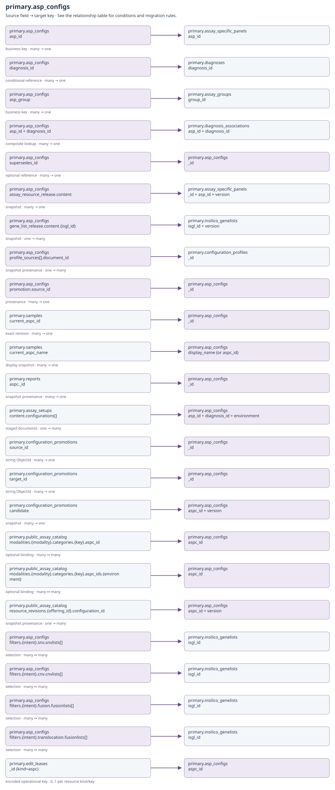
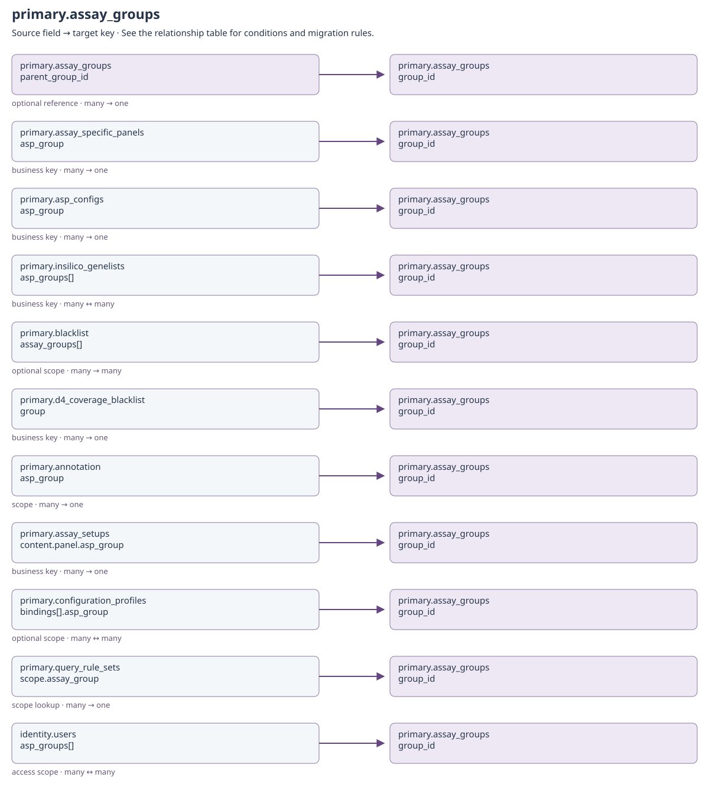
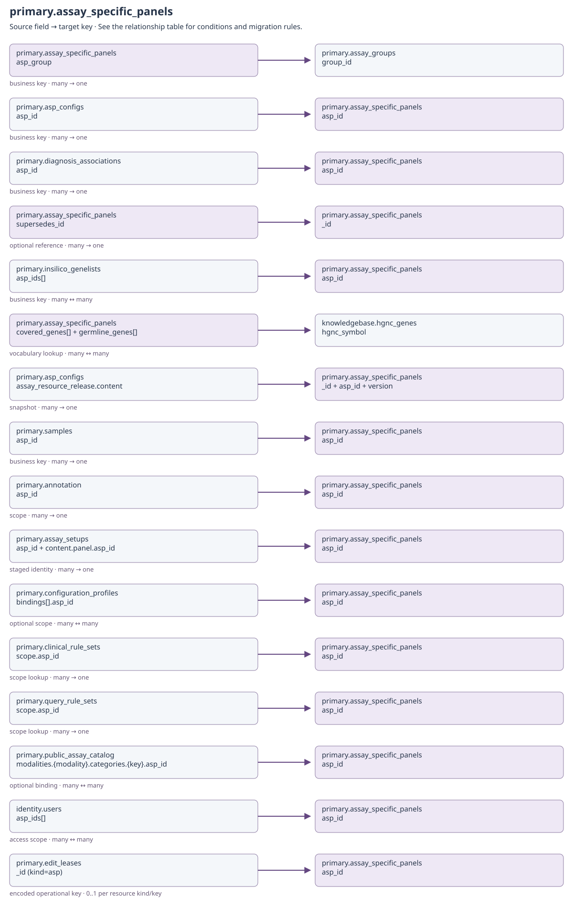
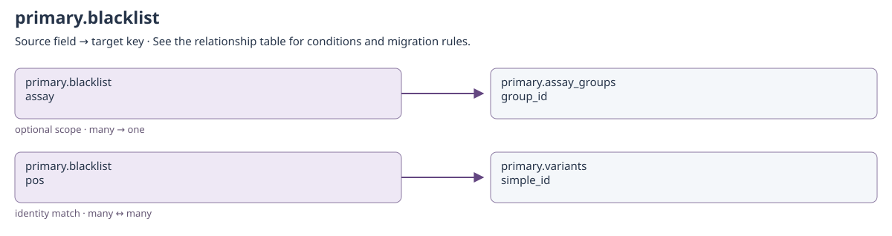
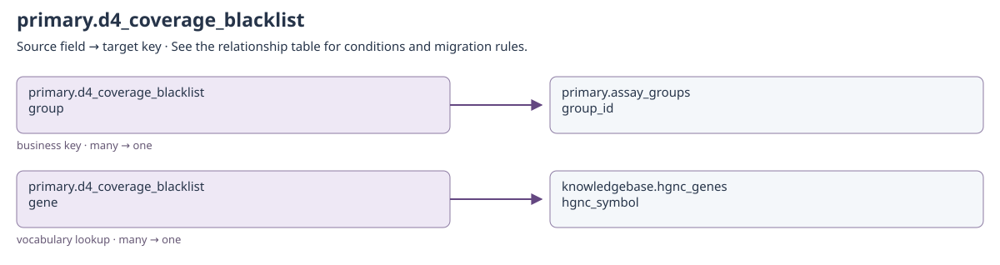
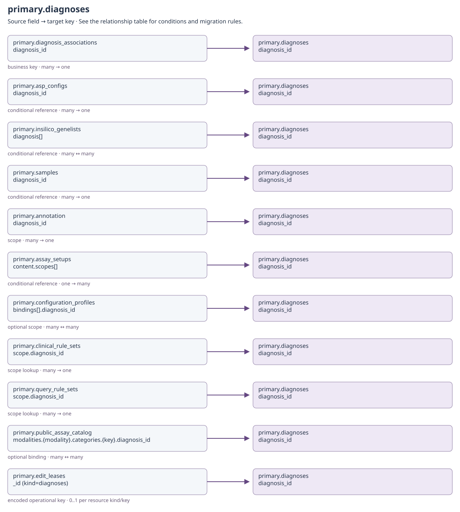
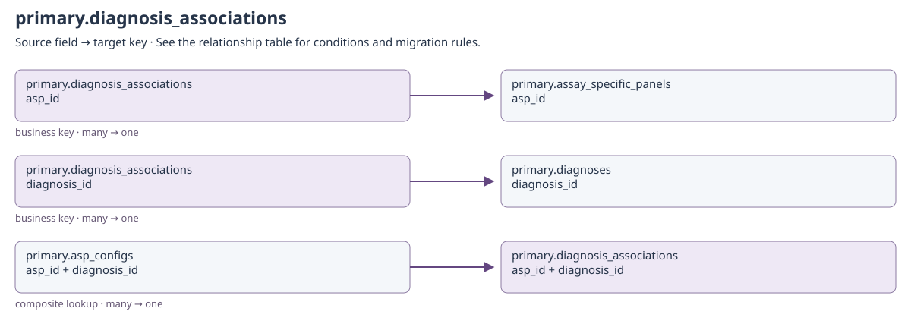
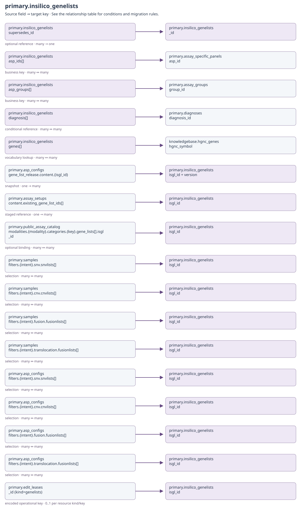

# Assays, diagnoses and gene lists

<!-- GENERATED: scripts/docs/export_collection_dependencies.py -->

[Relationship guide](README.md) · [All collections](inventory.md)

Arrows run from the referencing field to the target. Snapshot and historical-actor
links preserve provenance; they do not require a live target on every read.

## primary.asp_configs

Binding: `aspc_collection`.

Versioned assay configuration binding scope, filter profiles, and reporting.

The operational identity is assay + diagnosis + environment, with retained document versions. query_policy_release, clinical_rule_release and clinical_rule_base are historical capture fields: current schema comments and writes explicitly exclude them from new runtime captures. Preserve historical data without making these fields a prerequisite for new configurations.

Declared top-level fields: `created_by`, `updated_by`, `system_installed`, `_id`, `aspc_id`, `asp_id`, `diagnosis_id`, `environment`, `asp_group`, `asp_category`, `analysis_types`, `analysis_intents`, `system_managed`, `is_active`, `display_name`, `description`, `reference_genome`, `platform`, `verification_samples`, `use_diagnosis_genelist`, `filters`, `reporting`, `catalog`, `query_policy_release`, `clinical_rule_release`, `clinical_rule_base`, `assay_resource_release`, `gene_list_release`, `profile_sources`, `profile_overrides`, `template_release`, `promotion`, `version`, `created_on`, `updated_on`, `supersedes_id`, `retired_by`, `retired_on`, `retired_reason`.

[Field types and validation](../mongodb-collections.md#asp_configs). `_id` may also be retained by an open collection model.

[Open full-size diagram](../../assets/diagrams/collection-dependencies/primary-asp-configs.svg)

### Outgoing dependencies

| Source field | Target key | Relationship / multiplicity | Migration and resolution semantics | Evidence |
| --- | --- | --- | --- | --- |
| [primary.asp_configs](configuration.md#primary-asp-configs): `asp_id` | [primary.assay_specific_panels](configuration.md#primary-assay-specific-panels): `asp_id` | business key; many → one | Resolve the assay identity; retained assay versions can share this business key. | [S15](#s15) |
| [primary.asp_configs](configuration.md#primary-asp-configs): `diagnosis_id` | [primary.diagnoses](configuration.md#primary-diagnoses): `diagnosis_id` | conditional reference; many → one | Named scope only; base has no registry row. Also validate an active association for this asp_id. | [S15](#s15) |
| [primary.asp_configs](configuration.md#primary-asp-configs): `asp_group` | [primary.assay_groups](configuration.md#primary-assay-groups): `group_id` | business key; many → one | Must agree with the assay's group. | [S15](#s15) |
| [primary.asp_configs](configuration.md#primary-asp-configs): `asp_id + diagnosis_id` | [primary.diagnosis_associations](configuration.md#primary-diagnosis-associations): `asp_id + diagnosis_id` | composite lookup; many → one | Named scopes require an enabled current association; base is the explicit exception. | [S1](#s1) |
| [primary.asp_configs](configuration.md#primary-asp-configs): `supersedes_id` | [primary.asp_configs](configuration.md#primary-asp-configs): `_id` | optional reference; many → one | Previous retained document revision; preserve BSON identity rather than replacing it with the business identifier. | [S4](#s4) |
| [primary.asp_configs](configuration.md#primary-asp-configs): `assay_resource_release.content` | [primary.assay_specific_panels](configuration.md#primary-assay-specific-panels): `_id + asp_id + version` | snapshot; many → one | Embedded exact assay content and content_hash; do not refresh this capture from today's active assay. | [S7](#s7) |
| [primary.asp_configs](configuration.md#primary-asp-configs): `gene_list_release.content.{isgl_id}` | [primary.insilico_genelists](configuration.md#primary-insilico-genelists): `isgl_id + version` | snapshot; one → many | Embedded list documents keyed by business identity, with a content_hash for the whole capture. | [S7](#s7) |
| [primary.asp_configs](configuration.md#primary-asp-configs): `profile_sources[].document_id` | [primary.configuration_profiles](workflows.md#primary-configuration-profiles): `_id` | snapshot provenance; one → many | String document identity, plus profile_id/version/content_hash/content. Preserve the selected revision and captured content. | [S12](#s12) |
| [primary.asp_configs](configuration.md#primary-asp-configs): `promotion.source_id` | [primary.asp_configs](configuration.md#primary-asp-configs): `_id` | provenance; many → one | String ObjectId of the source configuration release; source_hash/evidence accompany it. This is not the promotion proposal's ObjectId. | [S13](#s13) |
| [primary.asp_configs](configuration.md#primary-asp-configs): `filters.{intent}.snv.snvlists[]` | [primary.insilico_genelists](configuration.md#primary-insilico-genelists): `isgl_id` | selection; many ↔ many | Only supported analysis/intent sections apply. Runtime list content comes from the applied ASPC's gene_list_release; this is not permission to substitute the newest live list. | [S24](#s24) |
| [primary.asp_configs](configuration.md#primary-asp-configs): `filters.{intent}.cnv.cnvlists[]` | [primary.insilico_genelists](configuration.md#primary-insilico-genelists): `isgl_id` | selection; many ↔ many | Only supported analysis/intent sections apply. Runtime list content comes from the applied ASPC's gene_list_release; this is not permission to substitute the newest live list. | [S24](#s24) |
| [primary.asp_configs](configuration.md#primary-asp-configs): `filters.{intent}.fusion.fusionlists[]` | [primary.insilico_genelists](configuration.md#primary-insilico-genelists): `isgl_id` | selection; many ↔ many | Only supported analysis/intent sections apply. Runtime list content comes from the applied ASPC's gene_list_release; this is not permission to substitute the newest live list. | [S24](#s24) |
| [primary.asp_configs](configuration.md#primary-asp-configs): `filters.{intent}.translocation.fusionlists[]` | [primary.insilico_genelists](configuration.md#primary-insilico-genelists): `isgl_id` | selection; many ↔ many | Only supported analysis/intent sections apply. Runtime list content comes from the applied ASPC's gene_list_release; this is not permission to substitute the newest live list. | [S24](#s24) |
| [primary.asp_configs](configuration.md#primary-asp-configs): `created_by + updated_by + retired_by` | [identity.users](identity.md#identity-users): `username` | historical actor; many → historical identity | Only populated actor fields apply. Preserve system and historical usernames even if no current account exists; never substitute the migration user. | [S21](#s21) |

### Incoming references and migration impact

| Source field | Target key | Relationship / multiplicity | Migration and resolution semantics | Evidence |
| --- | --- | --- | --- | --- |
| [primary.asp_configs](configuration.md#primary-asp-configs): `supersedes_id` | [primary.asp_configs](configuration.md#primary-asp-configs): `_id` | optional reference; many → one | Previous retained document revision; preserve BSON identity rather than replacing it with the business identifier. | [S4](#s4) |
| [primary.asp_configs](configuration.md#primary-asp-configs): `promotion.source_id` | [primary.asp_configs](configuration.md#primary-asp-configs): `_id` | provenance; many → one | String ObjectId of the source configuration release; source_hash/evidence accompany it. This is not the promotion proposal's ObjectId. | [S13](#s13) |
| [primary.samples](clinical.md#primary-samples): `current_aspc_id` | [primary.asp_configs](configuration.md#primary-asp-configs): `_id` | exact revision; many → one | Applied configuration document identity. Do not replace with the newest revision or with aspc_id. | [S22](#s22) |
| [primary.samples](clinical.md#primary-samples): `current_aspc_name` | [primary.asp_configs](configuration.md#primary-asp-configs): `display_name (or aspc_id)` | display snapshot; many → one | Not a join key: ingestion stores display_name, falling back to aspc_id. Use current_aspc_id for exact configuration resolution. | [S8](#s8) |
| [primary.reports](clinical.md#primary-reports): `aspc._id` | [primary.asp_configs](configuration.md#primary-asp-configs): `_id` | snapshot provenance; many → one | Report's applied configuration receipt, not today's sample configuration. | [S3](#s3) |
| [primary.assay_setups](workflows.md#primary-assay-setups): `content.configurations[]` | [primary.asp_configs](configuration.md#primary-asp-configs): `asp_id + diagnosis_id + environment` | staged documents; one → many | Embedded proposed configurations become operational revisions only after publication validation. | [S11](#s11) |
| [primary.configuration_promotions](workflows.md#primary-configuration-promotions): `source_id` | [primary.asp_configs](configuration.md#primary-asp-configs): `_id` | string ObjectId; many → one | Exact source release; verify source_hash before approval. | [S13](#s13) |
| [primary.configuration_promotions](workflows.md#primary-configuration-promotions): `target_id` | [primary.asp_configs](configuration.md#primary-asp-configs): `_id` | string ObjectId; many → one | Populated after approval with the installed target release; null while pending. | [S13](#s13) |
| [primary.configuration_promotions](workflows.md#primary-configuration-promotions): `candidate` | [primary.asp_configs](configuration.md#primary-asp-configs): `aspc_id + version` | snapshot; many → one | Review candidate content and content_hash; not a separate live configuration until approved. | [S14](#s14) |
| [primary.public_assay_catalog](workflows.md#primary-public-assay-catalog): `modalities.{modality}.categories.{key}.aspc_id` | [primary.asp_configs](configuration.md#primary-asp-configs): `aspc_id` | optional binding; many ↔ many | Entry bindings, including inherited category values, resolve resources during publication; folder keys and parent_key are within-document navigation, not collection references. | [S19](#s19) |
| [primary.public_assay_catalog](workflows.md#primary-public-assay-catalog): `modalities.{modality}.categories.{key}.aspc_ids.{environment}` | [primary.asp_configs](configuration.md#primary-asp-configs): `aspc_id` | optional binding; many ↔ many | Entry bindings, including inherited category values, resolve resources during publication; folder keys and parent_key are within-document navigation, not collection references. | [S19](#s19) |
| [primary.public_assay_catalog](workflows.md#primary-public-assay-catalog): `resource_revisions.{offering_id}.configuration_id` | [primary.asp_configs](configuration.md#primary-asp-configs): `aspc_id + version` | snapshot provenance; one → many | configuration_id is the aspc_id business key; configuration_revision supplies its version. This is not an ObjectId. Publication also captures assay_id/revision, group revision, diagnosis revision and gene-list versions. | [S10](#s10) |
| [primary.edit_leases](operations.md#primary-edit-leases): `_id (kind=aspc)` | [primary.asp_configs](configuration.md#primary-asp-configs): `aspc_id` | encoded operational key; 0..1 per resource kind/key | Length-prefixed encoded identity; not a plain target ObjectId. Expiry/release makes the target editable again; no document backfill is needed. | [S9](#s9) |

## primary.assay_groups

Binding: `assay_groups_collection`.

Registered scope; identifiers remain stable for clinical and access references.

Declared top-level fields: `created_by`, `updated_by`, `system_installed`, `_id`, `group_id`, `display_name`, `description`, `parent_group_id`, `system_managed`, `created_on`, `is_active`, `version`, `publication_serial`, `updated_on`, `status_reason`.

[Field types and validation](../mongodb-collections.md#assay_groups). `_id` may also be retained by an open collection model.

[Open full-size diagram](../../assets/diagrams/collection-dependencies/primary-assay-groups.svg)

### Outgoing dependencies

| Source field | Target key | Relationship / multiplicity | Migration and resolution semantics | Evidence |
| --- | --- | --- | --- | --- |
| [primary.assay_groups](configuration.md#primary-assay-groups): `parent_group_id` | [primary.assay_groups](configuration.md#primary-assay-groups): `group_id` | optional reference; many → one | Optional parent; preserve the hierarchy, detect cycles and missing parents. | [S16](#s16) |
| [primary.assay_groups](configuration.md#primary-assay-groups): `created_by + updated_by` | [identity.users](identity.md#identity-users): `username` | historical actor; many → historical identity | Only populated actor fields apply. Preserve system and historical usernames even if no current account exists; never substitute the migration user. | [S21](#s21) |

### Incoming references and migration impact

| Source field | Target key | Relationship / multiplicity | Migration and resolution semantics | Evidence |
| --- | --- | --- | --- | --- |
| [primary.assay_groups](configuration.md#primary-assay-groups): `parent_group_id` | [primary.assay_groups](configuration.md#primary-assay-groups): `group_id` | optional reference; many → one | Optional parent; preserve the hierarchy, detect cycles and missing parents. | [S16](#s16) |
| [primary.assay_specific_panels](configuration.md#primary-assay-specific-panels): `asp_group` | [primary.assay_groups](configuration.md#primary-assay-groups): `group_id` | business key; many → one | Resolve the registered biological group; this is not the sequencing family. | [S15](#s15) |
| [primary.asp_configs](configuration.md#primary-asp-configs): `asp_group` | [primary.assay_groups](configuration.md#primary-assay-groups): `group_id` | business key; many → one | Must agree with the assay's group. | [S15](#s15) |
| [primary.insilico_genelists](configuration.md#primary-insilico-genelists): `asp_groups[]` | [primary.assay_groups](configuration.md#primary-assay-groups): `group_id` | business key; many ↔ many | Allowed biological scopes; cross-check selected assays belong to these groups. | [S15](#s15) |
| [primary.blacklist](configuration.md#primary-blacklist): `assay` | [primary.assay_groups](configuration.md#primary-assay-groups): `group_id` | optional scope; many → one | Persisted scope is assay. Validated migration bundles call it assay_group and translate it before writing. Preserve pos and in_normal_perc with this scope. | [S5](#s5) |
| [primary.d4_coverage_blacklist](configuration.md#primary-d4-coverage-blacklist): `group` | [primary.assay_groups](configuration.md#primary-assay-groups): `group_id` | business key; many → one | Coverage exclusion scope. Also preserve gene, region and coordinate identity. | [S18](#s18) |
| [primary.annotation](clinical.md#primary-annotation): `asp_group` | [primary.assay_groups](configuration.md#primary-assay-groups): `group_id` | scope; many → one | Annotation scope also includes namespace (clinical/sandboxed). asp_id may be null; base diagnosis is implicit. | [S23](#s23) |
| [primary.assay_setups](workflows.md#primary-assay-setups): `content.panel.asp_group` | [primary.assay_groups](configuration.md#primary-assay-groups): `group_id` | business key; many → one | Registered group prerequisite, even before activation. | [S11](#s11) |
| [primary.configuration_profiles](workflows.md#primary-configuration-profiles): `bindings[].asp_group` | [primary.assay_groups](configuration.md#primary-assay-groups): `group_id` | optional scope; many ↔ many | Binding dimensions select applicability. Null means no restriction; base diagnosis is represented by no named diagnosis binding. | [S14](#s14) |
| [primary.query_rule_sets](workflows.md#primary-query-rule-sets): `scope.assay_group` | [primary.assay_groups](configuration.md#primary-assay-groups): `group_id` | scope lookup; many → one | Preserve all other scope dimensions and publication state. Named diagnosis references exclude implicit base; query scopes may be broad/null. | [S20](#s20) |
| [identity.users](identity.md#identity-users): `asp_groups[]` | [primary.assay_groups](configuration.md#primary-assay-groups): `group_id` | access scope; many ↔ many | Cross-database string scope assignments; wildcard semantics are authorization rules, not missing registry rows. | [S6](#s6) |

## primary.assay_specific_panels

Binding: `asp_collection`.

Assay definition with gene coverage, file requirements, and sequencing metadata.

Declared top-level fields: `created_by`, `updated_by`, `system_installed`, `_id`, `asp_id`, `asp_group`, `asp_family`, `asp_category`, `supported_analyses`, `display_name`, `description`, `igv`, `expected_files`, `required_files`, `covered_genes`, `germline_genes`, `accredited`, `kit_name`, `kit_type`, `kit_version`, `platform`, `read_mode`, `read_technology`, `read_length`, `capture_method`, `target_region_size`, `system_managed`, `is_active`, `version`, `created_on`, `updated_on`, `supersedes_id`, `retired_by`, `retired_on`, `retired_reason`.

[Field types and validation](../mongodb-collections.md#assay_specific_panels). `_id` may also be retained by an open collection model.

[Open full-size diagram](../../assets/diagrams/collection-dependencies/primary-assay-specific-panels.svg)

### Outgoing dependencies

| Source field | Target key | Relationship / multiplicity | Migration and resolution semantics | Evidence |
| --- | --- | --- | --- | --- |
| [primary.assay_specific_panels](configuration.md#primary-assay-specific-panels): `asp_group` | [primary.assay_groups](configuration.md#primary-assay-groups): `group_id` | business key; many → one | Resolve the registered biological group; this is not the sequencing family. | [S15](#s15) |
| [primary.assay_specific_panels](configuration.md#primary-assay-specific-panels): `supersedes_id` | [primary.assay_specific_panels](configuration.md#primary-assay-specific-panels): `_id` | optional reference; many → one | Previous retained document revision; preserve BSON identity rather than replacing it with the business identifier. | [S4](#s4) |
| [primary.assay_specific_panels](configuration.md#primary-assay-specific-panels): `covered_genes[] + germline_genes[]` | [knowledgebase.hgnc_genes](knowledgebase.md#knowledgebase-hgnc-genes): `hgnc_symbol` | vocabulary lookup; many ↔ many | Gene symbols, not HGNC ObjectIds. Preserve release context; resolve aliases deliberately, not through blanket renaming. | [S15](#s15) |
| [primary.assay_specific_panels](configuration.md#primary-assay-specific-panels): `created_by + updated_by + retired_by` | [identity.users](identity.md#identity-users): `username` | historical actor; many → historical identity | Only populated actor fields apply. Preserve system and historical usernames even if no current account exists; never substitute the migration user. | [S21](#s21) |

### Incoming references and migration impact

| Source field | Target key | Relationship / multiplicity | Migration and resolution semantics | Evidence |
| --- | --- | --- | --- | --- |
| [primary.asp_configs](configuration.md#primary-asp-configs): `asp_id` | [primary.assay_specific_panels](configuration.md#primary-assay-specific-panels): `asp_id` | business key; many → one | Resolve the assay identity; retained assay versions can share this business key. | [S15](#s15) |
| [primary.diagnosis_associations](configuration.md#primary-diagnosis-associations): `asp_id` | [primary.assay_specific_panels](configuration.md#primary-assay-specific-panels): `asp_id` | business key; many → one | Resolve the assay identity; retained assay versions can share this business key. | [S1](#s1) |
| [primary.assay_specific_panels](configuration.md#primary-assay-specific-panels): `supersedes_id` | [primary.assay_specific_panels](configuration.md#primary-assay-specific-panels): `_id` | optional reference; many → one | Previous retained document revision; preserve BSON identity rather than replacing it with the business identifier. | [S4](#s4) |
| [primary.insilico_genelists](configuration.md#primary-insilico-genelists): `asp_ids[]` | [primary.assay_specific_panels](configuration.md#primary-assay-specific-panels): `asp_id` | business key; many ↔ many | Zero or more assay associations. An unassociated list may be staged before the assay exists. | [S15](#s15) |
| [primary.asp_configs](configuration.md#primary-asp-configs): `assay_resource_release.content` | [primary.assay_specific_panels](configuration.md#primary-assay-specific-panels): `_id + asp_id + version` | snapshot; many → one | Embedded exact assay content and content_hash; do not refresh this capture from today's active assay. | [S7](#s7) |
| [primary.samples](clinical.md#primary-samples): `asp_id` | [primary.assay_specific_panels](configuration.md#primary-assay-specific-panels): `asp_id` | business key; many → one | Sample assay context. Do not replace with display_name. | [S22](#s22) |
| [primary.annotation](clinical.md#primary-annotation): `asp_id` | [primary.assay_specific_panels](configuration.md#primary-assay-specific-panels): `asp_id` | scope; many → one | Annotation scope also includes namespace (clinical/sandboxed). asp_id may be null; base diagnosis is implicit. | [S23](#s23) |
| [primary.assay_setups](workflows.md#primary-assay-setups): `asp_id + content.panel.asp_id` | [primary.assay_specific_panels](configuration.md#primary-assay-specific-panels): `asp_id` | staged identity; many → one | A reserved draft can exist before the operational assay. Publication creates the assay; this is not a required pre-existing parent. | [S11](#s11) |
| [primary.configuration_profiles](workflows.md#primary-configuration-profiles): `bindings[].asp_id` | [primary.assay_specific_panels](configuration.md#primary-assay-specific-panels): `asp_id` | optional scope; many ↔ many | Binding dimensions select applicability. Null means no restriction; base diagnosis is represented by no named diagnosis binding. | [S14](#s14) |
| [primary.clinical_rule_sets](workflows.md#primary-clinical-rule-sets): `scope.asp_id` | [primary.assay_specific_panels](configuration.md#primary-assay-specific-panels): `asp_id` | scope lookup; many → one | Preserve all other scope dimensions and publication state. Named diagnosis references exclude implicit base; query scopes may be broad/null. | [S17](#s17) |
| [primary.query_rule_sets](workflows.md#primary-query-rule-sets): `scope.asp_id` | [primary.assay_specific_panels](configuration.md#primary-assay-specific-panels): `asp_id` | scope lookup; many → one | Preserve all other scope dimensions and publication state. Named diagnosis references exclude implicit base; query scopes may be broad/null. | [S20](#s20) |
| [primary.public_assay_catalog](workflows.md#primary-public-assay-catalog): `modalities.{modality}.categories.{key}.asp_id` | [primary.assay_specific_panels](configuration.md#primary-assay-specific-panels): `asp_id` | optional binding; many ↔ many | Entry bindings, including inherited category values, resolve resources during publication; folder keys and parent_key are within-document navigation, not collection references. | [S19](#s19) |
| [identity.users](identity.md#identity-users): `asp_ids[]` | [primary.assay_specific_panels](configuration.md#primary-assay-specific-panels): `asp_id` | access scope; many ↔ many | Cross-database string scope assignments; wildcard semantics are authorization rules, not missing registry rows. | [S6](#s6) |
| [primary.edit_leases](operations.md#primary-edit-leases): `_id (kind=asp)` | [primary.assay_specific_panels](configuration.md#primary-assay-specific-panels): `asp_id` | encoded operational key; 0..1 per resource kind/key | Length-prefixed encoded identity; not a plain target ObjectId. Expiry/release makes the target editable again; no document backfill is needed. | [S9](#s9) |

## primary.blacklist

Binding: `blacklist_collection`.

Blacklisted position with optional assay group and normal-sample frequency.

pos matches variants.simple_id, not variants._id. The migration bundle contract declares assay_group; scripts/migration_common/apply_bundle.py deliberately persists it as assay because the repository queries and indexes (assay,pos). This is an explicit serialization boundary, not two interchangeable stored fields. Coverage exclusions use d4_coverage_blacklist instead.

Declared top-level fields: `created_by`, `updated_by`, `system_installed`, `_id`, `pos`, `assay_group`, `in_normal_perc`.

[Field types and validation](../mongodb-collections.md#blacklist). `_id` may also be retained by an open collection model.

[Open full-size diagram](../../assets/diagrams/collection-dependencies/primary-blacklist.svg)

### Outgoing dependencies

| Source field | Target key | Relationship / multiplicity | Migration and resolution semantics | Evidence |
| --- | --- | --- | --- | --- |
| [primary.blacklist](configuration.md#primary-blacklist): `assay` | [primary.assay_groups](configuration.md#primary-assay-groups): `group_id` | optional scope; many → one | Persisted scope is assay. Validated migration bundles call it assay_group and translate it before writing. Preserve pos and in_normal_perc with this scope. | [S5](#s5) |
| [primary.blacklist](configuration.md#primary-blacklist): `pos` | [primary.variants](clinical.md#primary-variants): `simple_id` | identity match; many ↔ many | Position identity shared across sample findings; apply the blacklist's scope predicate. | [S2](#s2) |
| [primary.blacklist](configuration.md#primary-blacklist): `created_by + updated_by` | [identity.users](identity.md#identity-users): `username` | historical actor; many → historical identity | Only populated actor fields apply. Preserve system and historical usernames even if no current account exists; never substitute the migration user. | [S21](#s21) |

### Incoming references and migration impact

No cross-collection business reference is declared in this catalog for this direction.

## primary.d4_coverage_blacklist

Binding: `d4_coverage_blacklist_collection`.

Gene or region excluded from D4 coverage evaluation for an assay group.

Declared top-level fields: `created_by`, `updated_by`, `system_installed`, `group`, `gene`, `region`, `coord`, `group_region_id`.

[Field types and validation](../mongodb-collections.md#d4_coverage_blacklist). `_id` may also be retained by an open collection model.

[Open full-size diagram](../../assets/diagrams/collection-dependencies/primary-d4-coverage-blacklist.svg)

### Outgoing dependencies

| Source field | Target key | Relationship / multiplicity | Migration and resolution semantics | Evidence |
| --- | --- | --- | --- | --- |
| [primary.d4_coverage_blacklist](configuration.md#primary-d4-coverage-blacklist): `group` | [primary.assay_groups](configuration.md#primary-assay-groups): `group_id` | business key; many → one | Coverage exclusion scope. Also preserve gene, region and coordinate identity. | [S18](#s18) |
| [primary.d4_coverage_blacklist](configuration.md#primary-d4-coverage-blacklist): `gene` | [knowledgebase.hgnc_genes](knowledgebase.md#knowledgebase-hgnc-genes): `hgnc_symbol` | vocabulary lookup; many → one | Region exclusions refer to a symbol; region/coord must still identify the original genomic interval. | [S18](#s18) |
| [primary.d4_coverage_blacklist](configuration.md#primary-d4-coverage-blacklist): `created_by + updated_by` | [identity.users](identity.md#identity-users): `username` | historical actor; many → historical identity | Only populated actor fields apply. Preserve system and historical usernames even if no current account exists; never substitute the migration user. | [S21](#s21) |

### Incoming references and migration impact

No cross-collection business reference is declared in this catalog for this direction.

## primary.diagnoses

Binding: `diagnoses_collection`.

Globally identified display metadata, independent of assay membership.

Declared top-level fields: `created_by`, `updated_by`, `system_installed`, `_id`, `display_name`, `description`, `is_active`, `diagnosis_id`, `version`, `is_current`, `updated_on`.

[Field types and validation](../mongodb-collections.md#diagnoses). `_id` may also be retained by an open collection model.

[Open full-size diagram](../../assets/diagrams/collection-dependencies/primary-diagnoses.svg)

### Outgoing dependencies

| Source field | Target key | Relationship / multiplicity | Migration and resolution semantics | Evidence |
| --- | --- | --- | --- | --- |
| [primary.diagnoses](configuration.md#primary-diagnoses): `created_by + updated_by` | [identity.users](identity.md#identity-users): `username` | historical actor; many → historical identity | Only populated actor fields apply. Preserve system and historical usernames even if no current account exists; never substitute the migration user. | [S21](#s21) |

### Incoming references and migration impact

| Source field | Target key | Relationship / multiplicity | Migration and resolution semantics | Evidence |
| --- | --- | --- | --- | --- |
| [primary.diagnosis_associations](configuration.md#primary-diagnosis-associations): `diagnosis_id` | [primary.diagnoses](configuration.md#primary-diagnoses): `diagnosis_id` | business key; many → one | Named diagnosis definition; retain version/is_current state. Base is implicit, not a diagnosis document. | [S1](#s1) |
| [primary.asp_configs](configuration.md#primary-asp-configs): `diagnosis_id` | [primary.diagnoses](configuration.md#primary-diagnoses): `diagnosis_id` | conditional reference; many → one | Named scope only; base has no registry row. Also validate an active association for this asp_id. | [S15](#s15) |
| [primary.insilico_genelists](configuration.md#primary-insilico-genelists): `diagnosis[]` | [primary.diagnoses](configuration.md#primary-diagnoses): `diagnosis_id` | conditional reference; many ↔ many | Named diagnosis tags; base is implicit. These tags do not create assay-diagnosis associations. | [S15](#s15) |
| [primary.samples](clinical.md#primary-samples): `diagnosis_id` | [primary.diagnoses](configuration.md#primary-diagnoses): `diagnosis_id` | conditional reference; many → one | Named diagnosis only; base is an implicit scope. Preserve aspc_resolution.resolved_diagnosis_id separately when configuration falls back to base. | [S22](#s22) |
| [primary.annotation](clinical.md#primary-annotation): `diagnosis_id` | [primary.diagnoses](configuration.md#primary-diagnoses): `diagnosis_id` | scope; many → one | Annotation scope also includes namespace (clinical/sandboxed). asp_id may be null; base diagnosis is implicit. | [S23](#s23) |
| [primary.assay_setups](workflows.md#primary-assay-setups): `content.scopes[]` | [primary.diagnoses](configuration.md#primary-diagnoses): `diagnosis_id` | conditional reference; one → many | Selected named scopes become diagnosis_associations at publication; base is implicit. | [S11](#s11) |
| [primary.configuration_profiles](workflows.md#primary-configuration-profiles): `bindings[].diagnosis_id` | [primary.diagnoses](configuration.md#primary-diagnoses): `diagnosis_id` | optional scope; many ↔ many | Binding dimensions select applicability. Null means no restriction; base diagnosis is represented by no named diagnosis binding. | [S14](#s14) |
| [primary.clinical_rule_sets](workflows.md#primary-clinical-rule-sets): `scope.diagnosis_id` | [primary.diagnoses](configuration.md#primary-diagnoses): `diagnosis_id` | scope lookup; many → one | Preserve all other scope dimensions and publication state. Named diagnosis references exclude implicit base; query scopes may be broad/null. | [S17](#s17) |
| [primary.query_rule_sets](workflows.md#primary-query-rule-sets): `scope.diagnosis_id` | [primary.diagnoses](configuration.md#primary-diagnoses): `diagnosis_id` | scope lookup; many → one | Preserve all other scope dimensions and publication state. Named diagnosis references exclude implicit base; query scopes may be broad/null. | [S20](#s20) |
| [primary.public_assay_catalog](workflows.md#primary-public-assay-catalog): `modalities.{modality}.categories.{key}.diagnosis_id` | [primary.diagnoses](configuration.md#primary-diagnoses): `diagnosis_id` | optional binding; many ↔ many | Entry bindings, including inherited category values, resolve resources during publication; folder keys and parent_key are within-document navigation, not collection references. | [S19](#s19) |
| [primary.edit_leases](operations.md#primary-edit-leases): `_id (kind=diagnoses)` | [primary.diagnoses](configuration.md#primary-diagnoses): `diagnosis_id` | encoded operational key; 0..1 per resource kind/key | Length-prefixed encoded identity; not a plain target ObjectId. Expiry/release makes the target editable again; no document backfill is needed. | [S9](#s9) |

## primary.diagnosis_associations

Binding: `diagnosis_associations_collection`.

Revision of an independently enabled assay-to-diagnosis association.

Declared top-level fields: `created_by`, `updated_by`, `system_installed`, `_id`, `asp_id`, `diagnosis_id`, `is_active`, `version`, `is_current`, `updated_on`.

[Field types and validation](../mongodb-collections.md#diagnosis_associations). `_id` may also be retained by an open collection model.

[Open full-size diagram](../../assets/diagrams/collection-dependencies/primary-diagnosis-associations.svg)

### Outgoing dependencies

| Source field | Target key | Relationship / multiplicity | Migration and resolution semantics | Evidence |
| --- | --- | --- | --- | --- |
| [primary.diagnosis_associations](configuration.md#primary-diagnosis-associations): `asp_id` | [primary.assay_specific_panels](configuration.md#primary-assay-specific-panels): `asp_id` | business key; many → one | Resolve the assay identity; retained assay versions can share this business key. | [S1](#s1) |
| [primary.diagnosis_associations](configuration.md#primary-diagnosis-associations): `diagnosis_id` | [primary.diagnoses](configuration.md#primary-diagnoses): `diagnosis_id` | business key; many → one | Named diagnosis definition; retain version/is_current state. Base is implicit, not a diagnosis document. | [S1](#s1) |
| [primary.diagnosis_associations](configuration.md#primary-diagnosis-associations): `created_by + updated_by` | [identity.users](identity.md#identity-users): `username` | historical actor; many → historical identity | Only populated actor fields apply. Preserve system and historical usernames even if no current account exists; never substitute the migration user. | [S21](#s21) |

### Incoming references and migration impact

| Source field | Target key | Relationship / multiplicity | Migration and resolution semantics | Evidence |
| --- | --- | --- | --- | --- |
| [primary.asp_configs](configuration.md#primary-asp-configs): `asp_id + diagnosis_id` | [primary.diagnosis_associations](configuration.md#primary-diagnosis-associations): `asp_id + diagnosis_id` | composite lookup; many → one | Named scopes require an enabled current association; base is the explicit exception. | [S1](#s1) |

## primary.insilico_genelists

Binding: `insilico_genelist_collection`.

One-gene-per-entry list shared by SNV, CNV, and fusion filtering.

Declared top-level fields: `created_by`, `updated_by`, `system_installed`, `_id`, `isgl_id`, `diagnosis`, `name`, `displayname`, `aliases`, `list_type`, `adhoc`, `is_public`, `system_managed`, `is_active`, `asp_groups`, `genes`, `asp_ids`, `version`, `created_on`, `updated_on`, `supersedes_id`, `retired_by`, `retired_on`, `retired_reason`.

[Field types and validation](../mongodb-collections.md#insilico_genelists). `_id` may also be retained by an open collection model.

[Open full-size diagram](../../assets/diagrams/collection-dependencies/primary-insilico-genelists.svg)

### Outgoing dependencies

| Source field | Target key | Relationship / multiplicity | Migration and resolution semantics | Evidence |
| --- | --- | --- | --- | --- |
| [primary.insilico_genelists](configuration.md#primary-insilico-genelists): `supersedes_id` | [primary.insilico_genelists](configuration.md#primary-insilico-genelists): `_id` | optional reference; many → one | Previous retained document revision; preserve BSON identity rather than replacing it with the business identifier. | [S4](#s4) |
| [primary.insilico_genelists](configuration.md#primary-insilico-genelists): `asp_ids[]` | [primary.assay_specific_panels](configuration.md#primary-assay-specific-panels): `asp_id` | business key; many ↔ many | Zero or more assay associations. An unassociated list may be staged before the assay exists. | [S15](#s15) |
| [primary.insilico_genelists](configuration.md#primary-insilico-genelists): `asp_groups[]` | [primary.assay_groups](configuration.md#primary-assay-groups): `group_id` | business key; many ↔ many | Allowed biological scopes; cross-check selected assays belong to these groups. | [S15](#s15) |
| [primary.insilico_genelists](configuration.md#primary-insilico-genelists): `diagnosis[]` | [primary.diagnoses](configuration.md#primary-diagnoses): `diagnosis_id` | conditional reference; many ↔ many | Named diagnosis tags; base is implicit. These tags do not create assay-diagnosis associations. | [S15](#s15) |
| [primary.insilico_genelists](configuration.md#primary-insilico-genelists): `genes[]` | [knowledgebase.hgnc_genes](knowledgebase.md#knowledgebase-hgnc-genes): `hgnc_symbol` | vocabulary lookup; many ↔ many | Gene symbols, not HGNC ObjectIds. Preserve release context; resolve aliases deliberately, not through blanket renaming. | [S15](#s15) |
| [primary.insilico_genelists](configuration.md#primary-insilico-genelists): `created_by + updated_by + retired_by` | [identity.users](identity.md#identity-users): `username` | historical actor; many → historical identity | Only populated actor fields apply. Preserve system and historical usernames even if no current account exists; never substitute the migration user. | [S21](#s21) |

### Incoming references and migration impact

| Source field | Target key | Relationship / multiplicity | Migration and resolution semantics | Evidence |
| --- | --- | --- | --- | --- |
| [primary.insilico_genelists](configuration.md#primary-insilico-genelists): `supersedes_id` | [primary.insilico_genelists](configuration.md#primary-insilico-genelists): `_id` | optional reference; many → one | Previous retained document revision; preserve BSON identity rather than replacing it with the business identifier. | [S4](#s4) |
| [primary.asp_configs](configuration.md#primary-asp-configs): `gene_list_release.content.{isgl_id}` | [primary.insilico_genelists](configuration.md#primary-insilico-genelists): `isgl_id + version` | snapshot; one → many | Embedded list documents keyed by business identity, with a content_hash for the whole capture. | [S7](#s7) |
| [primary.assay_setups](workflows.md#primary-assay-setups): `content.existing_gene_list_ids[]` | [primary.insilico_genelists](configuration.md#primary-insilico-genelists): `isgl_id` | staged reference; one → many | Existing lists are linked during publication. content.gene_lists[] instead contains new staged documents, not foreign keys. | [S11](#s11) |
| [primary.public_assay_catalog](workflows.md#primary-public-assay-catalog): `modalities.{modality}.categories.{key}.gene_lists[].isgl_id` | [primary.insilico_genelists](configuration.md#primary-insilico-genelists): `isgl_id` | optional binding; many ↔ many | Entry bindings, including inherited category values, resolve resources during publication; folder keys and parent_key are within-document navigation, not collection references. | [S19](#s19) |
| [primary.samples](clinical.md#primary-samples): `filters.{intent}.snv.snvlists[]` | [primary.insilico_genelists](configuration.md#primary-insilico-genelists): `isgl_id` | selection; many ↔ many | Only supported analysis/intent sections apply. Runtime list content comes from the applied ASPC's gene_list_release; this is not permission to substitute the newest live list. | [S24](#s24) |
| [primary.samples](clinical.md#primary-samples): `filters.{intent}.cnv.cnvlists[]` | [primary.insilico_genelists](configuration.md#primary-insilico-genelists): `isgl_id` | selection; many ↔ many | Only supported analysis/intent sections apply. Runtime list content comes from the applied ASPC's gene_list_release; this is not permission to substitute the newest live list. | [S24](#s24) |
| [primary.samples](clinical.md#primary-samples): `filters.{intent}.fusion.fusionlists[]` | [primary.insilico_genelists](configuration.md#primary-insilico-genelists): `isgl_id` | selection; many ↔ many | Only supported analysis/intent sections apply. Runtime list content comes from the applied ASPC's gene_list_release; this is not permission to substitute the newest live list. | [S24](#s24) |
| [primary.samples](clinical.md#primary-samples): `filters.{intent}.translocation.fusionlists[]` | [primary.insilico_genelists](configuration.md#primary-insilico-genelists): `isgl_id` | selection; many ↔ many | Only supported analysis/intent sections apply. Runtime list content comes from the applied ASPC's gene_list_release; this is not permission to substitute the newest live list. | [S24](#s24) |
| [primary.asp_configs](configuration.md#primary-asp-configs): `filters.{intent}.snv.snvlists[]` | [primary.insilico_genelists](configuration.md#primary-insilico-genelists): `isgl_id` | selection; many ↔ many | Only supported analysis/intent sections apply. Runtime list content comes from the applied ASPC's gene_list_release; this is not permission to substitute the newest live list. | [S24](#s24) |
| [primary.asp_configs](configuration.md#primary-asp-configs): `filters.{intent}.cnv.cnvlists[]` | [primary.insilico_genelists](configuration.md#primary-insilico-genelists): `isgl_id` | selection; many ↔ many | Only supported analysis/intent sections apply. Runtime list content comes from the applied ASPC's gene_list_release; this is not permission to substitute the newest live list. | [S24](#s24) |
| [primary.asp_configs](configuration.md#primary-asp-configs): `filters.{intent}.fusion.fusionlists[]` | [primary.insilico_genelists](configuration.md#primary-insilico-genelists): `isgl_id` | selection; many ↔ many | Only supported analysis/intent sections apply. Runtime list content comes from the applied ASPC's gene_list_release; this is not permission to substitute the newest live list. | [S24](#s24) |
| [primary.asp_configs](configuration.md#primary-asp-configs): `filters.{intent}.translocation.fusionlists[]` | [primary.insilico_genelists](configuration.md#primary-insilico-genelists): `isgl_id` | selection; many ↔ many | Only supported analysis/intent sections apply. Runtime list content comes from the applied ASPC's gene_list_release; this is not permission to substitute the newest live list. | [S24](#s24) |
| [primary.edit_leases](operations.md#primary-edit-leases): `_id (kind=genelists)` | [primary.insilico_genelists](configuration.md#primary-insilico-genelists): `isgl_id` | encoded operational key; 0..1 per resource kind/key | Length-prefixed encoded identity; not a plain target ObjectId. Expiry/release makes the target editable again; no document backfill is needed. | [S9](#s9) |

## Source evidence

### S1

`api/infra/mongo/repositories/assay_diagnoses.py`

### S2

`api/infra/mongo/repositories/blacklist.py`

### S3

`api/infra/mongo/repositories/reports.py`

### S4

`api/infra/mongo/repositories/revision_rotation.py`

### S5

`scripts/migration_common/apply_bundle.py`

### S6

`src/coyote3/application/common/access.py`

### S7

`src/coyote3/application/common/release_resources.py`

### S8

`src/coyote3/application/ingest/service.py`

### S9

`src/coyote3/application/operations/application.py`

### S10

`src/coyote3/application/public/offering_snapshots.py`

### S11

`src/coyote3/application/resources/assay_setup.py`

### S12

`src/coyote3/application/resources/configuration_profiles.py`

### S13

`src/coyote3/application/resources/configuration_promotions.py`

### S14

`src/coyote3/contracts/configuration_profiles.py`

### S15

`src/coyote3/contracts/schemas/assay.py`

### S16

`src/coyote3/contracts/schemas/assay_groups.py`

### S17

`src/coyote3/contracts/schemas/clinical_rules.py`

### S18

`src/coyote3/contracts/schemas/dna.py`

### S19

`src/coyote3/contracts/schemas/public_catalog.py`

### S20

`src/coyote3/contracts/schemas/query_rules.py`

### S21

`src/coyote3/contracts/schemas/registry.py`

### S22

`src/coyote3/contracts/schemas/samples.py`

### S23

`src/coyote3/domain/annotation_identity.py`

### S24

`src/coyote3/domain/filter_profiles.py`
