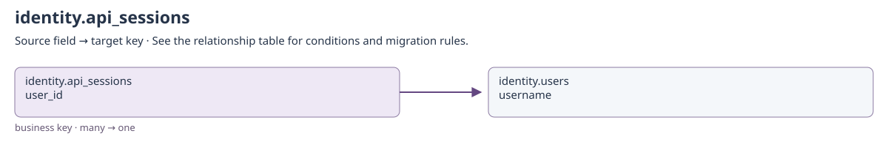
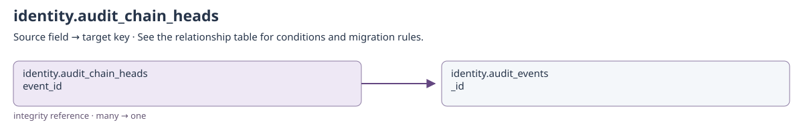
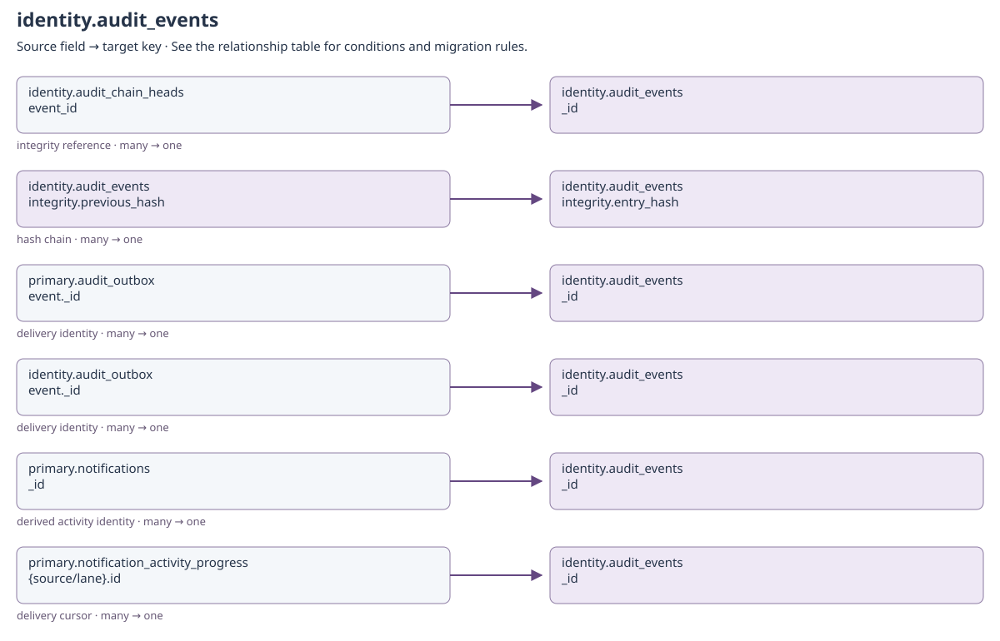
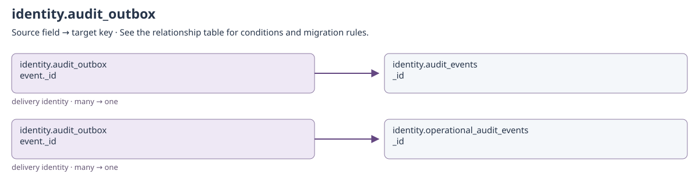
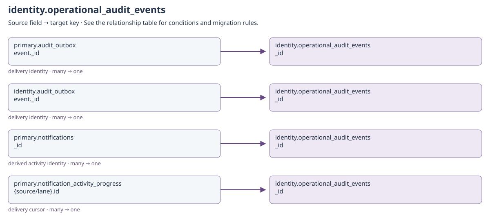
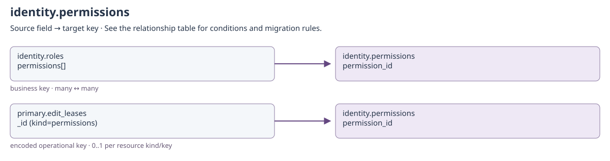
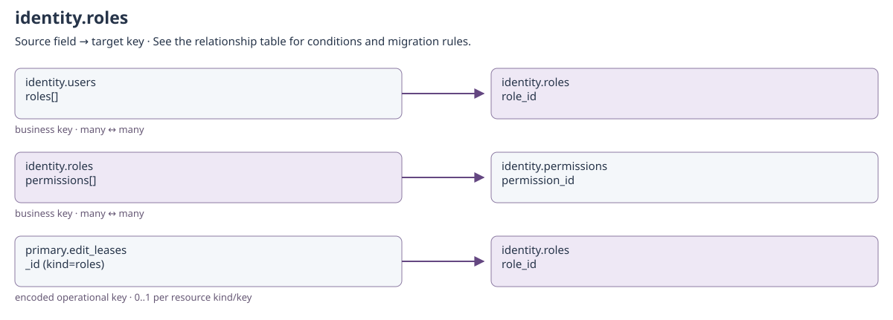
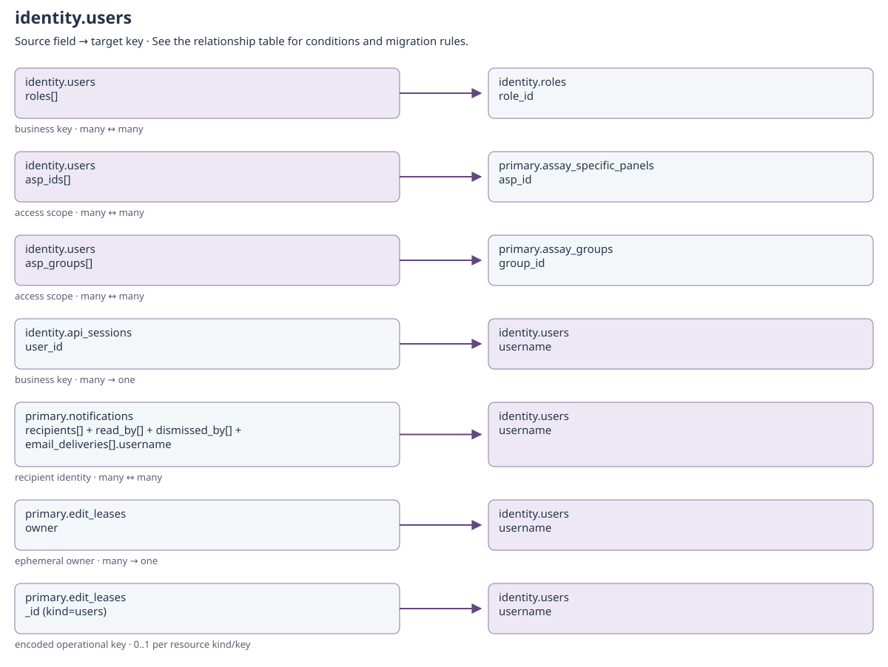

# Identity, permissions and audit

<!-- GENERATED: scripts/docs/export_collection_dependencies.py -->

[Relationship guide](README.md) · [All collections](inventory.md)

Arrows run from the referencing field to the target. Snapshot and historical-actor
links preserve provenance; they do not require a live target on every read.

## identity.api_sessions

Binding: `api_sessions_collection`.

Repository-defined storage; no collection-model adapter is registered for this physical namespace.

[Open full-size diagram](../../assets/diagrams/collection-dependencies/identity-api-sessions.svg)

### Outgoing dependencies

| Source field | Target key | Relationship / multiplicity | Migration and resolution semantics | Evidence |
| --- | --- | --- | --- | --- |
| [identity.api_sessions](identity.md#identity-api-sessions): `user_id` | [identity.users](identity.md#identity-users): `username` | business key; many → one | Despite the field name, this stores username, not users._id. Sessions are ephemeral; normally reauthenticate after migration. | [S4](#s4) |

### Incoming references and migration impact

No cross-collection business reference is declared in this catalog for this direction.

## identity.audit_chain_heads

Binding: `OPERATIONAL_COLLECTIONS.audit_chain_heads`.

Repository-defined storage; no collection-model adapter is registered for this physical namespace.

[Open full-size diagram](../../assets/diagrams/collection-dependencies/identity-audit-chain-heads.svg)

### Outgoing dependencies

| Source field | Target key | Relationship / multiplicity | Migration and resolution semantics | Evidence |
| --- | --- | --- | --- | --- |
| [identity.audit_chain_heads](identity.md#identity-audit-chain-heads): `event_id` | [identity.audit_events](identity.md#identity-audit-events): `_id` | integrity reference; many → one | Exact event at chain tip; collection/environment determine chain identity. Preserve sequence, entry_hash and all historical chain links. | [S1](#s1) |

### Incoming references and migration impact

No cross-collection business reference is declared in this catalog for this direction.

## identity.audit_events

Binding: `audit_events_collection`.

Retained traceability records and hash chains are not editable migration bookkeeping. resource.type/resource.id are polymorphic historical provenance; the referenced clinical object can have been deleted. Do not enforce a universal foreign-key constraint on these fields.

Repository-defined storage; no collection-model adapter is registered for this physical namespace.

[Open full-size diagram](../../assets/diagrams/collection-dependencies/identity-audit-events.svg)

### Outgoing dependencies

| Source field | Target key | Relationship / multiplicity | Migration and resolution semantics | Evidence |
| --- | --- | --- | --- | --- |
| [identity.audit_events](identity.md#identity-audit-events): `actor.username` | [identity.users](identity.md#identity-users): `username` | historical actor; many → one | Actor snapshot may be system or a historical/deleted account; do not rewrite past audit events to satisfy a present-day lookup. | [S2](#s2) |
| [identity.audit_events](identity.md#identity-audit-events): `integrity.previous_hash` | [identity.audit_events](identity.md#identity-audit-events): `integrity.entry_hash` | hash chain; many → one | Within the same integrity.chain_id, previous sequence. Genesis is a sentinel, not an event. | [S1](#s1) |

### Incoming references and migration impact

| Source field | Target key | Relationship / multiplicity | Migration and resolution semantics | Evidence |
| --- | --- | --- | --- | --- |
| [identity.audit_chain_heads](identity.md#identity-audit-chain-heads): `event_id` | [identity.audit_events](identity.md#identity-audit-events): `_id` | integrity reference; many → one | Exact event at chain tip; collection/environment determine chain identity. Preserve sequence, entry_hash and all historical chain links. | [S1](#s1) |
| [identity.audit_events](identity.md#identity-audit-events): `integrity.previous_hash` | [identity.audit_events](identity.md#identity-audit-events): `integrity.entry_hash` | hash chain; many → one | Within the same integrity.chain_id, previous sequence. Genesis is a sentinel, not an event. | [S1](#s1) |
| [primary.audit_outbox](operations.md#primary-audit-outbox): `event._id` | [identity.audit_events](identity.md#identity-audit-events): `_id` | delivery identity; many → one | Destination follows event retention/routing. Preserve the stable event ID for replay deduplication; the outbox row is removed after delivery. | [S2](#s2) |
| [identity.audit_outbox](identity.md#identity-audit-outbox): `event._id` | [identity.audit_events](identity.md#identity-audit-events): `_id` | delivery identity; many → one | Destination follows event retention/routing. Preserve the stable event ID for replay deduplication; the outbox row is removed after delivery. | [S2](#s2) |
| [primary.notifications](operations.md#primary-notifications): `_id` | [identity.audit_events](identity.md#identity-audit-events): `_id` | derived activity identity; many → one | For activity-derived notifications, source event identities support idempotent delivery. Manual broadcasts have no corresponding source event. | [S3](#s3) |
| [primary.notification_activity_progress](operations.md#primary-notification-activity-progress): `{source/lane}.id` | [identity.audit_events](identity.md#identity-audit-events): `_id` | delivery cursor; many → one | Dynamic cursor lane also stores timestamp. Preserve or intentionally reset with notification deduplication state; this is not a business document reference. | [S3](#s3) |

## identity.audit_outbox

Binding: `audit_outbox in the owning business database`.

Repository-defined storage; no collection-model adapter is registered for this physical namespace.

[Open full-size diagram](../../assets/diagrams/collection-dependencies/identity-audit-outbox.svg)

### Outgoing dependencies

| Source field | Target key | Relationship / multiplicity | Migration and resolution semantics | Evidence |
| --- | --- | --- | --- | --- |
| [identity.audit_outbox](identity.md#identity-audit-outbox): `event._id` | [identity.audit_events](identity.md#identity-audit-events): `_id` | delivery identity; many → one | Destination follows event retention/routing. Preserve the stable event ID for replay deduplication; the outbox row is removed after delivery. | [S2](#s2) |
| [identity.audit_outbox](identity.md#identity-audit-outbox): `event._id` | [identity.operational_audit_events](identity.md#identity-operational-audit-events): `_id` | delivery identity; many → one | Destination follows event retention/routing. Preserve the stable event ID for replay deduplication; the outbox row is removed after delivery. | [S2](#s2) |

### Incoming references and migration impact

No cross-collection business reference is declared in this catalog for this direction.

## identity.operational_audit_events

Binding: `OPERATIONAL_COLLECTIONS.operational_audit_events`.

Operational retention differs from permanent traceability history. These events do not participate in the traceability hash chain.

Repository-defined storage; no collection-model adapter is registered for this physical namespace.

[Open full-size diagram](../../assets/diagrams/collection-dependencies/identity-operational-audit-events.svg)

### Outgoing dependencies

| Source field | Target key | Relationship / multiplicity | Migration and resolution semantics | Evidence |
| --- | --- | --- | --- | --- |
| [identity.operational_audit_events](identity.md#identity-operational-audit-events): `actor.username` | [identity.users](identity.md#identity-users): `username` | historical actor; many → one | Actor snapshot may be system or a historical/deleted account; do not rewrite past audit events to satisfy a present-day lookup. | [S2](#s2) |

### Incoming references and migration impact

| Source field | Target key | Relationship / multiplicity | Migration and resolution semantics | Evidence |
| --- | --- | --- | --- | --- |
| [primary.audit_outbox](operations.md#primary-audit-outbox): `event._id` | [identity.operational_audit_events](identity.md#identity-operational-audit-events): `_id` | delivery identity; many → one | Destination follows event retention/routing. Preserve the stable event ID for replay deduplication; the outbox row is removed after delivery. | [S2](#s2) |
| [identity.audit_outbox](identity.md#identity-audit-outbox): `event._id` | [identity.operational_audit_events](identity.md#identity-operational-audit-events): `_id` | delivery identity; many → one | Destination follows event retention/routing. Preserve the stable event ID for replay deduplication; the outbox row is removed after delivery. | [S2](#s2) |
| [primary.notifications](operations.md#primary-notifications): `_id` | [identity.operational_audit_events](identity.md#identity-operational-audit-events): `_id` | derived activity identity; many → one | For activity-derived notifications, source event identities support idempotent delivery. Manual broadcasts have no corresponding source event. | [S3](#s3) |
| [primary.notification_activity_progress](operations.md#primary-notification-activity-progress): `{source/lane}.id` | [identity.operational_audit_events](identity.md#identity-operational-audit-events): `_id` | delivery cursor; many → one | Dynamic cursor lane also stores timestamp. Preserve or intentionally reset with notification deduplication state; this is not a business document reference. | [S3](#s3) |

## identity.permissions

Binding: `permissions_collection`.

Versioned permission identifier with catalog category and descriptive metadata.

Declared top-level fields: `created_by`, `updated_by`, `system_installed`, `_id`, `permission_id`, `label`, `category`, `description`, `tags`, `system_managed`, `is_active`, `version`, `created_on`, `updated_on`.

[Field types and validation](../mongodb-collections.md#permissions). `_id` may also be retained by an open collection model.

[Open full-size diagram](../../assets/diagrams/collection-dependencies/identity-permissions.svg)

### Outgoing dependencies

| Source field | Target key | Relationship / multiplicity | Migration and resolution semantics | Evidence |
| --- | --- | --- | --- | --- |
| [identity.permissions](identity.md#identity-permissions): `created_by + updated_by` | [identity.users](identity.md#identity-users): `username` | historical actor; many → historical identity | Only populated actor fields apply. Preserve system and historical usernames even if no current account exists; never substitute the migration user. | [S11](#s11) |

### Incoming references and migration impact

| Source field | Target key | Relationship / multiplicity | Migration and resolution semantics | Evidence |
| --- | --- | --- | --- | --- |
| [identity.roles](identity.md#identity-roles): `permissions[]` | [identity.permissions](identity.md#identity-permissions): `permission_id` | business key; many ↔ many | Permission catalog IDs; names/labels are presentation only. | [S9](#s9) |
| [primary.edit_leases](operations.md#primary-edit-leases): `_id (kind=permissions)` | [identity.permissions](identity.md#identity-permissions): `permission_id` | encoded operational key; 0..1 per resource kind/key | Length-prefixed encoded identity; not a plain target ObjectId. Expiry/release makes the target editable again; no document backfill is needed. | [S8](#s8) |

## identity.roles

Binding: `roles_collection`.

Versioned role definition with permission membership, level, and display color.

Declared top-level fields: `created_by`, `updated_by`, `system_installed`, `_id`, `role_id`, `name`, `label`, `description`, `color`, `level`, `system_managed`, `is_active`, `permissions`, `version`, `created_on`, `updated_on`.

[Field types and validation](../mongodb-collections.md#roles). `_id` may also be retained by an open collection model.

[Open full-size diagram](../../assets/diagrams/collection-dependencies/identity-roles.svg)

### Outgoing dependencies

| Source field | Target key | Relationship / multiplicity | Migration and resolution semantics | Evidence |
| --- | --- | --- | --- | --- |
| [identity.roles](identity.md#identity-roles): `permissions[]` | [identity.permissions](identity.md#identity-permissions): `permission_id` | business key; many ↔ many | Permission catalog IDs; names/labels are presentation only. | [S9](#s9) |
| [identity.roles](identity.md#identity-roles): `created_by + updated_by` | [identity.users](identity.md#identity-users): `username` | historical actor; many → historical identity | Only populated actor fields apply. Preserve system and historical usernames even if no current account exists; never substitute the migration user. | [S11](#s11) |

### Incoming references and migration impact

| Source field | Target key | Relationship / multiplicity | Migration and resolution semantics | Evidence |
| --- | --- | --- | --- | --- |
| [identity.users](identity.md#identity-users): `roles[]` | [identity.roles](identity.md#identity-roles): `role_id` | business key; many ↔ many | Runtime resolves current role definitions; these are role IDs, not role ObjectIds. | [S9](#s9) |
| [primary.edit_leases](operations.md#primary-edit-leases): `_id (kind=roles)` | [identity.roles](identity.md#identity-roles): `role_id` | encoded operational key; 0..1 per resource kind/key | Length-prefixed encoded identity; not a plain target ObjectId. Expiry/release makes the target editable again; no document backfill is needed. | [S8](#s8) |

## identity.users

Binding: `users_collection`.

Persisted user identity, authentication state, access scope, and UI preferences.

Declared top-level fields: `created_by`, `updated_by`, `system_installed`, `_id`, `email`, `username`, `firstname`, `lastname`, `fullname`, `job_title`, `auth_type`, `password`, `last_login`, `must_change_password`, `password_updated_on`, `password_action_token_hash`, `password_action_purpose`, `password_action_expires_at`, `password_action_issued_at`, `password_action_issued_by`, `roles`, `environments`, `asp_ids`, `asp_groups`, `ui_settings`, `system_managed`, `is_active`, `version`, `created_on`, `updated_on`.

[Field types and validation](../mongodb-collections.md#users). `_id` may also be retained by an open collection model.

[Open full-size diagram](../../assets/diagrams/collection-dependencies/identity-users.svg)

### Outgoing dependencies

| Source field | Target key | Relationship / multiplicity | Migration and resolution semantics | Evidence |
| --- | --- | --- | --- | --- |
| [identity.users](identity.md#identity-users): `roles[]` | [identity.roles](identity.md#identity-roles): `role_id` | business key; many ↔ many | Runtime resolves current role definitions; these are role IDs, not role ObjectIds. | [S9](#s9) |
| [identity.users](identity.md#identity-users): `asp_ids[]` | [primary.assay_specific_panels](configuration.md#primary-assay-specific-panels): `asp_id` | access scope; many ↔ many | Cross-database string scope assignments; wildcard semantics are authorization rules, not missing registry rows. | [S5](#s5) |
| [identity.users](identity.md#identity-users): `asp_groups[]` | [primary.assay_groups](configuration.md#primary-assay-groups): `group_id` | access scope; many ↔ many | Cross-database string scope assignments; wildcard semantics are authorization rules, not missing registry rows. | [S5](#s5) |
| [identity.users](identity.md#identity-users): `created_by + updated_by` | [identity.users](identity.md#identity-users): `username` | historical actor; many → historical identity | Only populated actor fields apply. Preserve system and historical usernames even if no current account exists; never substitute the migration user. | [S11](#s11) |

### Incoming references and migration impact

| Source field | Target key | Relationship / multiplicity | Migration and resolution semantics | Evidence |
| --- | --- | --- | --- | --- |
| [identity.api_sessions](identity.md#identity-api-sessions): `user_id` | [identity.users](identity.md#identity-users): `username` | business key; many → one | Despite the field name, this stores username, not users._id. Sessions are ephemeral; normally reauthenticate after migration. | [S4](#s4) |
| [identity.audit_events](identity.md#identity-audit-events): `actor.username` | [identity.users](identity.md#identity-users): `username` | historical actor; many → one | Actor snapshot may be system or a historical/deleted account; do not rewrite past audit events to satisfy a present-day lookup. | [S2](#s2) |
| [identity.operational_audit_events](identity.md#identity-operational-audit-events): `actor.username` | [identity.users](identity.md#identity-users): `username` | historical actor; many → one | Actor snapshot may be system or a historical/deleted account; do not rewrite past audit events to satisfy a present-day lookup. | [S2](#s2) |
| [primary.notifications](operations.md#primary-notifications): `recipients[] + read_by[] + dismissed_by[] + email_deliveries[].username` | [identity.users](identity.md#identity-users): `username` | recipient identity; many ↔ many | Persist recipient-specific read/dismissal/delivery state. Do not recreate old notifications on redeploy or change recipients during migration. | [S7](#s7) |
| [primary.edit_leases](operations.md#primary-edit-leases): `owner` | [identity.users](identity.md#identity-users): `username` | ephemeral owner; many → one | Owner is authenticated on each operation. editor_id is a per-form UUID, not an api_sessions token. | [S6](#s6) |
| [primary.ingest_jobs](operations.md#primary-ingest-jobs): `submitted_by` | [identity.users](identity.md#identity-users): `username` | historical actor; many → one | Actor provenance for durable ingestion; source_payload/result/error are workflow records, not arbitrary live foreign keys. | [S10](#s10) |
| [primary.edit_leases](operations.md#primary-edit-leases): `_id (kind=users)` | [identity.users](identity.md#identity-users): `username` | encoded operational key; 0..1 per resource kind/key | Length-prefixed encoded identity; not a plain target ObjectId. Expiry/release makes the target editable again; no document backfill is needed. | [S8](#s8) |
| [primary.ingest_jobs](operations.md#primary-ingest-jobs): `created_by + updated_by` | [identity.users](identity.md#identity-users): `username` | historical actor; many → historical identity | Only populated actor fields apply. Preserve system and historical usernames even if no current account exists; never substitute the migration user. | [S11](#s11) |
| [primary.insilico_genelists](configuration.md#primary-insilico-genelists): `created_by + updated_by + retired_by` | [identity.users](identity.md#identity-users): `username` | historical actor; many → historical identity | Only populated actor fields apply. Preserve system and historical usernames even if no current account exists; never substitute the migration user. | [S11](#s11) |
| [primary.asp_configs](configuration.md#primary-asp-configs): `created_by + updated_by + retired_by` | [identity.users](identity.md#identity-users): `username` | historical actor; many → historical identity | Only populated actor fields apply. Preserve system and historical usernames even if no current account exists; never substitute the migration user. | [S11](#s11) |
| [primary.configuration_profiles](workflows.md#primary-configuration-profiles): `created_by + updated_by + published_by` | [identity.users](identity.md#identity-users): `username` | historical actor; many → historical identity | Only populated actor fields apply. Preserve system and historical usernames even if no current account exists; never substitute the migration user. | [S11](#s11) |
| [primary.configuration_promotions](workflows.md#primary-configuration-promotions): `created_by + updated_by + approved_by` | [identity.users](identity.md#identity-users): `username` | historical actor; many → historical identity | Only populated actor fields apply. Preserve system and historical usernames even if no current account exists; never substitute the migration user. | [S11](#s11) |
| [primary.assay_specific_panels](configuration.md#primary-assay-specific-panels): `created_by + updated_by + retired_by` | [identity.users](identity.md#identity-users): `username` | historical actor; many → historical identity | Only populated actor fields apply. Preserve system and historical usernames even if no current account exists; never substitute the migration user. | [S11](#s11) |
| [primary.diagnoses](configuration.md#primary-diagnoses): `created_by + updated_by` | [identity.users](identity.md#identity-users): `username` | historical actor; many → historical identity | Only populated actor fields apply. Preserve system and historical usernames even if no current account exists; never substitute the migration user. | [S11](#s11) |
| [primary.diagnosis_associations](configuration.md#primary-diagnosis-associations): `created_by + updated_by` | [identity.users](identity.md#identity-users): `username` | historical actor; many → historical identity | Only populated actor fields apply. Preserve system and historical usernames even if no current account exists; never substitute the migration user. | [S11](#s11) |
| [primary.assay_setups](workflows.md#primary-assay-setups): `created_by + updated_by + published_by + content_editors` | [identity.users](identity.md#identity-users): `username` | historical actor; many → historical identity | Only populated actor fields apply. Preserve system and historical usernames even if no current account exists; never substitute the migration user. | [S11](#s11) |
| [primary.assay_groups](configuration.md#primary-assay-groups): `created_by + updated_by` | [identity.users](identity.md#identity-users): `username` | historical actor; many → historical identity | Only populated actor fields apply. Preserve system and historical usernames even if no current account exists; never substitute the migration user. | [S11](#s11) |
| [primary.assay_setup_revisions](workflows.md#primary-assay-setup-revisions): `created_by + updated_by` | [identity.users](identity.md#identity-users): `username` | historical actor; many → historical identity | Only populated actor fields apply. Preserve system and historical usernames even if no current account exists; never substitute the migration user. | [S11](#s11) |
| [primary.blacklist](configuration.md#primary-blacklist): `created_by + updated_by` | [identity.users](identity.md#identity-users): `username` | historical actor; many → historical identity | Only populated actor fields apply. Preserve system and historical usernames even if no current account exists; never substitute the migration user. | [S11](#s11) |
| [primary.annotation](clinical.md#primary-annotation): `created_by + updated_by + author` | [identity.users](identity.md#identity-users): `username` | historical actor; many → historical identity | Only populated actor fields apply. Preserve system and historical usernames even if no current account exists; never substitute the migration user. | [S11](#s11) |
| [primary.samples](clinical.md#primary-samples): `created_by + updated_by` | [identity.users](identity.md#identity-users): `username` | historical actor; many → historical identity | Only populated actor fields apply. Preserve system and historical usernames even if no current account exists; never substitute the migration user. | [S11](#s11) |
| [primary.sample_comments](clinical.md#primary-sample-comments): `created_by + updated_by + author + hidden_by` | [identity.users](identity.md#identity-users): `username` | historical actor; many → historical identity | Only populated actor fields apply. Preserve system and historical usernames even if no current account exists; never substitute the migration user. | [S11](#s11) |
| [primary.finding_comments](clinical.md#primary-finding-comments): `created_by + updated_by + author + hidden_by` | [identity.users](identity.md#identity-users): `username` | historical actor; many → historical identity | Only populated actor fields apply. Preserve system and historical usernames even if no current account exists; never substitute the migration user. | [S11](#s11) |
| [primary.reports](clinical.md#primary-reports): `created_by + updated_by + author` | [identity.users](identity.md#identity-users): `username` | historical actor; many → historical identity | Only populated actor fields apply. Preserve system and historical usernames even if no current account exists; never substitute the migration user. | [S11](#s11) |
| [primary.clinical_rule_sets](workflows.md#primary-clinical-rule-sets): `created_by + updated_by + published_by + retired_by` | [identity.users](identity.md#identity-users): `username` | historical actor; many → historical identity | Only populated actor fields apply. Preserve system and historical usernames even if no current account exists; never substitute the migration user. | [S11](#s11) |
| [primary.query_rule_sets](workflows.md#primary-query-rule-sets): `created_by + updated_by + published_by + approved_by` | [identity.users](identity.md#identity-users): `username` | historical actor; many → historical identity | Only populated actor fields apply. Preserve system and historical usernames even if no current account exists; never substitute the migration user. | [S11](#s11) |
| [primary.query_rule_revisions](workflows.md#primary-query-rule-revisions): `created_by + updated_by + actor` | [identity.users](identity.md#identity-users): `username` | historical actor; many → historical identity | Only populated actor fields apply. Preserve system and historical usernames even if no current account exists; never substitute the migration user. | [S11](#s11) |
| [primary.clinical_rule_revisions](workflows.md#primary-clinical-rule-revisions): `created_by + updated_by + actor` | [identity.users](identity.md#identity-users): `username` | historical actor; many → historical identity | Only populated actor fields apply. Preserve system and historical usernames even if no current account exists; never substitute the migration user. | [S11](#s11) |
| [primary.public_assay_catalog](workflows.md#primary-public-assay-catalog): `created_by + updated_by` | [identity.users](identity.md#identity-users): `username` | historical actor; many → historical identity | Only populated actor fields apply. Preserve system and historical usernames even if no current account exists; never substitute the migration user. | [S11](#s11) |
| [primary.public_assay_catalog_versions](workflows.md#primary-public-assay-catalog-versions): `created_by + updated_by + published_by + content_editors` | [identity.users](identity.md#identity-users): `username` | historical actor; many → historical identity | Only populated actor fields apply. Preserve system and historical usernames even if no current account exists; never substitute the migration user. | [S11](#s11) |
| [primary.public_assay_catalog_revisions](workflows.md#primary-public-assay-catalog-revisions): `created_by + updated_by` | [identity.users](identity.md#identity-users): `username` | historical actor; many → historical identity | Only populated actor fields apply. Preserve system and historical usernames even if no current account exists; never substitute the migration user. | [S11](#s11) |
| [primary.variants](clinical.md#primary-variants): `created_by + updated_by` | [identity.users](identity.md#identity-users): `username` | historical actor; many → historical identity | Only populated actor fields apply. Preserve system and historical usernames even if no current account exists; never substitute the migration user. | [S11](#s11) |
| [primary.anno_vep](clinical.md#primary-anno-vep): `created_by + updated_by` | [identity.users](identity.md#identity-users): `username` | historical actor; many → historical identity | Only populated actor fields apply. Preserve system and historical usernames even if no current account exists; never substitute the migration user. | [S11](#s11) |
| [primary.cnvs](clinical.md#primary-cnvs): `created_by + updated_by` | [identity.users](identity.md#identity-users): `username` | historical actor; many → historical identity | Only populated actor fields apply. Preserve system and historical usernames even if no current account exists; never substitute the migration user. | [S11](#s11) |
| [primary.fusions](clinical.md#primary-fusions): `created_by + updated_by` | [identity.users](identity.md#identity-users): `username` | historical actor; many → historical identity | Only populated actor fields apply. Preserve system and historical usernames even if no current account exists; never substitute the migration user. | [S11](#s11) |
| [primary.translocations](clinical.md#primary-translocations): `created_by + updated_by` | [identity.users](identity.md#identity-users): `username` | historical actor; many → historical identity | Only populated actor fields apply. Preserve system and historical usernames even if no current account exists; never substitute the migration user. | [S11](#s11) |
| [primary.biomarkers](clinical.md#primary-biomarkers): `created_by + updated_by` | [identity.users](identity.md#identity-users): `username` | historical actor; many → historical identity | Only populated actor fields apply. Preserve system and historical usernames even if no current account exists; never substitute the migration user. | [S11](#s11) |
| [primary.pgx](clinical.md#primary-pgx): `created_by + updated_by` | [identity.users](identity.md#identity-users): `username` | historical actor; many → historical identity | Only populated actor fields apply. Preserve system and historical usernames even if no current account exists; never substitute the migration user. | [S11](#s11) |
| [primary.d4_coverage](clinical.md#primary-d4-coverage): `created_by + updated_by` | [identity.users](identity.md#identity-users): `username` | historical actor; many → historical identity | Only populated actor fields apply. Preserve system and historical usernames even if no current account exists; never substitute the migration user. | [S11](#s11) |
| [primary.d4_coverage_blacklist](configuration.md#primary-d4-coverage-blacklist): `created_by + updated_by` | [identity.users](identity.md#identity-users): `username` | historical actor; many → historical identity | Only populated actor fields apply. Preserve system and historical usernames even if no current account exists; never substitute the migration user. | [S11](#s11) |
| [primary.rna_expression](clinical.md#primary-rna-expression): `created_by + updated_by` | [identity.users](identity.md#identity-users): `username` | historical actor; many → historical identity | Only populated actor fields apply. Preserve system and historical usernames even if no current account exists; never substitute the migration user. | [S11](#s11) |
| [primary.rna_qc](clinical.md#primary-rna-qc): `created_by + updated_by` | [identity.users](identity.md#identity-users): `username` | historical actor; many → historical identity | Only populated actor fields apply. Preserve system and historical usernames even if no current account exists; never substitute the migration user. | [S11](#s11) |
| [primary.rna_classification](clinical.md#primary-rna-classification): `created_by + updated_by` | [identity.users](identity.md#identity-users): `username` | historical actor; many → historical identity | Only populated actor fields apply. Preserve system and historical usernames even if no current account exists; never substitute the migration user. | [S11](#s11) |
| [primary.reported_variants](clinical.md#primary-reported-variants): `created_by + updated_by` | [identity.users](identity.md#identity-users): `username` | historical actor; many → historical identity | Only populated actor fields apply. Preserve system and historical usernames even if no current account exists; never substitute the migration user. | [S11](#s11) |
| [identity.users](identity.md#identity-users): `created_by + updated_by` | [identity.users](identity.md#identity-users): `username` | historical actor; many → historical identity | Only populated actor fields apply. Preserve system and historical usernames even if no current account exists; never substitute the migration user. | [S11](#s11) |
| [identity.roles](identity.md#identity-roles): `created_by + updated_by` | [identity.users](identity.md#identity-users): `username` | historical actor; many → historical identity | Only populated actor fields apply. Preserve system and historical usernames even if no current account exists; never substitute the migration user. | [S11](#s11) |
| [identity.permissions](identity.md#identity-permissions): `created_by + updated_by` | [identity.users](identity.md#identity-users): `username` | historical actor; many → historical identity | Only populated actor fields apply. Preserve system and historical usernames even if no current account exists; never substitute the migration user. | [S11](#s11) |
| [knowledgebase.hgnc_genes](knowledgebase.md#knowledgebase-hgnc-genes): `created_by + updated_by` | [identity.users](identity.md#identity-users): `username` | historical actor; many → historical identity | Only populated actor fields apply. Preserve system and historical usernames even if no current account exists; never substitute the migration user. | [S11](#s11) |
| [knowledgebase.vep_metadata](knowledgebase.md#knowledgebase-vep-metadata): `created_by + updated_by` | [identity.users](identity.md#identity-users): `username` | historical actor; many → historical identity | Only populated actor fields apply. Preserve system and historical usernames even if no current account exists; never substitute the migration user. | [S11](#s11) |
| [knowledgebase.vep_diagrams](knowledgebase.md#knowledgebase-vep-diagrams): `created_by + updated_by` | [identity.users](identity.md#identity-users): `username` | historical actor; many → historical identity | Only populated actor fields apply. Preserve system and historical usernames even if no current account exists; never substitute the migration user. | [S11](#s11) |
| [knowledgebase.civic_variants](knowledgebase.md#knowledgebase-civic-variants): `created_by + updated_by` | [identity.users](identity.md#identity-users): `username` | historical actor; many → historical identity | Only populated actor fields apply. Preserve system and historical usernames even if no current account exists; never substitute the migration user. | [S11](#s11) |
| [knowledgebase.civic_genes](knowledgebase.md#knowledgebase-civic-genes): `created_by + updated_by` | [identity.users](identity.md#identity-users): `username` | historical actor; many → historical identity | Only populated actor fields apply. Preserve system and historical usernames even if no current account exists; never substitute the migration user. | [S11](#s11) |
| [knowledgebase.oncokb_actionable](knowledgebase.md#knowledgebase-oncokb-actionable): `created_by + updated_by` | [identity.users](identity.md#identity-users): `username` | historical actor; many → historical identity | Only populated actor fields apply. Preserve system and historical usernames even if no current account exists; never substitute the migration user. | [S11](#s11) |
| [knowledgebase.oncokb_genes](knowledgebase.md#knowledgebase-oncokb-genes): `created_by + updated_by` | [identity.users](identity.md#identity-users): `username` | historical actor; many → historical identity | Only populated actor fields apply. Preserve system and historical usernames even if no current account exists; never substitute the migration user. | [S11](#s11) |
| [knowledgebase.oncokb_public](knowledgebase.md#knowledgebase-oncokb-public): `created_by + updated_by` | [identity.users](identity.md#identity-users): `username` | historical actor; many → historical identity | Only populated actor fields apply. Preserve system and historical usernames even if no current account exists; never substitute the migration user. | [S11](#s11) |
| [knowledgebase.oncokb_genes_public](knowledgebase.md#knowledgebase-oncokb-genes-public): `created_by + updated_by` | [identity.users](identity.md#identity-users): `username` | historical actor; many → historical identity | Only populated actor fields apply. Preserve system and historical usernames even if no current account exists; never substitute the migration user. | [S11](#s11) |
| [knowledgebase.oncokb_cancer_genes_public](knowledgebase.md#knowledgebase-oncokb-cancer-genes-public): `created_by + updated_by` | [identity.users](identity.md#identity-users): `username` | historical actor; many → historical identity | Only populated actor fields apply. Preserve system and historical usernames even if no current account exists; never substitute the migration user. | [S11](#s11) |
| [knowledgebase.clinpgx_genes_public](knowledgebase.md#knowledgebase-clinpgx-genes-public): `created_by + updated_by` | [identity.users](identity.md#identity-users): `username` | historical actor; many → historical identity | Only populated actor fields apply. Preserve system and historical usernames even if no current account exists; never substitute the migration user. | [S11](#s11) |
| [knowledgebase.brcaexchange](knowledgebase.md#knowledgebase-brcaexchange): `created_by + updated_by` | [identity.users](identity.md#identity-users): `username` | historical actor; many → historical identity | Only populated actor fields apply. Preserve system and historical usernames even if no current account exists; never substitute the migration user. | [S11](#s11) |
| [knowledgebase.iarc_tp53](knowledgebase.md#knowledgebase-iarc-tp53): `created_by + updated_by` | [identity.users](identity.md#identity-users): `username` | historical actor; many → historical identity | Only populated actor fields apply. Preserve system and historical usernames even if no current account exists; never substitute the migration user. | [S11](#s11) |
| [knowledgebase.cosmic](knowledgebase.md#knowledgebase-cosmic): `created_by + updated_by` | [identity.users](identity.md#identity-users): `username` | historical actor; many → historical identity | Only populated actor fields apply. Preserve system and historical usernames even if no current account exists; never substitute the migration user. | [S11](#s11) |
| [knowledgebase.cosmic_noncoding_variants](knowledgebase.md#knowledgebase-cosmic-noncoding-variants): `created_by + updated_by` | [identity.users](identity.md#identity-users): `username` | historical actor; many → historical identity | Only populated actor fields apply. Preserve system and historical usernames even if no current account exists; never substitute the migration user. | [S11](#s11) |
| [knowledgebase.cosmic_targeted_variants](knowledgebase.md#knowledgebase-cosmic-targeted-variants): `created_by + updated_by` | [identity.users](identity.md#identity-users): `username` | historical actor; many → historical identity | Only populated actor fields apply. Preserve system and historical usernames even if no current account exists; never substitute the migration user. | [S11](#s11) |
| [knowledgebase.cosmic_breakpoints](knowledgebase.md#knowledgebase-cosmic-breakpoints): `created_by + updated_by` | [identity.users](identity.md#identity-users): `username` | historical actor; many → historical identity | Only populated actor fields apply. Preserve system and historical usernames even if no current account exists; never substitute the migration user. | [S11](#s11) |
| [knowledgebase.cosmic_structural_variants](knowledgebase.md#knowledgebase-cosmic-structural-variants): `created_by + updated_by` | [identity.users](identity.md#identity-users): `username` | historical actor; many → historical identity | Only populated actor fields apply. Preserve system and historical usernames even if no current account exists; never substitute the migration user. | [S11](#s11) |
| [knowledgebase.cosmic_copy_number](knowledgebase.md#knowledgebase-cosmic-copy-number): `created_by + updated_by` | [identity.users](identity.md#identity-users): `username` | historical actor; many → historical identity | Only populated actor fields apply. Preserve system and historical usernames even if no current account exists; never substitute the migration user. | [S11](#s11) |
| [knowledgebase.cosmic_fusions](knowledgebase.md#knowledgebase-cosmic-fusions): `created_by + updated_by` | [identity.users](identity.md#identity-users): `username` | historical actor; many → historical identity | Only populated actor fields apply. Preserve system and historical usernames even if no current account exists; never substitute the migration user. | [S11](#s11) |
| [knowledgebase.cosmic_gene_expression](knowledgebase.md#knowledgebase-cosmic-gene-expression): `created_by + updated_by` | [identity.users](identity.md#identity-users): `username` | historical actor; many → historical identity | Only populated actor fields apply. Preserve system and historical usernames even if no current account exists; never substitute the migration user. | [S11](#s11) |
| [knowledgebase.cosmic_methylation](knowledgebase.md#knowledgebase-cosmic-methylation): `created_by + updated_by` | [identity.users](identity.md#identity-users): `username` | historical actor; many → historical identity | Only populated actor fields apply. Preserve system and historical usernames even if no current account exists; never substitute the migration user. | [S11](#s11) |
| [knowledgebase.cosmic_classifications](knowledgebase.md#knowledgebase-cosmic-classifications): `created_by + updated_by` | [identity.users](identity.md#identity-users): `username` | historical actor; many → historical identity | Only populated actor fields apply. Preserve system and historical usernames even if no current account exists; never substitute the migration user. | [S11](#s11) |
| [knowledgebase.cosmic_classification_papers](knowledgebase.md#knowledgebase-cosmic-classification-papers): `created_by + updated_by` | [identity.users](identity.md#identity-users): `username` | historical actor; many → historical identity | Only populated actor fields apply. Preserve system and historical usernames even if no current account exists; never substitute the migration user. | [S11](#s11) |
| [knowledgebase.cosmic_cancer_gene_census](knowledgebase.md#knowledgebase-cosmic-cancer-gene-census): `created_by + updated_by` | [identity.users](identity.md#identity-users): `username` | historical actor; many → historical identity | Only populated actor fields apply. Preserve system and historical usernames even if no current account exists; never substitute the migration user. | [S11](#s11) |
| [knowledgebase.cosmic_cgc_hallmarks](knowledgebase.md#knowledgebase-cosmic-cgc-hallmarks): `created_by + updated_by` | [identity.users](identity.md#identity-users): `username` | historical actor; many → historical identity | Only populated actor fields apply. Preserve system and historical usernames even if no current account exists; never substitute the migration user. | [S11](#s11) |
| [knowledgebase.cosmic_genes](knowledgebase.md#knowledgebase-cosmic-genes): `created_by + updated_by` | [identity.users](identity.md#identity-users): `username` | historical actor; many → historical identity | Only populated actor fields apply. Preserve system and historical usernames even if no current account exists; never substitute the migration user. | [S11](#s11) |
| [knowledgebase.cosmic_transcripts](knowledgebase.md#knowledgebase-cosmic-transcripts): `created_by + updated_by` | [identity.users](identity.md#identity-users): `username` | historical actor; many → historical identity | Only populated actor fields apply. Preserve system and historical usernames even if no current account exists; never substitute the migration user. | [S11](#s11) |
| [knowledgebase.cosmic_census_gene_mutations](knowledgebase.md#knowledgebase-cosmic-census-gene-mutations): `created_by + updated_by` | [identity.users](identity.md#identity-users): `username` | historical actor; many → historical identity | Only populated actor fields apply. Preserve system and historical usernames even if no current account exists; never substitute the migration user. | [S11](#s11) |
| [knowledgebase.cosmic_resistance_mutations](knowledgebase.md#knowledgebase-cosmic-resistance-mutations): `created_by + updated_by` | [identity.users](identity.md#identity-users): `username` | historical actor; many → historical identity | Only populated actor fields apply. Preserve system and historical usernames even if no current account exists; never substitute the migration user. | [S11](#s11) |
| [knowledgebase.cosmic_mutation_census](knowledgebase.md#knowledgebase-cosmic-mutation-census): `created_by + updated_by` | [identity.users](identity.md#identity-users): `username` | historical actor; many → historical identity | Only populated actor fields apply. Preserve system and historical usernames even if no current account exists; never substitute the migration user. | [S11](#s11) |
| [knowledgebase.cosmic_signature_sbs](knowledgebase.md#knowledgebase-cosmic-signature-sbs): `created_by + updated_by` | [identity.users](identity.md#identity-users): `username` | historical actor; many → historical identity | Only populated actor fields apply. Preserve system and historical usernames even if no current account exists; never substitute the migration user. | [S11](#s11) |
| [knowledgebase.cosmic_signature_dbs](knowledgebase.md#knowledgebase-cosmic-signature-dbs): `created_by + updated_by` | [identity.users](identity.md#identity-users): `username` | historical actor; many → historical identity | Only populated actor fields apply. Preserve system and historical usernames even if no current account exists; never substitute the migration user. | [S11](#s11) |
| [knowledgebase.cosmic_signature_sv](knowledgebase.md#knowledgebase-cosmic-signature-sv): `created_by + updated_by` | [identity.users](identity.md#identity-users): `username` | historical actor; many → historical identity | Only populated actor fields apply. Preserve system and historical usernames even if no current account exists; never substitute the migration user. | [S11](#s11) |
| [knowledgebase.cosmic_actionability](knowledgebase.md#knowledgebase-cosmic-actionability): `created_by + updated_by` | [identity.users](identity.md#identity-users): `username` | historical actor; many → historical identity | Only populated actor fields apply. Preserve system and historical usernames even if no current account exists; never substitute the migration user. | [S11](#s11) |
| [knowledgebase.versions](knowledgebase.md#knowledgebase-versions): `created_by + updated_by` | [identity.users](identity.md#identity-users): `username` | historical actor; many → historical identity | Only populated actor fields apply. Preserve system and historical usernames even if no current account exists; never substitute the migration user. | [S11](#s11) |
| [knowledgebase.hpaexpr](knowledgebase.md#knowledgebase-hpaexpr): `created_by + updated_by` | [identity.users](identity.md#identity-users): `username` | historical actor; many → historical identity | Only populated actor fields apply. Preserve system and historical usernames even if no current account exists; never substitute the migration user. | [S11](#s11) |
| [primary.app_controls](operations.md#primary-app-controls): `created_by + updated_by` | [identity.users](identity.md#identity-users): `username` | historical actor; many → historical identity | Only populated actor fields apply. Preserve system and historical usernames even if no current account exists; never substitute the migration user. | [S11](#s11) |

## Source evidence

### S1

`api/infra/mongo/repositories/audit_integrity.py`

### S2

`api/infra/mongo/repositories/audit_outbox.py`

### S3

`api/infra/mongo/repositories/notification_activity.py`

### S4

`api/infra/security/sessions.py`

### S5

`src/coyote3/application/common/access.py`

### S6

`src/coyote3/application/editing.py`

### S7

`src/coyote3/application/notifications/service.py`

### S8

`src/coyote3/application/operations/application.py`

### S9

`src/coyote3/contracts/schemas/governance.py`

### S10

`src/coyote3/contracts/schemas/ingest_jobs.py`

### S11

`src/coyote3/contracts/schemas/registry.py`
