# Knowledgebase and reference evidence

<!-- GENERATED: scripts/docs/export_collection_dependencies.py -->

[Relationship guide](README.md) · [All collections](inventory.md)

Arrows run from the referencing field to the target. Snapshot and historical-actor
links preserve provenance; they do not require a live target on every read.

## knowledgebase.brcaexchange

Binding: `brcaexchange_collection`.

BRCA Exchange alleles, ENIGMA interpretation, and retained source metadata.

Declared top-level fields: `created_by`, `updated_by`, `system_installed`, `id`, `chr`, `pos`, `ref`, `alt`, `chr38`, `pos38`, `ref38`, `alt38`, `enigma_clinsig`, `enigma_clinsig_refs`, `enigma_clinsig_comment`, `gene`, `transcript`, `hgvsc`, `hgvsp`, `pathogenicity_expert`, `pathogenicity_all`, `source_url`, `source_record`.

[Field types and validation](../mongodb-collections.md#brcaexchange). `_id` may also be retained by an open collection model.

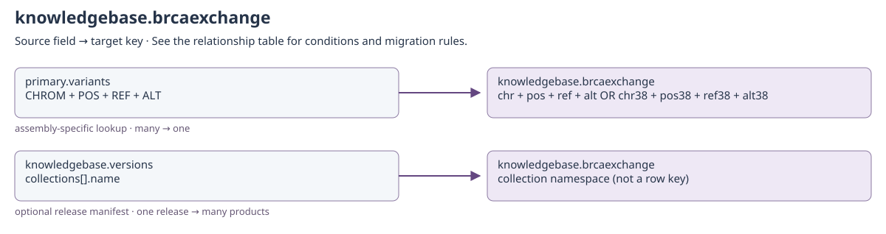

[Open full-size diagram](../../assets/diagrams/collection-dependencies/knowledgebase-brcaexchange.svg)

### Outgoing dependencies

| Source field | Target key | Relationship / multiplicity | Migration and resolution semantics | Evidence |
| --- | --- | --- | --- | --- |
| [knowledgebase.brcaexchange](knowledgebase.md#knowledgebase-brcaexchange): `created_by + updated_by` | [identity.users](identity.md#identity-users): `username` | historical actor; many → historical identity | Only populated actor fields apply. Preserve system and historical usernames even if no current account exists; never substitute the migration user. | [S12](#s12) |

### Incoming references and migration impact

| Source field | Target key | Relationship / multiplicity | Migration and resolution semantics | Evidence |
| --- | --- | --- | --- | --- |
| [primary.variants](clinical.md#primary-variants): `CHROM + POS + REF + ALT` | [knowledgebase.brcaexchange](knowledgebase.md#knowledgebase-brcaexchange): `chr + pos + ref + alt OR chr38 + pos38 + ref38 + alt38` | assembly-specific lookup; many → one | The sample genome build chooses the 37 or 38 key set; unsupported build returns no match. | [S1](#s1) |
| [knowledgebase.versions](knowledgebase.md#knowledgebase-versions): `collections[].name` | [knowledgebase.brcaexchange](knowledgebase.md#knowledgebase-brcaexchange): `collection namespace (not a row key)` | optional release manifest; one release → many products | Applies only when this collection is named in a release manifest. The manifest does not establish a foreign key from each provider row to versions._id. Keep source, release, build and import counts/checksums together. | [S6](#s6) |

## knowledgebase.civic_genes

Binding: `civic_gene_collection`.

CIViC gene record with review timestamp, aliases, and source identifiers.

Declared top-level fields: `created_by`, `updated_by`, `system_installed`, `gene_id`, `entrez_id`, `name`, `description`, `gene_civic_url`, `last_review_date`, `feature_type`, `aliases`, `ncit_id`, `source_record`.

[Field types and validation](../mongodb-collections.md#civic_genes). `_id` may also be retained by an open collection model.

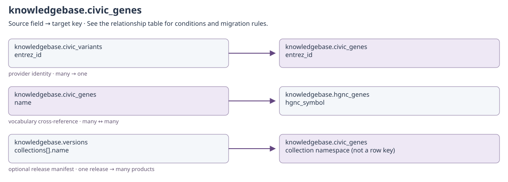

[Open full-size diagram](../../assets/diagrams/collection-dependencies/knowledgebase-civic-genes.svg)

### Outgoing dependencies

| Source field | Target key | Relationship / multiplicity | Migration and resolution semantics | Evidence |
| --- | --- | --- | --- | --- |
| [knowledgebase.civic_genes](knowledgebase.md#knowledgebase-civic-genes): `name` | [knowledgebase.hgnc_genes](knowledgebase.md#knowledgebase-hgnc-genes): `hgnc_symbol` | vocabulary cross-reference; many ↔ many | Provider gene identity, not a Coyote3 ObjectId foreign key. Keep provider release/source and resolve aliases only through documented nomenclature. | [S11](#s11) |
| [knowledgebase.civic_genes](knowledgebase.md#knowledgebase-civic-genes): `created_by + updated_by` | [identity.users](identity.md#identity-users): `username` | historical actor; many → historical identity | Only populated actor fields apply. Preserve system and historical usernames even if no current account exists; never substitute the migration user. | [S12](#s12) |

### Incoming references and migration impact

| Source field | Target key | Relationship / multiplicity | Migration and resolution semantics | Evidence |
| --- | --- | --- | --- | --- |
| [knowledgebase.civic_variants](knowledgebase.md#knowledgebase-civic-variants): `entrez_id` | [knowledgebase.civic_genes](knowledgebase.md#knowledgebase-civic-genes): `entrez_id` | provider identity; many → one | Shared Entrez gene identity. CIViC gene_id and variant_id belong to different provider namespaces. | [S11](#s11) |
| [knowledgebase.versions](knowledgebase.md#knowledgebase-versions): `collections[].name` | [knowledgebase.civic_genes](knowledgebase.md#knowledgebase-civic-genes): `collection namespace (not a row key)` | optional release manifest; one release → many products | Applies only when this collection is named in a release manifest. The manifest does not establish a foreign key from each provider row to versions._id. Keep source, release, build and import counts/checksums together. | [S6](#s6) |

## knowledgebase.civic_variants

Binding: `civic_variants_collection`.

CIViC variant or fusion record with coordinates, HGVS, and review metadata.

Declared top-level fields: `created_by`, `updated_by`, `system_installed`, `variant_id`, `entrez_id`, `gene`, `variant`, `summary`, `variant_types`, `variant_groups`, `chromosome`, `start`, `stop`, `chromosome2`, `start2`, `stop2`, `reference_build`, `ensembl_version`, `representative_transcript`, `representative_transcript2`, `reference_bases`, `variant_bases`, `hgvs_expressions`, `civic_actionability_score`, `variant_civic_url`, `last_review_date`, `feature_type`, `feature_id`, `feature_name`, `feature_civic_url`, `variant_aliases`, `is_flagged`, `molecular_profile_id`, `allele_registry_id`, `clinvar_ids`, `ncit_id`, `five_prime_partner`, `three_prime_partner`, `vicc_compliant_name`, `iscn_name`, `source_record`.

[Field types and validation](../mongodb-collections.md#civic_variants). `_id` may also be retained by an open collection model.

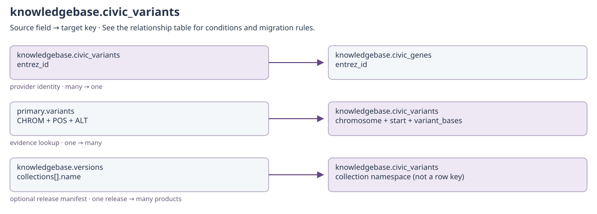

[Open full-size diagram](../../assets/diagrams/collection-dependencies/knowledgebase-civic-variants.svg)

### Outgoing dependencies

| Source field | Target key | Relationship / multiplicity | Migration and resolution semantics | Evidence |
| --- | --- | --- | --- | --- |
| [knowledgebase.civic_variants](knowledgebase.md#knowledgebase-civic-variants): `entrez_id` | [knowledgebase.civic_genes](knowledgebase.md#knowledgebase-civic-genes): `entrez_id` | provider identity; many → one | Shared Entrez gene identity. CIViC gene_id and variant_id belong to different provider namespaces. | [S11](#s11) |
| [knowledgebase.civic_variants](knowledgebase.md#knowledgebase-civic-variants): `created_by + updated_by` | [identity.users](identity.md#identity-users): `username` | historical actor; many → historical identity | Only populated actor fields apply. Preserve system and historical usernames even if no current account exists; never substitute the migration user. | [S12](#s12) |

### Incoming references and migration impact

| Source field | Target key | Relationship / multiplicity | Migration and resolution semantics | Evidence |
| --- | --- | --- | --- | --- |
| [primary.variants](clinical.md#primary-variants): `CHROM + POS + ALT` | [knowledgebase.civic_variants](knowledgebase.md#knowledgebase-civic-variants): `chromosome + start + variant_bases` | evidence lookup; one → many | One CIViC lookup branch; alternatives use selected transcript SYMBOL/HGVSc or gene/variant description. Reference-build compatibility still needs validation. | [S2](#s2) |
| [knowledgebase.versions](knowledgebase.md#knowledgebase-versions): `collections[].name` | [knowledgebase.civic_variants](knowledgebase.md#knowledgebase-civic-variants): `collection namespace (not a row key)` | optional release manifest; one release → many products | Applies only when this collection is named in a release manifest. The manifest does not establish a foreign key from each provider row to versions._id. Keep source, release, build and import counts/checksums together. | [S6](#s6) |

## knowledgebase.clinpgx_genes_public

Binding: `clinpgx_genes_public_collection`.

Public ClinPGx gene cache record imported from genes.tsv.

Declared top-level fields: `created_by`, `updated_by`, `system_installed`, `pharmgkb_accession_id`, `ncbi_gene_id`, `hgnc_id`, `ensembl_id`, `name`, `symbol`, `alternate_names`, `alternate_symbols`, `is_vip`, `has_variant_annotation`, `has_cpic_dosing_guideline`, `cross_references`, `chromosome`, `grch37_start`, `grch37_stop`, `grch38_start`, `grch38_stop`, `source`, `source_file`, `source_reference`, `source_created`, `public_api`, `last_seen_at`.

[Field types and validation](../mongodb-collections.md#clinpgx_genes_public). `_id` may also be retained by an open collection model.

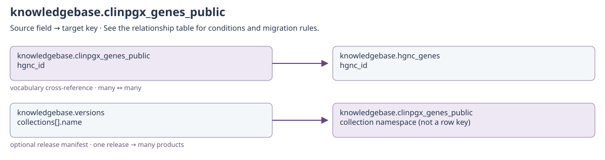

[Open full-size diagram](../../assets/diagrams/collection-dependencies/knowledgebase-clinpgx-genes-public.svg)

### Outgoing dependencies

| Source field | Target key | Relationship / multiplicity | Migration and resolution semantics | Evidence |
| --- | --- | --- | --- | --- |
| [knowledgebase.clinpgx_genes_public](knowledgebase.md#knowledgebase-clinpgx-genes-public): `hgnc_id` | [knowledgebase.hgnc_genes](knowledgebase.md#knowledgebase-hgnc-genes): `hgnc_id` | vocabulary cross-reference; many ↔ many | Provider gene identity, not a Coyote3 ObjectId foreign key. Keep provider release/source and resolve aliases only through documented nomenclature. | [S11](#s11) |
| [knowledgebase.clinpgx_genes_public](knowledgebase.md#knowledgebase-clinpgx-genes-public): `created_by + updated_by` | [identity.users](identity.md#identity-users): `username` | historical actor; many → historical identity | Only populated actor fields apply. Preserve system and historical usernames even if no current account exists; never substitute the migration user. | [S12](#s12) |

### Incoming references and migration impact

| Source field | Target key | Relationship / multiplicity | Migration and resolution semantics | Evidence |
| --- | --- | --- | --- | --- |
| [knowledgebase.versions](knowledgebase.md#knowledgebase-versions): `collections[].name` | [knowledgebase.clinpgx_genes_public](knowledgebase.md#knowledgebase-clinpgx-genes-public): `collection namespace (not a row key)` | optional release manifest; one release → many products | Applies only when this collection is named in a release manifest. The manifest does not establish a foreign key from each provider row to versions._id. Keep source, release, build and import counts/checksums together. | [S6](#s6) |

## knowledgebase.cosmic

Binding: `cosmic_collection`.

COSMIC variant interval with named occurrence counts.

Declared top-level fields: `created_by`, `updated_by`, `system_installed`, `id`, `chr`, `start`, `end`, `cnt`.

[Field types and validation](../mongodb-collections.md#cosmic). `_id` may also be retained by an open collection model.

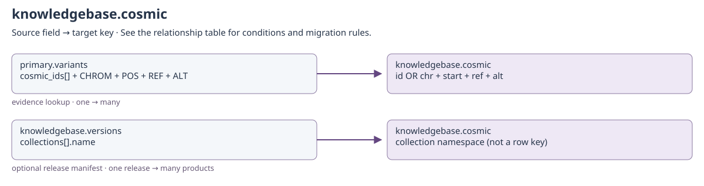

[Open full-size diagram](../../assets/diagrams/collection-dependencies/knowledgebase-cosmic.svg)

### Outgoing dependencies

| Source field | Target key | Relationship / multiplicity | Migration and resolution semantics | Evidence |
| --- | --- | --- | --- | --- |
| [knowledgebase.cosmic](knowledgebase.md#knowledgebase-cosmic): `created_by + updated_by` | [identity.users](identity.md#identity-users): `username` | historical actor; many → historical identity | Only populated actor fields apply. Preserve system and historical usernames even if no current account exists; never substitute the migration user. | [S12](#s12) |

### Incoming references and migration impact

| Source field | Target key | Relationship / multiplicity | Migration and resolution semantics | Evidence |
| --- | --- | --- | --- | --- |
| [primary.variants](clinical.md#primary-variants): `cosmic_ids[] + CHROM + POS + REF + ALT` | [knowledgebase.cosmic](knowledgebase.md#knowledgebase-cosmic): `id OR chr + start + ref + alt` | evidence lookup; one → many | Use product/build availability checks and exact allele predicates. CosmicDoc's minimal schema omits ref/alt used by the richer repository records; inspect imported product shape. | [S3](#s3) |
| [knowledgebase.versions](knowledgebase.md#knowledgebase-versions): `collections[].name` | [knowledgebase.cosmic](knowledgebase.md#knowledgebase-cosmic): `collection namespace (not a row key)` | optional release manifest; one release → many products | Applies only when this collection is named in a release manifest. The manifest does not establish a foreign key from each provider row to versions._id. Keep source, release, build and import counts/checksums together. | [S6](#s6) |

## knowledgebase.cosmic_actionability

Binding: `cosmic_actionability_collection`.

Common contract for a source-faithful non-variant COSMIC product record.

Provider product rows retain `record_key` and `source_row`. The latter is an opaque
provider payload: its columns are release-specific, not declared Coyote3 foreign keys.
Do not infer a gene/transcript/variant join from a similarly named vendor column.

Declared top-level fields: `created_by`, `updated_by`, `system_installed`, `record_key`, `source_row`.

[Field types and validation](../mongodb-collections.md#cosmic_actionability). `_id` may also be retained by an open collection model.

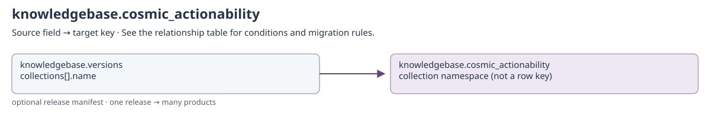

[Open full-size diagram](../../assets/diagrams/collection-dependencies/knowledgebase-cosmic-actionability.svg)

### Outgoing dependencies

| Source field | Target key | Relationship / multiplicity | Migration and resolution semantics | Evidence |
| --- | --- | --- | --- | --- |
| [knowledgebase.cosmic_actionability](knowledgebase.md#knowledgebase-cosmic-actionability): `created_by + updated_by` | [identity.users](identity.md#identity-users): `username` | historical actor; many → historical identity | Only populated actor fields apply. Preserve system and historical usernames even if no current account exists; never substitute the migration user. | [S12](#s12) |

### Incoming references and migration impact

| Source field | Target key | Relationship / multiplicity | Migration and resolution semantics | Evidence |
| --- | --- | --- | --- | --- |
| [knowledgebase.versions](knowledgebase.md#knowledgebase-versions): `collections[].name` | [knowledgebase.cosmic_actionability](knowledgebase.md#knowledgebase-cosmic-actionability): `collection namespace (not a row key)` | optional release manifest; one release → many products | Applies only when this collection is named in a release manifest. The manifest does not establish a foreign key from each provider row to versions._id. Keep source, release, build and import counts/checksums together. | [S6](#s6) |

## knowledgebase.cosmic_breakpoints

Binding: `cosmic_breakpoints_collection`.

Common contract for a source-faithful non-variant COSMIC product record.

Provider product rows retain `record_key` and `source_row`. The latter is an opaque
provider payload: its columns are release-specific, not declared Coyote3 foreign keys.
Do not infer a gene/transcript/variant join from a similarly named vendor column.

Declared top-level fields: `created_by`, `updated_by`, `system_installed`, `record_key`, `source_row`.

[Field types and validation](../mongodb-collections.md#cosmic_breakpoints). `_id` may also be retained by an open collection model.

[Open full-size diagram](../../assets/diagrams/collection-dependencies/knowledgebase-cosmic-breakpoints.svg)

### Outgoing dependencies

| Source field | Target key | Relationship / multiplicity | Migration and resolution semantics | Evidence |
| --- | --- | --- | --- | --- |
| [knowledgebase.cosmic_breakpoints](knowledgebase.md#knowledgebase-cosmic-breakpoints): `created_by + updated_by` | [identity.users](identity.md#identity-users): `username` | historical actor; many → historical identity | Only populated actor fields apply. Preserve system and historical usernames even if no current account exists; never substitute the migration user. | [S12](#s12) |

### Incoming references and migration impact

| Source field | Target key | Relationship / multiplicity | Migration and resolution semantics | Evidence |
| --- | --- | --- | --- | --- |
| [knowledgebase.versions](knowledgebase.md#knowledgebase-versions): `collections[].name` | [knowledgebase.cosmic_breakpoints](knowledgebase.md#knowledgebase-cosmic-breakpoints): `collection namespace (not a row key)` | optional release manifest; one release → many products | Applies only when this collection is named in a release manifest. The manifest does not establish a foreign key from each provider row to versions._id. Keep source, release, build and import counts/checksums together. | [S6](#s6) |

## knowledgebase.cosmic_cancer_gene_census

Binding: `cosmic_cgc_collection`.

Common contract for a source-faithful non-variant COSMIC product record.

Provider product rows retain `record_key` and `source_row`. The latter is an opaque
provider payload: its columns are release-specific, not declared Coyote3 foreign keys.
Do not infer a gene/transcript/variant join from a similarly named vendor column.

Declared top-level fields: `created_by`, `updated_by`, `system_installed`, `record_key`, `source_row`.

[Field types and validation](../mongodb-collections.md#cosmic_cancer_gene_census). `_id` may also be retained by an open collection model.

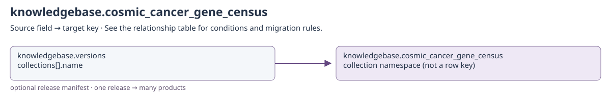

[Open full-size diagram](../../assets/diagrams/collection-dependencies/knowledgebase-cosmic-cancer-gene-census.svg)

### Outgoing dependencies

| Source field | Target key | Relationship / multiplicity | Migration and resolution semantics | Evidence |
| --- | --- | --- | --- | --- |
| [knowledgebase.cosmic_cancer_gene_census](knowledgebase.md#knowledgebase-cosmic-cancer-gene-census): `created_by + updated_by` | [identity.users](identity.md#identity-users): `username` | historical actor; many → historical identity | Only populated actor fields apply. Preserve system and historical usernames even if no current account exists; never substitute the migration user. | [S12](#s12) |

### Incoming references and migration impact

| Source field | Target key | Relationship / multiplicity | Migration and resolution semantics | Evidence |
| --- | --- | --- | --- | --- |
| [knowledgebase.versions](knowledgebase.md#knowledgebase-versions): `collections[].name` | [knowledgebase.cosmic_cancer_gene_census](knowledgebase.md#knowledgebase-cosmic-cancer-gene-census): `collection namespace (not a row key)` | optional release manifest; one release → many products | Applies only when this collection is named in a release manifest. The manifest does not establish a foreign key from each provider row to versions._id. Keep source, release, build and import counts/checksums together. | [S6](#s6) |

## knowledgebase.cosmic_census_gene_mutations

Binding: `cosmic_mutant_census_collection`.

Common contract for a source-faithful non-variant COSMIC product record.

Provider product rows retain `record_key` and `source_row`. The latter is an opaque
provider payload: its columns are release-specific, not declared Coyote3 foreign keys.
Do not infer a gene/transcript/variant join from a similarly named vendor column.

Declared top-level fields: `created_by`, `updated_by`, `system_installed`, `record_key`, `source_row`.

[Field types and validation](../mongodb-collections.md#cosmic_census_gene_mutations). `_id` may also be retained by an open collection model.

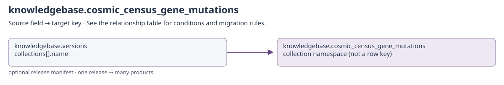

[Open full-size diagram](../../assets/diagrams/collection-dependencies/knowledgebase-cosmic-census-gene-mutations.svg)

### Outgoing dependencies

| Source field | Target key | Relationship / multiplicity | Migration and resolution semantics | Evidence |
| --- | --- | --- | --- | --- |
| [knowledgebase.cosmic_census_gene_mutations](knowledgebase.md#knowledgebase-cosmic-census-gene-mutations): `created_by + updated_by` | [identity.users](identity.md#identity-users): `username` | historical actor; many → historical identity | Only populated actor fields apply. Preserve system and historical usernames even if no current account exists; never substitute the migration user. | [S12](#s12) |

### Incoming references and migration impact

| Source field | Target key | Relationship / multiplicity | Migration and resolution semantics | Evidence |
| --- | --- | --- | --- | --- |
| [knowledgebase.versions](knowledgebase.md#knowledgebase-versions): `collections[].name` | [knowledgebase.cosmic_census_gene_mutations](knowledgebase.md#knowledgebase-cosmic-census-gene-mutations): `collection namespace (not a row key)` | optional release manifest; one release → many products | Applies only when this collection is named in a release manifest. The manifest does not establish a foreign key from each provider row to versions._id. Keep source, release, build and import counts/checksums together. | [S6](#s6) |

## knowledgebase.cosmic_cgc_hallmarks

Binding: `cosmic_cgc_hallmarks_collection`.

Common contract for a source-faithful non-variant COSMIC product record.

Provider product rows retain `record_key` and `source_row`. The latter is an opaque
provider payload: its columns are release-specific, not declared Coyote3 foreign keys.
Do not infer a gene/transcript/variant join from a similarly named vendor column.

Declared top-level fields: `created_by`, `updated_by`, `system_installed`, `record_key`, `source_row`.

[Field types and validation](../mongodb-collections.md#cosmic_cgc_hallmarks). `_id` may also be retained by an open collection model.

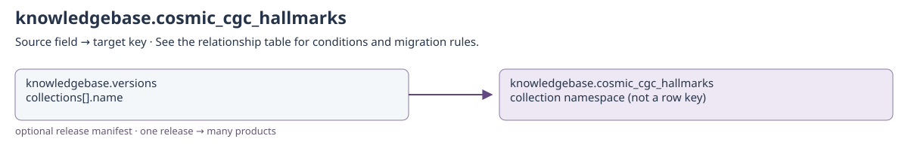

[Open full-size diagram](../../assets/diagrams/collection-dependencies/knowledgebase-cosmic-cgc-hallmarks.svg)

### Outgoing dependencies

| Source field | Target key | Relationship / multiplicity | Migration and resolution semantics | Evidence |
| --- | --- | --- | --- | --- |
| [knowledgebase.cosmic_cgc_hallmarks](knowledgebase.md#knowledgebase-cosmic-cgc-hallmarks): `created_by + updated_by` | [identity.users](identity.md#identity-users): `username` | historical actor; many → historical identity | Only populated actor fields apply. Preserve system and historical usernames even if no current account exists; never substitute the migration user. | [S12](#s12) |

### Incoming references and migration impact

| Source field | Target key | Relationship / multiplicity | Migration and resolution semantics | Evidence |
| --- | --- | --- | --- | --- |
| [knowledgebase.versions](knowledgebase.md#knowledgebase-versions): `collections[].name` | [knowledgebase.cosmic_cgc_hallmarks](knowledgebase.md#knowledgebase-cosmic-cgc-hallmarks): `collection namespace (not a row key)` | optional release manifest; one release → many products | Applies only when this collection is named in a release manifest. The manifest does not establish a foreign key from each provider row to versions._id. Keep source, release, build and import counts/checksums together. | [S6](#s6) |

## knowledgebase.cosmic_classification_papers

Binding: `cosmic_classification_paper_collection`.

Common contract for a source-faithful non-variant COSMIC product record.

Provider product rows retain `record_key` and `source_row`. The latter is an opaque
provider payload: its columns are release-specific, not declared Coyote3 foreign keys.
Do not infer a gene/transcript/variant join from a similarly named vendor column.

Declared top-level fields: `created_by`, `updated_by`, `system_installed`, `record_key`, `source_row`.

[Field types and validation](../mongodb-collections.md#cosmic_classification_papers). `_id` may also be retained by an open collection model.

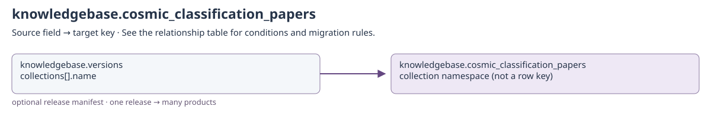

[Open full-size diagram](../../assets/diagrams/collection-dependencies/knowledgebase-cosmic-classification-papers.svg)

### Outgoing dependencies

| Source field | Target key | Relationship / multiplicity | Migration and resolution semantics | Evidence |
| --- | --- | --- | --- | --- |
| [knowledgebase.cosmic_classification_papers](knowledgebase.md#knowledgebase-cosmic-classification-papers): `created_by + updated_by` | [identity.users](identity.md#identity-users): `username` | historical actor; many → historical identity | Only populated actor fields apply. Preserve system and historical usernames even if no current account exists; never substitute the migration user. | [S12](#s12) |

### Incoming references and migration impact

| Source field | Target key | Relationship / multiplicity | Migration and resolution semantics | Evidence |
| --- | --- | --- | --- | --- |
| [knowledgebase.versions](knowledgebase.md#knowledgebase-versions): `collections[].name` | [knowledgebase.cosmic_classification_papers](knowledgebase.md#knowledgebase-cosmic-classification-papers): `collection namespace (not a row key)` | optional release manifest; one release → many products | Applies only when this collection is named in a release manifest. The manifest does not establish a foreign key from each provider row to versions._id. Keep source, release, build and import counts/checksums together. | [S6](#s6) |

## knowledgebase.cosmic_classifications

Binding: `cosmic_classification_collection`.

Common contract for a source-faithful non-variant COSMIC product record.

Provider product rows retain `record_key` and `source_row`. The latter is an opaque
provider payload: its columns are release-specific, not declared Coyote3 foreign keys.
Do not infer a gene/transcript/variant join from a similarly named vendor column.

Declared top-level fields: `created_by`, `updated_by`, `system_installed`, `record_key`, `source_row`.

[Field types and validation](../mongodb-collections.md#cosmic_classifications). `_id` may also be retained by an open collection model.

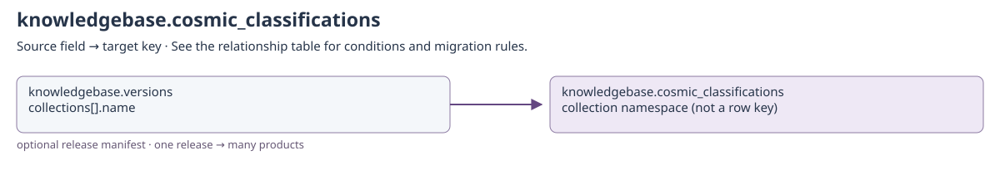

[Open full-size diagram](../../assets/diagrams/collection-dependencies/knowledgebase-cosmic-classifications.svg)

### Outgoing dependencies

| Source field | Target key | Relationship / multiplicity | Migration and resolution semantics | Evidence |
| --- | --- | --- | --- | --- |
| [knowledgebase.cosmic_classifications](knowledgebase.md#knowledgebase-cosmic-classifications): `created_by + updated_by` | [identity.users](identity.md#identity-users): `username` | historical actor; many → historical identity | Only populated actor fields apply. Preserve system and historical usernames even if no current account exists; never substitute the migration user. | [S12](#s12) |

### Incoming references and migration impact

| Source field | Target key | Relationship / multiplicity | Migration and resolution semantics | Evidence |
| --- | --- | --- | --- | --- |
| [knowledgebase.versions](knowledgebase.md#knowledgebase-versions): `collections[].name` | [knowledgebase.cosmic_classifications](knowledgebase.md#knowledgebase-cosmic-classifications): `collection namespace (not a row key)` | optional release manifest; one release → many products | Applies only when this collection is named in a release manifest. The manifest does not establish a foreign key from each provider row to versions._id. Keep source, release, build and import counts/checksums together. | [S6](#s6) |

## knowledgebase.cosmic_copy_number

Binding: `cosmic_cna_collection`.

Common contract for a source-faithful non-variant COSMIC product record.

Provider product rows retain `record_key` and `source_row`. The latter is an opaque
provider payload: its columns are release-specific, not declared Coyote3 foreign keys.
Do not infer a gene/transcript/variant join from a similarly named vendor column.

Declared top-level fields: `created_by`, `updated_by`, `system_installed`, `record_key`, `source_row`.

[Field types and validation](../mongodb-collections.md#cosmic_copy_number). `_id` may also be retained by an open collection model.

[Open full-size diagram](../../assets/diagrams/collection-dependencies/knowledgebase-cosmic-copy-number.svg)

### Outgoing dependencies

| Source field | Target key | Relationship / multiplicity | Migration and resolution semantics | Evidence |
| --- | --- | --- | --- | --- |
| [knowledgebase.cosmic_copy_number](knowledgebase.md#knowledgebase-cosmic-copy-number): `created_by + updated_by` | [identity.users](identity.md#identity-users): `username` | historical actor; many → historical identity | Only populated actor fields apply. Preserve system and historical usernames even if no current account exists; never substitute the migration user. | [S12](#s12) |

### Incoming references and migration impact

| Source field | Target key | Relationship / multiplicity | Migration and resolution semantics | Evidence |
| --- | --- | --- | --- | --- |
| [knowledgebase.versions](knowledgebase.md#knowledgebase-versions): `collections[].name` | [knowledgebase.cosmic_copy_number](knowledgebase.md#knowledgebase-cosmic-copy-number): `collection namespace (not a row key)` | optional release manifest; one release → many products | Applies only when this collection is named in a release manifest. The manifest does not establish a foreign key from each provider row to versions._id. Keep source, release, build and import counts/checksums together. | [S6](#s6) |

## knowledgebase.cosmic_fusions

Binding: `cosmic_fusion_collection`.

Common contract for a source-faithful non-variant COSMIC product record.

Provider product rows retain `record_key` and `source_row`. The latter is an opaque
provider payload: its columns are release-specific, not declared Coyote3 foreign keys.
Do not infer a gene/transcript/variant join from a similarly named vendor column.

Declared top-level fields: `created_by`, `updated_by`, `system_installed`, `record_key`, `source_row`.

[Field types and validation](../mongodb-collections.md#cosmic_fusions). `_id` may also be retained by an open collection model.

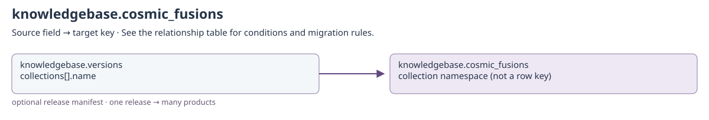

[Open full-size diagram](../../assets/diagrams/collection-dependencies/knowledgebase-cosmic-fusions.svg)

### Outgoing dependencies

| Source field | Target key | Relationship / multiplicity | Migration and resolution semantics | Evidence |
| --- | --- | --- | --- | --- |
| [knowledgebase.cosmic_fusions](knowledgebase.md#knowledgebase-cosmic-fusions): `created_by + updated_by` | [identity.users](identity.md#identity-users): `username` | historical actor; many → historical identity | Only populated actor fields apply. Preserve system and historical usernames even if no current account exists; never substitute the migration user. | [S12](#s12) |

### Incoming references and migration impact

| Source field | Target key | Relationship / multiplicity | Migration and resolution semantics | Evidence |
| --- | --- | --- | --- | --- |
| [knowledgebase.versions](knowledgebase.md#knowledgebase-versions): `collections[].name` | [knowledgebase.cosmic_fusions](knowledgebase.md#knowledgebase-cosmic-fusions): `collection namespace (not a row key)` | optional release manifest; one release → many products | Applies only when this collection is named in a release manifest. The manifest does not establish a foreign key from each provider row to versions._id. Keep source, release, build and import counts/checksums together. | [S6](#s6) |

## knowledgebase.cosmic_gene_expression

Binding: `cosmic_expression_collection`.

Common contract for a source-faithful non-variant COSMIC product record.

Provider product rows retain `record_key` and `source_row`. The latter is an opaque
provider payload: its columns are release-specific, not declared Coyote3 foreign keys.
Do not infer a gene/transcript/variant join from a similarly named vendor column.

Declared top-level fields: `created_by`, `updated_by`, `system_installed`, `record_key`, `source_row`.

[Field types and validation](../mongodb-collections.md#cosmic_gene_expression). `_id` may also be retained by an open collection model.

[Open full-size diagram](../../assets/diagrams/collection-dependencies/knowledgebase-cosmic-gene-expression.svg)

### Outgoing dependencies

| Source field | Target key | Relationship / multiplicity | Migration and resolution semantics | Evidence |
| --- | --- | --- | --- | --- |
| [knowledgebase.cosmic_gene_expression](knowledgebase.md#knowledgebase-cosmic-gene-expression): `created_by + updated_by` | [identity.users](identity.md#identity-users): `username` | historical actor; many → historical identity | Only populated actor fields apply. Preserve system and historical usernames even if no current account exists; never substitute the migration user. | [S12](#s12) |

### Incoming references and migration impact

| Source field | Target key | Relationship / multiplicity | Migration and resolution semantics | Evidence |
| --- | --- | --- | --- | --- |
| [knowledgebase.versions](knowledgebase.md#knowledgebase-versions): `collections[].name` | [knowledgebase.cosmic_gene_expression](knowledgebase.md#knowledgebase-cosmic-gene-expression): `collection namespace (not a row key)` | optional release manifest; one release → many products | Applies only when this collection is named in a release manifest. The manifest does not establish a foreign key from each provider row to versions._id. Keep source, release, build and import counts/checksums together. | [S6](#s6) |

## knowledgebase.cosmic_genes

Binding: `cosmic_genes_collection`.

Common contract for a source-faithful non-variant COSMIC product record.

Provider product rows retain `record_key` and `source_row`. The latter is an opaque
provider payload: its columns are release-specific, not declared Coyote3 foreign keys.
Do not infer a gene/transcript/variant join from a similarly named vendor column.

Declared top-level fields: `created_by`, `updated_by`, `system_installed`, `record_key`, `source_row`.

[Field types and validation](../mongodb-collections.md#cosmic_genes). `_id` may also be retained by an open collection model.

[Open full-size diagram](../../assets/diagrams/collection-dependencies/knowledgebase-cosmic-genes.svg)

### Outgoing dependencies

| Source field | Target key | Relationship / multiplicity | Migration and resolution semantics | Evidence |
| --- | --- | --- | --- | --- |
| [knowledgebase.cosmic_genes](knowledgebase.md#knowledgebase-cosmic-genes): `created_by + updated_by` | [identity.users](identity.md#identity-users): `username` | historical actor; many → historical identity | Only populated actor fields apply. Preserve system and historical usernames even if no current account exists; never substitute the migration user. | [S12](#s12) |

### Incoming references and migration impact

| Source field | Target key | Relationship / multiplicity | Migration and resolution semantics | Evidence |
| --- | --- | --- | --- | --- |
| [knowledgebase.versions](knowledgebase.md#knowledgebase-versions): `collections[].name` | [knowledgebase.cosmic_genes](knowledgebase.md#knowledgebase-cosmic-genes): `collection namespace (not a row key)` | optional release manifest; one release → many products | Applies only when this collection is named in a release manifest. The manifest does not establish a foreign key from each provider row to versions._id. Keep source, release, build and import counts/checksums together. | [S6](#s6) |

## knowledgebase.cosmic_methylation

Binding: `cosmic_methylation_collection`.

Common contract for a source-faithful non-variant COSMIC product record.

Provider product rows retain `record_key` and `source_row`. The latter is an opaque
provider payload: its columns are release-specific, not declared Coyote3 foreign keys.
Do not infer a gene/transcript/variant join from a similarly named vendor column.

Declared top-level fields: `created_by`, `updated_by`, `system_installed`, `record_key`, `source_row`.

[Field types and validation](../mongodb-collections.md#cosmic_methylation). `_id` may also be retained by an open collection model.

[Open full-size diagram](../../assets/diagrams/collection-dependencies/knowledgebase-cosmic-methylation.svg)

### Outgoing dependencies

| Source field | Target key | Relationship / multiplicity | Migration and resolution semantics | Evidence |
| --- | --- | --- | --- | --- |
| [knowledgebase.cosmic_methylation](knowledgebase.md#knowledgebase-cosmic-methylation): `created_by + updated_by` | [identity.users](identity.md#identity-users): `username` | historical actor; many → historical identity | Only populated actor fields apply. Preserve system and historical usernames even if no current account exists; never substitute the migration user. | [S12](#s12) |

### Incoming references and migration impact

| Source field | Target key | Relationship / multiplicity | Migration and resolution semantics | Evidence |
| --- | --- | --- | --- | --- |
| [knowledgebase.versions](knowledgebase.md#knowledgebase-versions): `collections[].name` | [knowledgebase.cosmic_methylation](knowledgebase.md#knowledgebase-cosmic-methylation): `collection namespace (not a row key)` | optional release manifest; one release → many products | Applies only when this collection is named in a release manifest. The manifest does not establish a foreign key from each provider row to versions._id. Keep source, release, build and import counts/checksums together. | [S6](#s6) |

## knowledgebase.cosmic_mutation_census

Binding: `cosmic_mutation_census_collection`.

Common contract for a source-faithful non-variant COSMIC product record.

Provider product rows retain `record_key` and `source_row`. The latter is an opaque
provider payload: its columns are release-specific, not declared Coyote3 foreign keys.
Do not infer a gene/transcript/variant join from a similarly named vendor column.

Declared top-level fields: `created_by`, `updated_by`, `system_installed`, `record_key`, `source_row`.

[Field types and validation](../mongodb-collections.md#cosmic_mutation_census). `_id` may also be retained by an open collection model.

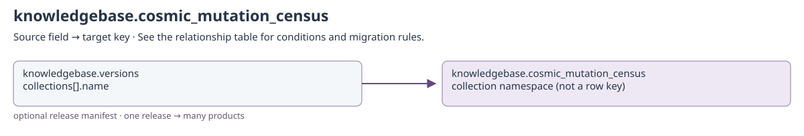

[Open full-size diagram](../../assets/diagrams/collection-dependencies/knowledgebase-cosmic-mutation-census.svg)

### Outgoing dependencies

| Source field | Target key | Relationship / multiplicity | Migration and resolution semantics | Evidence |
| --- | --- | --- | --- | --- |
| [knowledgebase.cosmic_mutation_census](knowledgebase.md#knowledgebase-cosmic-mutation-census): `created_by + updated_by` | [identity.users](identity.md#identity-users): `username` | historical actor; many → historical identity | Only populated actor fields apply. Preserve system and historical usernames even if no current account exists; never substitute the migration user. | [S12](#s12) |

### Incoming references and migration impact

| Source field | Target key | Relationship / multiplicity | Migration and resolution semantics | Evidence |
| --- | --- | --- | --- | --- |
| [knowledgebase.versions](knowledgebase.md#knowledgebase-versions): `collections[].name` | [knowledgebase.cosmic_mutation_census](knowledgebase.md#knowledgebase-cosmic-mutation-census): `collection namespace (not a row key)` | optional release manifest; one release → many products | Applies only when this collection is named in a release manifest. The manifest does not establish a foreign key from each provider row to versions._id. Keep source, release, build and import counts/checksums together. | [S6](#s6) |

## knowledgebase.cosmic_noncoding_variants

Binding: `cosmic_noncoding_collection`.

COSMIC variant interval with named occurrence counts.

Declared top-level fields: `created_by`, `updated_by`, `system_installed`, `id`, `chr`, `start`, `end`, `cnt`.

[Field types and validation](../mongodb-collections.md#cosmic_noncoding_variants). `_id` may also be retained by an open collection model.

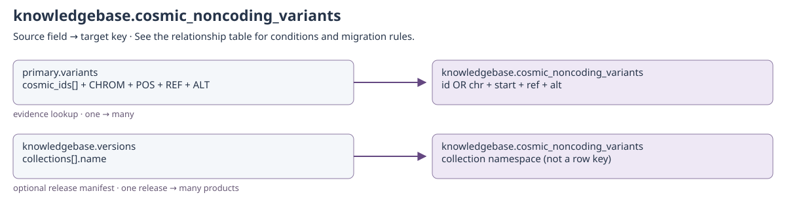

[Open full-size diagram](../../assets/diagrams/collection-dependencies/knowledgebase-cosmic-noncoding-variants.svg)

### Outgoing dependencies

| Source field | Target key | Relationship / multiplicity | Migration and resolution semantics | Evidence |
| --- | --- | --- | --- | --- |
| [knowledgebase.cosmic_noncoding_variants](knowledgebase.md#knowledgebase-cosmic-noncoding-variants): `created_by + updated_by` | [identity.users](identity.md#identity-users): `username` | historical actor; many → historical identity | Only populated actor fields apply. Preserve system and historical usernames even if no current account exists; never substitute the migration user. | [S12](#s12) |

### Incoming references and migration impact

| Source field | Target key | Relationship / multiplicity | Migration and resolution semantics | Evidence |
| --- | --- | --- | --- | --- |
| [primary.variants](clinical.md#primary-variants): `cosmic_ids[] + CHROM + POS + REF + ALT` | [knowledgebase.cosmic_noncoding_variants](knowledgebase.md#knowledgebase-cosmic-noncoding-variants): `id OR chr + start + ref + alt` | evidence lookup; one → many | Use product/build availability checks and exact allele predicates. CosmicDoc's minimal schema omits ref/alt used by the richer repository records; inspect imported product shape. | [S3](#s3) |
| [knowledgebase.versions](knowledgebase.md#knowledgebase-versions): `collections[].name` | [knowledgebase.cosmic_noncoding_variants](knowledgebase.md#knowledgebase-cosmic-noncoding-variants): `collection namespace (not a row key)` | optional release manifest; one release → many products | Applies only when this collection is named in a release manifest. The manifest does not establish a foreign key from each provider row to versions._id. Keep source, release, build and import counts/checksums together. | [S6](#s6) |

## knowledgebase.cosmic_resistance_mutations

Binding: `cosmic_resistance_collection`.

Common contract for a source-faithful non-variant COSMIC product record.

Provider product rows retain `record_key` and `source_row`. The latter is an opaque
provider payload: its columns are release-specific, not declared Coyote3 foreign keys.
Do not infer a gene/transcript/variant join from a similarly named vendor column.

Declared top-level fields: `created_by`, `updated_by`, `system_installed`, `record_key`, `source_row`.

[Field types and validation](../mongodb-collections.md#cosmic_resistance_mutations). `_id` may also be retained by an open collection model.

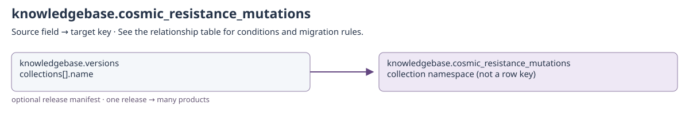

[Open full-size diagram](../../assets/diagrams/collection-dependencies/knowledgebase-cosmic-resistance-mutations.svg)

### Outgoing dependencies

| Source field | Target key | Relationship / multiplicity | Migration and resolution semantics | Evidence |
| --- | --- | --- | --- | --- |
| [knowledgebase.cosmic_resistance_mutations](knowledgebase.md#knowledgebase-cosmic-resistance-mutations): `created_by + updated_by` | [identity.users](identity.md#identity-users): `username` | historical actor; many → historical identity | Only populated actor fields apply. Preserve system and historical usernames even if no current account exists; never substitute the migration user. | [S12](#s12) |

### Incoming references and migration impact

| Source field | Target key | Relationship / multiplicity | Migration and resolution semantics | Evidence |
| --- | --- | --- | --- | --- |
| [knowledgebase.versions](knowledgebase.md#knowledgebase-versions): `collections[].name` | [knowledgebase.cosmic_resistance_mutations](knowledgebase.md#knowledgebase-cosmic-resistance-mutations): `collection namespace (not a row key)` | optional release manifest; one release → many products | Applies only when this collection is named in a release manifest. The manifest does not establish a foreign key from each provider row to versions._id. Keep source, release, build and import counts/checksums together. | [S6](#s6) |

## knowledgebase.cosmic_signature_dbs

Binding: `cosmic_signature_dbs_collection`.

Common contract for a source-faithful non-variant COSMIC product record.

Provider product rows retain `record_key` and `source_row`. The latter is an opaque
provider payload: its columns are release-specific, not declared Coyote3 foreign keys.
Do not infer a gene/transcript/variant join from a similarly named vendor column.

Declared top-level fields: `created_by`, `updated_by`, `system_installed`, `record_key`, `source_row`.

[Field types and validation](../mongodb-collections.md#cosmic_signature_dbs). `_id` may also be retained by an open collection model.

[Open full-size diagram](../../assets/diagrams/collection-dependencies/knowledgebase-cosmic-signature-dbs.svg)

### Outgoing dependencies

| Source field | Target key | Relationship / multiplicity | Migration and resolution semantics | Evidence |
| --- | --- | --- | --- | --- |
| [knowledgebase.cosmic_signature_dbs](knowledgebase.md#knowledgebase-cosmic-signature-dbs): `created_by + updated_by` | [identity.users](identity.md#identity-users): `username` | historical actor; many → historical identity | Only populated actor fields apply. Preserve system and historical usernames even if no current account exists; never substitute the migration user. | [S12](#s12) |

### Incoming references and migration impact

| Source field | Target key | Relationship / multiplicity | Migration and resolution semantics | Evidence |
| --- | --- | --- | --- | --- |
| [knowledgebase.versions](knowledgebase.md#knowledgebase-versions): `collections[].name` | [knowledgebase.cosmic_signature_dbs](knowledgebase.md#knowledgebase-cosmic-signature-dbs): `collection namespace (not a row key)` | optional release manifest; one release → many products | Applies only when this collection is named in a release manifest. The manifest does not establish a foreign key from each provider row to versions._id. Keep source, release, build and import counts/checksums together. | [S6](#s6) |

## knowledgebase.cosmic_signature_sbs

Binding: `cosmic_signature_sbs_collection`.

Common contract for a source-faithful non-variant COSMIC product record.

Provider product rows retain `record_key` and `source_row`. The latter is an opaque
provider payload: its columns are release-specific, not declared Coyote3 foreign keys.
Do not infer a gene/transcript/variant join from a similarly named vendor column.

Declared top-level fields: `created_by`, `updated_by`, `system_installed`, `record_key`, `source_row`.

[Field types and validation](../mongodb-collections.md#cosmic_signature_sbs). `_id` may also be retained by an open collection model.

[Open full-size diagram](../../assets/diagrams/collection-dependencies/knowledgebase-cosmic-signature-sbs.svg)

### Outgoing dependencies

| Source field | Target key | Relationship / multiplicity | Migration and resolution semantics | Evidence |
| --- | --- | --- | --- | --- |
| [knowledgebase.cosmic_signature_sbs](knowledgebase.md#knowledgebase-cosmic-signature-sbs): `created_by + updated_by` | [identity.users](identity.md#identity-users): `username` | historical actor; many → historical identity | Only populated actor fields apply. Preserve system and historical usernames even if no current account exists; never substitute the migration user. | [S12](#s12) |

### Incoming references and migration impact

| Source field | Target key | Relationship / multiplicity | Migration and resolution semantics | Evidence |
| --- | --- | --- | --- | --- |
| [knowledgebase.versions](knowledgebase.md#knowledgebase-versions): `collections[].name` | [knowledgebase.cosmic_signature_sbs](knowledgebase.md#knowledgebase-cosmic-signature-sbs): `collection namespace (not a row key)` | optional release manifest; one release → many products | Applies only when this collection is named in a release manifest. The manifest does not establish a foreign key from each provider row to versions._id. Keep source, release, build and import counts/checksums together. | [S6](#s6) |

## knowledgebase.cosmic_signature_sv

Binding: `cosmic_signature_sv_collection`.

Common contract for a source-faithful non-variant COSMIC product record.

Provider product rows retain `record_key` and `source_row`. The latter is an opaque
provider payload: its columns are release-specific, not declared Coyote3 foreign keys.
Do not infer a gene/transcript/variant join from a similarly named vendor column.

Declared top-level fields: `created_by`, `updated_by`, `system_installed`, `record_key`, `source_row`.

[Field types and validation](../mongodb-collections.md#cosmic_signature_sv). `_id` may also be retained by an open collection model.

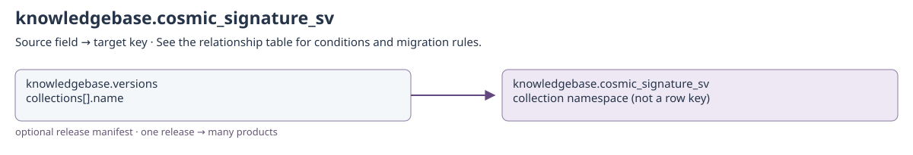

[Open full-size diagram](../../assets/diagrams/collection-dependencies/knowledgebase-cosmic-signature-sv.svg)

### Outgoing dependencies

| Source field | Target key | Relationship / multiplicity | Migration and resolution semantics | Evidence |
| --- | --- | --- | --- | --- |
| [knowledgebase.cosmic_signature_sv](knowledgebase.md#knowledgebase-cosmic-signature-sv): `created_by + updated_by` | [identity.users](identity.md#identity-users): `username` | historical actor; many → historical identity | Only populated actor fields apply. Preserve system and historical usernames even if no current account exists; never substitute the migration user. | [S12](#s12) |

### Incoming references and migration impact

| Source field | Target key | Relationship / multiplicity | Migration and resolution semantics | Evidence |
| --- | --- | --- | --- | --- |
| [knowledgebase.versions](knowledgebase.md#knowledgebase-versions): `collections[].name` | [knowledgebase.cosmic_signature_sv](knowledgebase.md#knowledgebase-cosmic-signature-sv): `collection namespace (not a row key)` | optional release manifest; one release → many products | Applies only when this collection is named in a release manifest. The manifest does not establish a foreign key from each provider row to versions._id. Keep source, release, build and import counts/checksums together. | [S6](#s6) |

## knowledgebase.cosmic_structural_variants

Binding: `cosmic_structural_collection`.

Common contract for a source-faithful non-variant COSMIC product record.

Provider product rows retain `record_key` and `source_row`. The latter is an opaque
provider payload: its columns are release-specific, not declared Coyote3 foreign keys.
Do not infer a gene/transcript/variant join from a similarly named vendor column.

Declared top-level fields: `created_by`, `updated_by`, `system_installed`, `record_key`, `source_row`.

[Field types and validation](../mongodb-collections.md#cosmic_structural_variants). `_id` may also be retained by an open collection model.

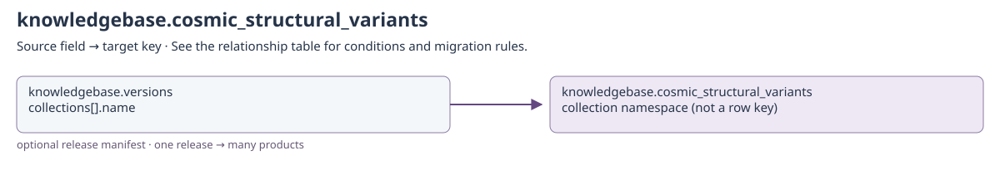

[Open full-size diagram](../../assets/diagrams/collection-dependencies/knowledgebase-cosmic-structural-variants.svg)

### Outgoing dependencies

| Source field | Target key | Relationship / multiplicity | Migration and resolution semantics | Evidence |
| --- | --- | --- | --- | --- |
| [knowledgebase.cosmic_structural_variants](knowledgebase.md#knowledgebase-cosmic-structural-variants): `created_by + updated_by` | [identity.users](identity.md#identity-users): `username` | historical actor; many → historical identity | Only populated actor fields apply. Preserve system and historical usernames even if no current account exists; never substitute the migration user. | [S12](#s12) |

### Incoming references and migration impact

| Source field | Target key | Relationship / multiplicity | Migration and resolution semantics | Evidence |
| --- | --- | --- | --- | --- |
| [knowledgebase.versions](knowledgebase.md#knowledgebase-versions): `collections[].name` | [knowledgebase.cosmic_structural_variants](knowledgebase.md#knowledgebase-cosmic-structural-variants): `collection namespace (not a row key)` | optional release manifest; one release → many products | Applies only when this collection is named in a release manifest. The manifest does not establish a foreign key from each provider row to versions._id. Keep source, release, build and import counts/checksums together. | [S6](#s6) |

## knowledgebase.cosmic_targeted_variants

Binding: `cosmic_targeted_collection`.

COSMIC variant interval with named occurrence counts.

Declared top-level fields: `created_by`, `updated_by`, `system_installed`, `id`, `chr`, `start`, `end`, `cnt`.

[Field types and validation](../mongodb-collections.md#cosmic_targeted_variants). `_id` may also be retained by an open collection model.

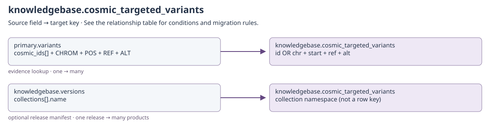

[Open full-size diagram](../../assets/diagrams/collection-dependencies/knowledgebase-cosmic-targeted-variants.svg)

### Outgoing dependencies

| Source field | Target key | Relationship / multiplicity | Migration and resolution semantics | Evidence |
| --- | --- | --- | --- | --- |
| [knowledgebase.cosmic_targeted_variants](knowledgebase.md#knowledgebase-cosmic-targeted-variants): `created_by + updated_by` | [identity.users](identity.md#identity-users): `username` | historical actor; many → historical identity | Only populated actor fields apply. Preserve system and historical usernames even if no current account exists; never substitute the migration user. | [S12](#s12) |

### Incoming references and migration impact

| Source field | Target key | Relationship / multiplicity | Migration and resolution semantics | Evidence |
| --- | --- | --- | --- | --- |
| [primary.variants](clinical.md#primary-variants): `cosmic_ids[] + CHROM + POS + REF + ALT` | [knowledgebase.cosmic_targeted_variants](knowledgebase.md#knowledgebase-cosmic-targeted-variants): `id OR chr + start + ref + alt` | evidence lookup; one → many | Use product/build availability checks and exact allele predicates. CosmicDoc's minimal schema omits ref/alt used by the richer repository records; inspect imported product shape. | [S3](#s3) |
| [knowledgebase.versions](knowledgebase.md#knowledgebase-versions): `collections[].name` | [knowledgebase.cosmic_targeted_variants](knowledgebase.md#knowledgebase-cosmic-targeted-variants): `collection namespace (not a row key)` | optional release manifest; one release → many products | Applies only when this collection is named in a release manifest. The manifest does not establish a foreign key from each provider row to versions._id. Keep source, release, build and import counts/checksums together. | [S6](#s6) |

## knowledgebase.cosmic_transcripts

Binding: `cosmic_transcripts_collection`.

Common contract for a source-faithful non-variant COSMIC product record.

Provider product rows retain `record_key` and `source_row`. The latter is an opaque
provider payload: its columns are release-specific, not declared Coyote3 foreign keys.
Do not infer a gene/transcript/variant join from a similarly named vendor column.

Declared top-level fields: `created_by`, `updated_by`, `system_installed`, `record_key`, `source_row`.

[Field types and validation](../mongodb-collections.md#cosmic_transcripts). `_id` may also be retained by an open collection model.

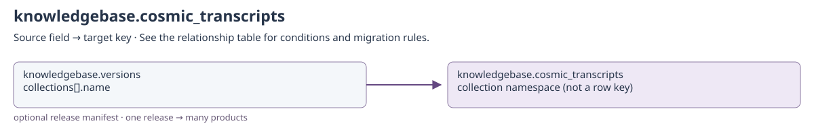

[Open full-size diagram](../../assets/diagrams/collection-dependencies/knowledgebase-cosmic-transcripts.svg)

### Outgoing dependencies

| Source field | Target key | Relationship / multiplicity | Migration and resolution semantics | Evidence |
| --- | --- | --- | --- | --- |
| [knowledgebase.cosmic_transcripts](knowledgebase.md#knowledgebase-cosmic-transcripts): `created_by + updated_by` | [identity.users](identity.md#identity-users): `username` | historical actor; many → historical identity | Only populated actor fields apply. Preserve system and historical usernames even if no current account exists; never substitute the migration user. | [S12](#s12) |

### Incoming references and migration impact

| Source field | Target key | Relationship / multiplicity | Migration and resolution semantics | Evidence |
| --- | --- | --- | --- | --- |
| [knowledgebase.versions](knowledgebase.md#knowledgebase-versions): `collections[].name` | [knowledgebase.cosmic_transcripts](knowledgebase.md#knowledgebase-cosmic-transcripts): `collection namespace (not a row key)` | optional release manifest; one release → many products | Applies only when this collection is named in a release manifest. The manifest does not establish a foreign key from each provider row to versions._id. Keep source, release, build and import counts/checksums together. | [S6](#s6) |

## knowledgebase.hgnc_genes

Binding: `hgnc_collection`.

HGNC gene nomenclature with genomic, cross-reference, and transcript metadata.

Declared top-level fields: `created_by`, `updated_by`, `system_installed`, `hgnc_id`, `hgnc_symbol`, `gene_name`, `status`, `locus`, `locus_sortable`, `alias_symbol`, `alias_name`, `prev_symbol`, `prev_name`, `date_approved_reserved`, `date_symbol_changed`, `date_name_changed`, `date_modified`, `entrez_id`, `ensembl_gene_id`, `refseq_accession`, `cosmic`, `omim_id`, `pseudogene_org`, `imgt`, `lncrnadb`, `lncipedia`, `ensembl_mane_select`, `refseq_mane_select`, `ensembl_mane_plus_clinical`, `chromosome`, `other_chromosome`, `start`, `end`, `gene_gc_content`, `gene_description`, `ensembl_canonical`, `gene_type`, `refseq_mane_plus_clinical`, `addtional_transcript_info`.

[Field types and validation](../mongodb-collections.md#hgnc_genes). `_id` may also be retained by an open collection model.

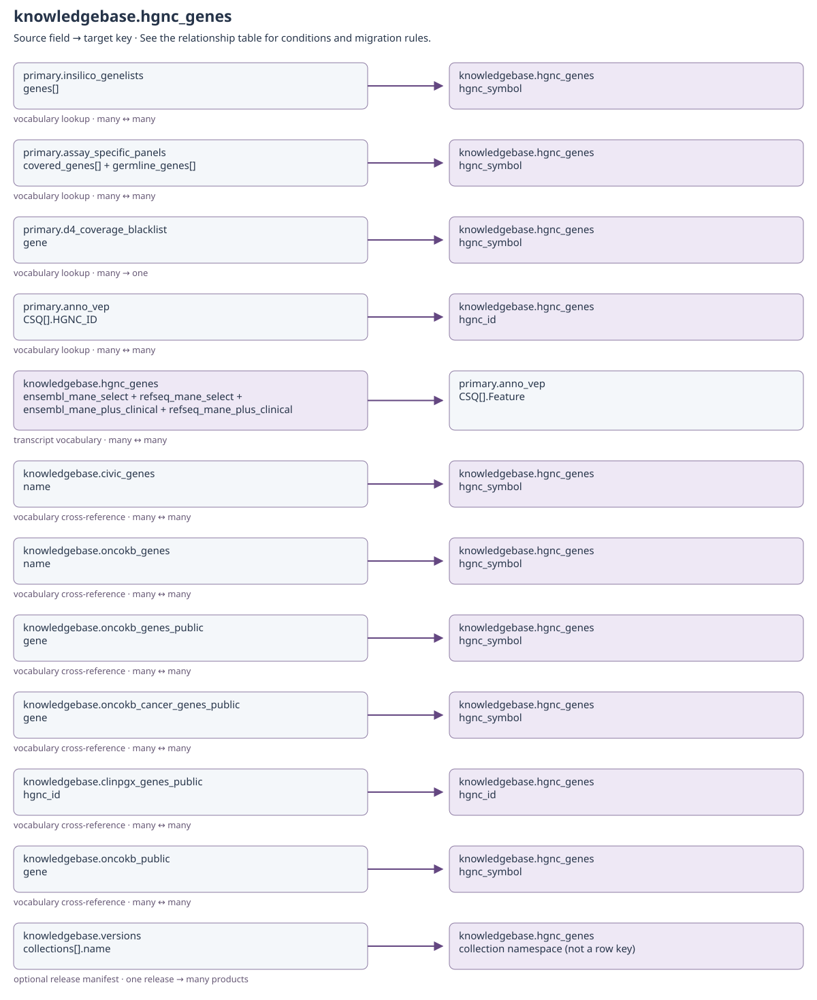

[Open full-size diagram](../../assets/diagrams/collection-dependencies/knowledgebase-hgnc-genes.svg)

### Outgoing dependencies

| Source field | Target key | Relationship / multiplicity | Migration and resolution semantics | Evidence |
| --- | --- | --- | --- | --- |
| [knowledgebase.hgnc_genes](knowledgebase.md#knowledgebase-hgnc-genes): `ensembl_mane_select + refseq_mane_select + ensembl_mane_plus_clinical + refseq_mane_plus_clinical` | [primary.anno_vep](clinical.md#primary-anno-vep): `CSQ[].Feature` | transcript vocabulary; many ↔ many | Transcript accessions guide selection/enrichment. Matching depends on accession versions and the selected VEP record, not a global transcript ObjectId. | [S11](#s11) |
| [knowledgebase.hgnc_genes](knowledgebase.md#knowledgebase-hgnc-genes): `created_by + updated_by` | [identity.users](identity.md#identity-users): `username` | historical actor; many → historical identity | Only populated actor fields apply. Preserve system and historical usernames even if no current account exists; never substitute the migration user. | [S12](#s12) |

### Incoming references and migration impact

| Source field | Target key | Relationship / multiplicity | Migration and resolution semantics | Evidence |
| --- | --- | --- | --- | --- |
| [primary.insilico_genelists](configuration.md#primary-insilico-genelists): `genes[]` | [knowledgebase.hgnc_genes](knowledgebase.md#knowledgebase-hgnc-genes): `hgnc_symbol` | vocabulary lookup; many ↔ many | Gene symbols, not HGNC ObjectIds. Preserve release context; resolve aliases deliberately, not through blanket renaming. | [S9](#s9) |
| [primary.assay_specific_panels](configuration.md#primary-assay-specific-panels): `covered_genes[] + germline_genes[]` | [knowledgebase.hgnc_genes](knowledgebase.md#knowledgebase-hgnc-genes): `hgnc_symbol` | vocabulary lookup; many ↔ many | Gene symbols, not HGNC ObjectIds. Preserve release context; resolve aliases deliberately, not through blanket renaming. | [S9](#s9) |
| [primary.d4_coverage_blacklist](configuration.md#primary-d4-coverage-blacklist): `gene` | [knowledgebase.hgnc_genes](knowledgebase.md#knowledgebase-hgnc-genes): `hgnc_symbol` | vocabulary lookup; many → one | Region exclusions refer to a symbol; region/coord must still identify the original genomic interval. | [S10](#s10) |
| [primary.anno_vep](clinical.md#primary-anno-vep): `CSQ[].HGNC_ID` | [knowledgebase.hgnc_genes](knowledgebase.md#knowledgebase-hgnc-genes): `hgnc_id` | vocabulary lookup; many ↔ many | Optional transcript-level HGNC identity. SYMBOL is a display/matching symbol, not an ObjectId. | [S13](#s13) |
| [knowledgebase.civic_genes](knowledgebase.md#knowledgebase-civic-genes): `name` | [knowledgebase.hgnc_genes](knowledgebase.md#knowledgebase-hgnc-genes): `hgnc_symbol` | vocabulary cross-reference; many ↔ many | Provider gene identity, not a Coyote3 ObjectId foreign key. Keep provider release/source and resolve aliases only through documented nomenclature. | [S11](#s11) |
| [knowledgebase.oncokb_genes](knowledgebase.md#knowledgebase-oncokb-genes): `name` | [knowledgebase.hgnc_genes](knowledgebase.md#knowledgebase-hgnc-genes): `hgnc_symbol` | vocabulary cross-reference; many ↔ many | Provider gene identity, not a Coyote3 ObjectId foreign key. Keep provider release/source and resolve aliases only through documented nomenclature. | [S11](#s11) |
| [knowledgebase.oncokb_genes_public](knowledgebase.md#knowledgebase-oncokb-genes-public): `gene` | [knowledgebase.hgnc_genes](knowledgebase.md#knowledgebase-hgnc-genes): `hgnc_symbol` | vocabulary cross-reference; many ↔ many | Provider gene identity, not a Coyote3 ObjectId foreign key. Keep provider release/source and resolve aliases only through documented nomenclature. | [S11](#s11) |
| [knowledgebase.oncokb_cancer_genes_public](knowledgebase.md#knowledgebase-oncokb-cancer-genes-public): `gene` | [knowledgebase.hgnc_genes](knowledgebase.md#knowledgebase-hgnc-genes): `hgnc_symbol` | vocabulary cross-reference; many ↔ many | Provider gene identity, not a Coyote3 ObjectId foreign key. Keep provider release/source and resolve aliases only through documented nomenclature. | [S11](#s11) |
| [knowledgebase.clinpgx_genes_public](knowledgebase.md#knowledgebase-clinpgx-genes-public): `hgnc_id` | [knowledgebase.hgnc_genes](knowledgebase.md#knowledgebase-hgnc-genes): `hgnc_id` | vocabulary cross-reference; many ↔ many | Provider gene identity, not a Coyote3 ObjectId foreign key. Keep provider release/source and resolve aliases only through documented nomenclature. | [S11](#s11) |
| [knowledgebase.oncokb_public](knowledgebase.md#knowledgebase-oncokb-public): `gene` | [knowledgebase.hgnc_genes](knowledgebase.md#knowledgebase-hgnc-genes): `hgnc_symbol` | vocabulary cross-reference; many ↔ many | Provider gene identity, not a Coyote3 ObjectId foreign key. Keep provider release/source and resolve aliases only through documented nomenclature. | [S11](#s11) |
| [knowledgebase.versions](knowledgebase.md#knowledgebase-versions): `collections[].name` | [knowledgebase.hgnc_genes](knowledgebase.md#knowledgebase-hgnc-genes): `collection namespace (not a row key)` | optional release manifest; one release → many products | Applies only when this collection is named in a release manifest. The manifest does not establish a foreign key from each provider row to versions._id. Keep source, release, build and import counts/checksums together. | [S6](#s6) |

## knowledgebase.hpaexpr

Binding: `expression_collection`.

Tissue expression values associated with an HPA transcript identifier.

tid is a transcript accession. The rna_expression document is sample-owned; HPA rows are shared external reference values, not owned by that sample.

Declared top-level fields: `created_by`, `updated_by`, `system_installed`, `tid`, `expr`.

[Field types and validation](../mongodb-collections.md#hpaexpr). `_id` may also be retained by an open collection model.

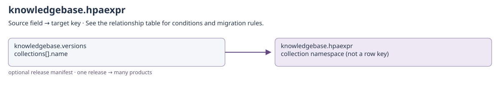

[Open full-size diagram](../../assets/diagrams/collection-dependencies/knowledgebase-hpaexpr.svg)

### Outgoing dependencies

| Source field | Target key | Relationship / multiplicity | Migration and resolution semantics | Evidence |
| --- | --- | --- | --- | --- |
| [knowledgebase.hpaexpr](knowledgebase.md#knowledgebase-hpaexpr): `created_by + updated_by` | [identity.users](identity.md#identity-users): `username` | historical actor; many → historical identity | Only populated actor fields apply. Preserve system and historical usernames even if no current account exists; never substitute the migration user. | [S12](#s12) |

### Incoming references and migration impact

| Source field | Target key | Relationship / multiplicity | Migration and resolution semantics | Evidence |
| --- | --- | --- | --- | --- |
| [knowledgebase.versions](knowledgebase.md#knowledgebase-versions): `collections[].name` | [knowledgebase.hpaexpr](knowledgebase.md#knowledgebase-hpaexpr): `collection namespace (not a row key)` | optional release manifest; one release → many products | Applies only when this collection is named in a release manifest. The manifest does not establish a foreign key from each provider row to versions._id. Keep source, release, build and import counts/checksums together. | [S6](#s6) |

## knowledgebase.iarc_tp53

Binding: `iarc_tp53_collection`.

TP53 variant evidence with functional annotations and cohort counts.

Declared top-level fields: `created_by`, `updated_by`, `system_installed`, `id`, `var`, `polymorphism`, `cpg`, `splice`, `transactivation_class`, `AGVGD_class`, `residue_func`, `motif`, `structure_function_class`, `domain_func`, `n_somatic`, `n_germline`, `topology_count`, `hgvsg_hg19`, `hgvsg_hg38`, `hgvsp`, `effect`, `hotspot`, `external_cohort_count`, `source_record`.

[Field types and validation](../mongodb-collections.md#iarc_tp53). `_id` may also be retained by an open collection model.

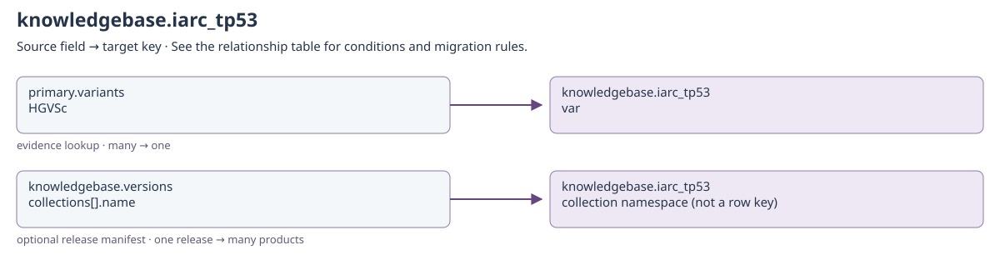

[Open full-size diagram](../../assets/diagrams/collection-dependencies/knowledgebase-iarc-tp53.svg)

### Outgoing dependencies

| Source field | Target key | Relationship / multiplicity | Migration and resolution semantics | Evidence |
| --- | --- | --- | --- | --- |
| [knowledgebase.iarc_tp53](knowledgebase.md#knowledgebase-iarc-tp53): `created_by + updated_by` | [identity.users](identity.md#identity-users): `username` | historical actor; many → historical identity | Only populated actor fields apply. Preserve system and historical usernames even if no current account exists; never substitute the migration user. | [S12](#s12) |

### Incoming references and migration impact

| Source field | Target key | Relationship / multiplicity | Migration and resolution semantics | Evidence |
| --- | --- | --- | --- | --- |
| [primary.variants](clinical.md#primary-variants): `HGVSc` | [knowledgebase.iarc_tp53](knowledgebase.md#knowledgebase-iarc-tp53): `var` | evidence lookup; many → one | TP53-specific lookup normalizes transcript/cDNA notation; not an exact ObjectId join. | [S4](#s4) |
| [knowledgebase.versions](knowledgebase.md#knowledgebase-versions): `collections[].name` | [knowledgebase.iarc_tp53](knowledgebase.md#knowledgebase-iarc-tp53): `collection namespace (not a row key)` | optional release manifest; one release → many products | Applies only when this collection is named in a release manifest. The manifest does not establish a foreign key from each provider row to versions._id. Keep source, release, build and import counts/checksums together. | [S6](#s6) |

## knowledgebase.oncokb_actionable

Binding: `oncokb_actionable_collection`.

OncoKB alteration evidence with drug, cancer-type, and evidence-level fields.

Declared top-level fields: `created_by`, `updated_by`, `system_installed`, `RefSeq`, `Alteration`, `Isoform`, `Drugs(s)`, `Level`, `Cancer Type`, `Entrez Gene ID`, `Hugo Symbol`, `Protein Change`, `PMIDs for drug`.

[Field types and validation](../mongodb-collections.md#oncokb_actionable). `_id` may also be retained by an open collection model.

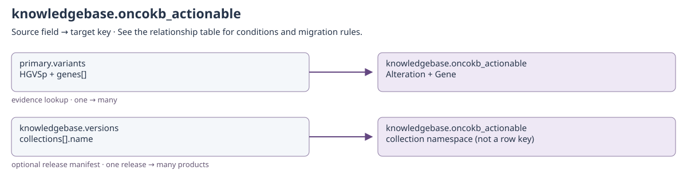

[Open full-size diagram](../../assets/diagrams/collection-dependencies/knowledgebase-oncokb-actionable.svg)

### Outgoing dependencies

| Source field | Target key | Relationship / multiplicity | Migration and resolution semantics | Evidence |
| --- | --- | --- | --- | --- |
| [knowledgebase.oncokb_actionable](knowledgebase.md#knowledgebase-oncokb-actionable): `created_by + updated_by` | [identity.users](identity.md#identity-users): `username` | historical actor; many → historical identity | Only populated actor fields apply. Preserve system and historical usernames even if no current account exists; never substitute the migration user. | [S12](#s12) |

### Incoming references and migration impact

| Source field | Target key | Relationship / multiplicity | Migration and resolution semantics | Evidence |
| --- | --- | --- | --- | --- |
| [primary.variants](clinical.md#primary-variants): `HGVSp + genes[]` | [knowledgebase.oncokb_actionable](knowledgebase.md#knowledgebase-oncokb-actionable): `Alteration + Gene` | evidence lookup; one → many | Repository queries Gene, while the typed import contract names Hugo Symbol / Entrez Gene ID. Confirm import shape before relying on this lookup; include Oncogenic Mutations fallback semantics. | [S5](#s5) |
| [knowledgebase.versions](knowledgebase.md#knowledgebase-versions): `collections[].name` | [knowledgebase.oncokb_actionable](knowledgebase.md#knowledgebase-oncokb-actionable): `collection namespace (not a row key)` | optional release manifest; one release → many products | Applies only when this collection is named in a release manifest. The manifest does not establish a foreign key from each provider row to versions._id. Keep source, release, build and import counts/checksums together. | [S6](#s6) |

## knowledgebase.oncokb_cancer_genes_public

Binding: `oncokb_cancer_genes_public_collection`.

Public OncoKB cancer-gene list record from /utils/cancerGeneList.

Declared top-level fields: `created_by`, `updated_by`, `system_installed`, `gene`, `source`, `public_api`, `therapeutic_data_included`, `data_version`, `hgnc_id`, `previous_symbols`, `alias_symbols`, `entrez_gene_id`, `gene_type`, `occurrence_count`, `oncokb_annotated`, `sanger_cgc`, `vogelstein`, `foundation`, `foundation_heme`, `msk_impact`, `msk_heme`, `grch37_refseq`, `grch37_isoform`, `grch38_refseq`, `grch38_isoform`.

[Field types and validation](../mongodb-collections.md#oncokb_cancer_genes_public). `_id` may also be retained by an open collection model.

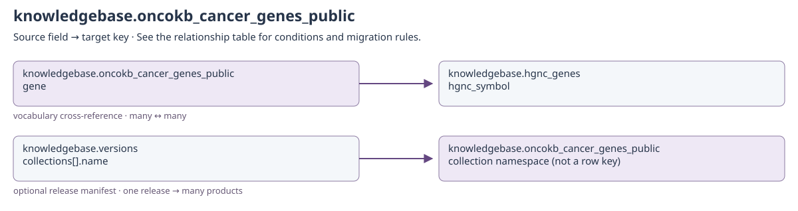

[Open full-size diagram](../../assets/diagrams/collection-dependencies/knowledgebase-oncokb-cancer-genes-public.svg)

### Outgoing dependencies

| Source field | Target key | Relationship / multiplicity | Migration and resolution semantics | Evidence |
| --- | --- | --- | --- | --- |
| [knowledgebase.oncokb_cancer_genes_public](knowledgebase.md#knowledgebase-oncokb-cancer-genes-public): `gene` | [knowledgebase.hgnc_genes](knowledgebase.md#knowledgebase-hgnc-genes): `hgnc_symbol` | vocabulary cross-reference; many ↔ many | Provider gene identity, not a Coyote3 ObjectId foreign key. Keep provider release/source and resolve aliases only through documented nomenclature. | [S11](#s11) |
| [knowledgebase.oncokb_cancer_genes_public](knowledgebase.md#knowledgebase-oncokb-cancer-genes-public): `created_by + updated_by` | [identity.users](identity.md#identity-users): `username` | historical actor; many → historical identity | Only populated actor fields apply. Preserve system and historical usernames even if no current account exists; never substitute the migration user. | [S12](#s12) |

### Incoming references and migration impact

| Source field | Target key | Relationship / multiplicity | Migration and resolution semantics | Evidence |
| --- | --- | --- | --- | --- |
| [knowledgebase.versions](knowledgebase.md#knowledgebase-versions): `collections[].name` | [knowledgebase.oncokb_cancer_genes_public](knowledgebase.md#knowledgebase-oncokb-cancer-genes-public): `collection namespace (not a row key)` | optional release manifest; one release → many products | Applies only when this collection is named in a release manifest. The manifest does not establish a foreign key from each provider row to versions._id. Keep source, release, build and import counts/checksums together. | [S6](#s6) |

## knowledgebase.oncokb_genes

Binding: `oncokb_genes_collection`.

OncoKB gene name and descriptive text.

Declared top-level fields: `created_by`, `updated_by`, `system_installed`, `name`, `description`.

[Field types and validation](../mongodb-collections.md#oncokb_genes). `_id` may also be retained by an open collection model.

[Open full-size diagram](../../assets/diagrams/collection-dependencies/knowledgebase-oncokb-genes.svg)

### Outgoing dependencies

| Source field | Target key | Relationship / multiplicity | Migration and resolution semantics | Evidence |
| --- | --- | --- | --- | --- |
| [knowledgebase.oncokb_genes](knowledgebase.md#knowledgebase-oncokb-genes): `name` | [knowledgebase.hgnc_genes](knowledgebase.md#knowledgebase-hgnc-genes): `hgnc_symbol` | vocabulary cross-reference; many ↔ many | Provider gene identity, not a Coyote3 ObjectId foreign key. Keep provider release/source and resolve aliases only through documented nomenclature. | [S11](#s11) |
| [knowledgebase.oncokb_genes](knowledgebase.md#knowledgebase-oncokb-genes): `created_by + updated_by` | [identity.users](identity.md#identity-users): `username` | historical actor; many → historical identity | Only populated actor fields apply. Preserve system and historical usernames even if no current account exists; never substitute the migration user. | [S12](#s12) |

### Incoming references and migration impact

| Source field | Target key | Relationship / multiplicity | Migration and resolution semantics | Evidence |
| --- | --- | --- | --- | --- |
| [knowledgebase.versions](knowledgebase.md#knowledgebase-versions): `collections[].name` | [knowledgebase.oncokb_genes](knowledgebase.md#knowledgebase-oncokb-genes): `collection namespace (not a row key)` | optional release manifest; one release → many products | Applies only when this collection is named in a release manifest. The manifest does not establish a foreign key from each provider row to versions._id. Keep source, release, build and import counts/checksums together. | [S6](#s6) |

## knowledgebase.oncokb_genes_public

Binding: `oncokb_genes_public_collection`.

Public OncoKB gene summary, identifiers, aliases, and assembly-specific isoforms.

Declared top-level fields: `created_by`, `updated_by`, `system_installed`, `gene`, `source`, `public_api`, `therapeutic_data_included`, `data_version`, `gene_exist`, `gene_summary`, `background`, `setting`, `entrez_gene_id`, `gene_type`, `highest_sensitive_level`, `highest_resistance_level`, `grch37_refseq`, `grch37_isoform`, `grch38_refseq`, `grch38_isoform`, `hgnc_id`, `previous_symbols`, `alias_symbols`.

[Field types and validation](../mongodb-collections.md#oncokb_genes_public). `_id` may also be retained by an open collection model.

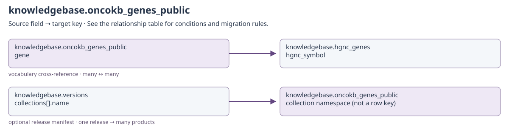

[Open full-size diagram](../../assets/diagrams/collection-dependencies/knowledgebase-oncokb-genes-public.svg)

### Outgoing dependencies

| Source field | Target key | Relationship / multiplicity | Migration and resolution semantics | Evidence |
| --- | --- | --- | --- | --- |
| [knowledgebase.oncokb_genes_public](knowledgebase.md#knowledgebase-oncokb-genes-public): `gene` | [knowledgebase.hgnc_genes](knowledgebase.md#knowledgebase-hgnc-genes): `hgnc_symbol` | vocabulary cross-reference; many ↔ many | Provider gene identity, not a Coyote3 ObjectId foreign key. Keep provider release/source and resolve aliases only through documented nomenclature. | [S11](#s11) |
| [knowledgebase.oncokb_genes_public](knowledgebase.md#knowledgebase-oncokb-genes-public): `created_by + updated_by` | [identity.users](identity.md#identity-users): `username` | historical actor; many → historical identity | Only populated actor fields apply. Preserve system and historical usernames even if no current account exists; never substitute the migration user. | [S12](#s12) |

### Incoming references and migration impact

| Source field | Target key | Relationship / multiplicity | Migration and resolution semantics | Evidence |
| --- | --- | --- | --- | --- |
| [knowledgebase.versions](knowledgebase.md#knowledgebase-versions): `collections[].name` | [knowledgebase.oncokb_genes_public](knowledgebase.md#knowledgebase-oncokb-genes-public): `collection namespace (not a row key)` | optional release manifest; one release → many products | Applies only when this collection is named in a release manifest. The manifest does not establish a foreign key from each provider row to versions._id. Keep source, release, build and import counts/checksums together. | [S6](#s6) |

## knowledgebase.oncokb_public

Binding: `oncokb_public_collection`.

Sample-independent public OncoKB query cache with provenance and response data.

query_hash is the cache identity for a normalized public API query, not variants.simple_id_hash. Retain query, response, reference_genome and data_version. Public API evidence is not equivalent to the licensed actionable dataset.

Declared top-level fields: `created_by`, `updated_by`, `system_installed`, `query_hash`, `gene`, `alteration`, `reference_genome`, `public_api`, `therapeutic_data_included`, `source`, `license`, `query`, `response`, `data_version`, `gene_exist`, `variant_exist`, `variant_ids`.

[Field types and validation](../mongodb-collections.md#oncokb_public). `_id` may also be retained by an open collection model.

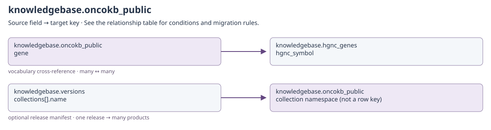

[Open full-size diagram](../../assets/diagrams/collection-dependencies/knowledgebase-oncokb-public.svg)

### Outgoing dependencies

| Source field | Target key | Relationship / multiplicity | Migration and resolution semantics | Evidence |
| --- | --- | --- | --- | --- |
| [knowledgebase.oncokb_public](knowledgebase.md#knowledgebase-oncokb-public): `gene` | [knowledgebase.hgnc_genes](knowledgebase.md#knowledgebase-hgnc-genes): `hgnc_symbol` | vocabulary cross-reference; many ↔ many | Provider gene identity, not a Coyote3 ObjectId foreign key. Keep provider release/source and resolve aliases only through documented nomenclature. | [S11](#s11) |
| [knowledgebase.oncokb_public](knowledgebase.md#knowledgebase-oncokb-public): `created_by + updated_by` | [identity.users](identity.md#identity-users): `username` | historical actor; many → historical identity | Only populated actor fields apply. Preserve system and historical usernames even if no current account exists; never substitute the migration user. | [S12](#s12) |

### Incoming references and migration impact

| Source field | Target key | Relationship / multiplicity | Migration and resolution semantics | Evidence |
| --- | --- | --- | --- | --- |
| [knowledgebase.versions](knowledgebase.md#knowledgebase-versions): `collections[].name` | [knowledgebase.oncokb_public](knowledgebase.md#knowledgebase-oncokb-public): `collection namespace (not a row key)` | optional release manifest; one release → many products | Applies only when this collection is named in a release manifest. The manifest does not establish a foreign key from each provider row to versions._id. Keep source, release, build and import counts/checksums together. | [S6](#s6) |

## knowledgebase.onkokb

Binding: `oncokb_collection`.

Physical binding oncokb_collection → onkokb is intentional in the current mapping. This collection has repository-defined Gene/Alteration records, without a COLLECTION_MODEL_ADAPTERS entry. Do not silently rename it to oncokb during migration.

Repository-defined storage; no collection-model adapter is registered for this physical namespace.

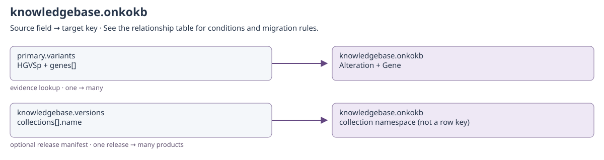

[Open full-size diagram](../../assets/diagrams/collection-dependencies/knowledgebase-onkokb.svg)

### Outgoing dependencies

No cross-collection business reference is declared in this catalog for this direction.

### Incoming references and migration impact

| Source field | Target key | Relationship / multiplicity | Migration and resolution semantics | Evidence |
| --- | --- | --- | --- | --- |
| [primary.variants](clinical.md#primary-variants): `HGVSp + genes[]` | [knowledgebase.onkokb](knowledgebase.md#knowledgebase-onkokb): `Alteration + Gene` | evidence lookup; one → many | Stored physical name is onkokb. Lookup uses the hydrated selected transcript symbol and translated protein alteration. | [S5](#s5) |
| [knowledgebase.versions](knowledgebase.md#knowledgebase-versions): `collections[].name` | [knowledgebase.onkokb](knowledgebase.md#knowledgebase-onkokb): `collection namespace (not a row key)` | optional release manifest; one release → many products | Applies only when this collection is named in a release manifest. The manifest does not establish a foreign key from each provider row to versions._id. Keep source, release, build and import counts/checksums together. | [S6](#s6) |

## knowledgebase.vep_diagrams

Binding: `vep_diagrams_collection`.

Content-addressed image stored as BSON binary in the knowledgebase.

Declared top-level fields: `created_by`, `updated_by`, `system_installed`, `_id`, `data`, `mime_type`.

[Field types and validation](../mongodb-collections.md#vep_diagrams). `_id` may also be retained by an open collection model.

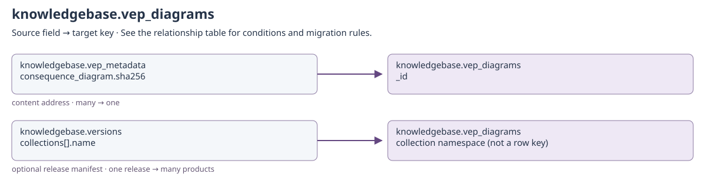

[Open full-size diagram](../../assets/diagrams/collection-dependencies/knowledgebase-vep-diagrams.svg)

### Outgoing dependencies

| Source field | Target key | Relationship / multiplicity | Migration and resolution semantics | Evidence |
| --- | --- | --- | --- | --- |
| [knowledgebase.vep_diagrams](knowledgebase.md#knowledgebase-vep-diagrams): `created_by + updated_by` | [identity.users](identity.md#identity-users): `username` | historical actor; many → historical identity | Only populated actor fields apply. Preserve system and historical usernames even if no current account exists; never substitute the migration user. | [S12](#s12) |

### Incoming references and migration impact

| Source field | Target key | Relationship / multiplicity | Migration and resolution semantics | Evidence |
| --- | --- | --- | --- | --- |
| [knowledgebase.vep_metadata](knowledgebase.md#knowledgebase-vep-metadata): `consequence_diagram.sha256` | [knowledgebase.vep_diagrams](knowledgebase.md#knowledgebase-vep-diagrams): `_id` | content address; many → one | SHA-256 string identity of stored diagram bytes; retain mime type and matching digest. | [S13](#s13) |
| [knowledgebase.versions](knowledgebase.md#knowledgebase-versions): `collections[].name` | [knowledgebase.vep_diagrams](knowledgebase.md#knowledgebase-vep-diagrams): `collection namespace (not a row key)` | optional release manifest; one release → many products | Applies only when this collection is named in a release manifest. The manifest does not establish a foreign key from each provider row to versions._id. Keep source, release, build and import counts/checksums together. | [S6](#s6) |

## knowledgebase.vep_metadata

Binding: `vep_metadata_collection`.

Versioned VEP database metadata, display translations, and consequence groups.

Declared top-level fields: `created_by`, `updated_by`, `system_installed`, `vep_id`, `created_on`, `source`, `vc_translation_source`, `conseq_translation_source`, `db_info`, `variant_class_translations`, `conseq_translations`, `consequence_groups`, `consequence_diagram`.

[Field types and validation](../mongodb-collections.md#vep_metadata). `_id` may also be retained by an open collection model.

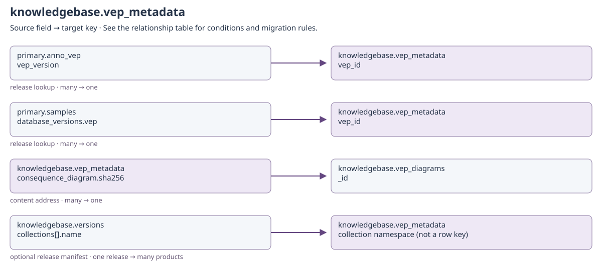

[Open full-size diagram](../../assets/diagrams/collection-dependencies/knowledgebase-vep-metadata.svg)

### Outgoing dependencies

| Source field | Target key | Relationship / multiplicity | Migration and resolution semantics | Evidence |
| --- | --- | --- | --- | --- |
| [knowledgebase.vep_metadata](knowledgebase.md#knowledgebase-vep-metadata): `consequence_diagram.sha256` | [knowledgebase.vep_diagrams](knowledgebase.md#knowledgebase-vep-diagrams): `_id` | content address; many → one | SHA-256 string identity of stored diagram bytes; retain mime type and matching digest. | [S13](#s13) |
| [knowledgebase.vep_metadata](knowledgebase.md#knowledgebase-vep-metadata): `created_by + updated_by` | [identity.users](identity.md#identity-users): `username` | historical actor; many → historical identity | Only populated actor fields apply. Preserve system and historical usernames even if no current account exists; never substitute the migration user. | [S12](#s12) |

### Incoming references and migration impact

| Source field | Target key | Relationship / multiplicity | Migration and resolution semantics | Evidence |
| --- | --- | --- | --- | --- |
| [primary.anno_vep](clinical.md#primary-anno-vep): `vep_version` | [knowledgebase.vep_metadata](knowledgebase.md#knowledgebase-vep-metadata): `vep_id` | release lookup; many → one | Canonical VEP version used to interpret consequence codes and transcript provenance. | [S13](#s13) |
| [primary.samples](clinical.md#primary-samples): `database_versions.vep` | [knowledgebase.vep_metadata](knowledgebase.md#knowledgebase-vep-metadata): `vep_id` | release lookup; many → one | Normalize equivalent numeric release labels with vep_metadata_release; preserve nonzero minor versions. | [S8](#s8) |
| [knowledgebase.versions](knowledgebase.md#knowledgebase-versions): `collections[].name` | [knowledgebase.vep_metadata](knowledgebase.md#knowledgebase-vep-metadata): `collection namespace (not a row key)` | optional release manifest; one release → many products | Applies only when this collection is named in a release manifest. The manifest does not establish a foreign key from each provider row to versions._id. Keep source, release, build and import counts/checksums together. | [S6](#s6) |

## knowledgebase.versions

Binding: `knowledgebase_versions_collection`.

Provenance and publication state for one imported knowledgebase snapshot.

Declared top-level fields: `created_by`, `updated_by`, `system_installed`, `source`, `release`, `status`, `import_cpus`, `started_at`, `files`, `collections`, `published_at`, `retired_at`, `failed_at`.

[Field types and validation](../mongodb-collections.md#versions). `_id` may also be retained by an open collection model.

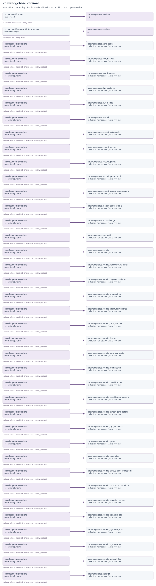

[Open full-size diagram](../../assets/diagrams/collection-dependencies/knowledgebase-versions.svg)

### Outgoing dependencies

| Source field | Target key | Relationship / multiplicity | Migration and resolution semantics | Evidence |
| --- | --- | --- | --- | --- |
| [knowledgebase.versions](knowledgebase.md#knowledgebase-versions): `collections[].name` | [knowledgebase.hgnc_genes](knowledgebase.md#knowledgebase-hgnc-genes): `collection namespace (not a row key)` | optional release manifest; one release → many products | Applies only when this collection is named in a release manifest. The manifest does not establish a foreign key from each provider row to versions._id. Keep source, release, build and import counts/checksums together. | [S6](#s6) |
| [knowledgebase.versions](knowledgebase.md#knowledgebase-versions): `collections[].name` | [knowledgebase.vep_metadata](knowledgebase.md#knowledgebase-vep-metadata): `collection namespace (not a row key)` | optional release manifest; one release → many products | Applies only when this collection is named in a release manifest. The manifest does not establish a foreign key from each provider row to versions._id. Keep source, release, build and import counts/checksums together. | [S6](#s6) |
| [knowledgebase.versions](knowledgebase.md#knowledgebase-versions): `collections[].name` | [knowledgebase.vep_diagrams](knowledgebase.md#knowledgebase-vep-diagrams): `collection namespace (not a row key)` | optional release manifest; one release → many products | Applies only when this collection is named in a release manifest. The manifest does not establish a foreign key from each provider row to versions._id. Keep source, release, build and import counts/checksums together. | [S6](#s6) |
| [knowledgebase.versions](knowledgebase.md#knowledgebase-versions): `collections[].name` | [knowledgebase.civic_variants](knowledgebase.md#knowledgebase-civic-variants): `collection namespace (not a row key)` | optional release manifest; one release → many products | Applies only when this collection is named in a release manifest. The manifest does not establish a foreign key from each provider row to versions._id. Keep source, release, build and import counts/checksums together. | [S6](#s6) |
| [knowledgebase.versions](knowledgebase.md#knowledgebase-versions): `collections[].name` | [knowledgebase.civic_genes](knowledgebase.md#knowledgebase-civic-genes): `collection namespace (not a row key)` | optional release manifest; one release → many products | Applies only when this collection is named in a release manifest. The manifest does not establish a foreign key from each provider row to versions._id. Keep source, release, build and import counts/checksums together. | [S6](#s6) |
| [knowledgebase.versions](knowledgebase.md#knowledgebase-versions): `collections[].name` | [knowledgebase.onkokb](knowledgebase.md#knowledgebase-onkokb): `collection namespace (not a row key)` | optional release manifest; one release → many products | Applies only when this collection is named in a release manifest. The manifest does not establish a foreign key from each provider row to versions._id. Keep source, release, build and import counts/checksums together. | [S6](#s6) |
| [knowledgebase.versions](knowledgebase.md#knowledgebase-versions): `collections[].name` | [knowledgebase.oncokb_actionable](knowledgebase.md#knowledgebase-oncokb-actionable): `collection namespace (not a row key)` | optional release manifest; one release → many products | Applies only when this collection is named in a release manifest. The manifest does not establish a foreign key from each provider row to versions._id. Keep source, release, build and import counts/checksums together. | [S6](#s6) |
| [knowledgebase.versions](knowledgebase.md#knowledgebase-versions): `collections[].name` | [knowledgebase.oncokb_genes](knowledgebase.md#knowledgebase-oncokb-genes): `collection namespace (not a row key)` | optional release manifest; one release → many products | Applies only when this collection is named in a release manifest. The manifest does not establish a foreign key from each provider row to versions._id. Keep source, release, build and import counts/checksums together. | [S6](#s6) |
| [knowledgebase.versions](knowledgebase.md#knowledgebase-versions): `collections[].name` | [knowledgebase.oncokb_public](knowledgebase.md#knowledgebase-oncokb-public): `collection namespace (not a row key)` | optional release manifest; one release → many products | Applies only when this collection is named in a release manifest. The manifest does not establish a foreign key from each provider row to versions._id. Keep source, release, build and import counts/checksums together. | [S6](#s6) |
| [knowledgebase.versions](knowledgebase.md#knowledgebase-versions): `collections[].name` | [knowledgebase.oncokb_genes_public](knowledgebase.md#knowledgebase-oncokb-genes-public): `collection namespace (not a row key)` | optional release manifest; one release → many products | Applies only when this collection is named in a release manifest. The manifest does not establish a foreign key from each provider row to versions._id. Keep source, release, build and import counts/checksums together. | [S6](#s6) |
| [knowledgebase.versions](knowledgebase.md#knowledgebase-versions): `collections[].name` | [knowledgebase.oncokb_cancer_genes_public](knowledgebase.md#knowledgebase-oncokb-cancer-genes-public): `collection namespace (not a row key)` | optional release manifest; one release → many products | Applies only when this collection is named in a release manifest. The manifest does not establish a foreign key from each provider row to versions._id. Keep source, release, build and import counts/checksums together. | [S6](#s6) |
| [knowledgebase.versions](knowledgebase.md#knowledgebase-versions): `collections[].name` | [knowledgebase.clinpgx_genes_public](knowledgebase.md#knowledgebase-clinpgx-genes-public): `collection namespace (not a row key)` | optional release manifest; one release → many products | Applies only when this collection is named in a release manifest. The manifest does not establish a foreign key from each provider row to versions._id. Keep source, release, build and import counts/checksums together. | [S6](#s6) |
| [knowledgebase.versions](knowledgebase.md#knowledgebase-versions): `collections[].name` | [knowledgebase.brcaexchange](knowledgebase.md#knowledgebase-brcaexchange): `collection namespace (not a row key)` | optional release manifest; one release → many products | Applies only when this collection is named in a release manifest. The manifest does not establish a foreign key from each provider row to versions._id. Keep source, release, build and import counts/checksums together. | [S6](#s6) |
| [knowledgebase.versions](knowledgebase.md#knowledgebase-versions): `collections[].name` | [knowledgebase.iarc_tp53](knowledgebase.md#knowledgebase-iarc-tp53): `collection namespace (not a row key)` | optional release manifest; one release → many products | Applies only when this collection is named in a release manifest. The manifest does not establish a foreign key from each provider row to versions._id. Keep source, release, build and import counts/checksums together. | [S6](#s6) |
| [knowledgebase.versions](knowledgebase.md#knowledgebase-versions): `collections[].name` | [knowledgebase.cosmic](knowledgebase.md#knowledgebase-cosmic): `collection namespace (not a row key)` | optional release manifest; one release → many products | Applies only when this collection is named in a release manifest. The manifest does not establish a foreign key from each provider row to versions._id. Keep source, release, build and import counts/checksums together. | [S6](#s6) |
| [knowledgebase.versions](knowledgebase.md#knowledgebase-versions): `collections[].name` | [knowledgebase.cosmic_noncoding_variants](knowledgebase.md#knowledgebase-cosmic-noncoding-variants): `collection namespace (not a row key)` | optional release manifest; one release → many products | Applies only when this collection is named in a release manifest. The manifest does not establish a foreign key from each provider row to versions._id. Keep source, release, build and import counts/checksums together. | [S6](#s6) |
| [knowledgebase.versions](knowledgebase.md#knowledgebase-versions): `collections[].name` | [knowledgebase.cosmic_targeted_variants](knowledgebase.md#knowledgebase-cosmic-targeted-variants): `collection namespace (not a row key)` | optional release manifest; one release → many products | Applies only when this collection is named in a release manifest. The manifest does not establish a foreign key from each provider row to versions._id. Keep source, release, build and import counts/checksums together. | [S6](#s6) |
| [knowledgebase.versions](knowledgebase.md#knowledgebase-versions): `collections[].name` | [knowledgebase.cosmic_breakpoints](knowledgebase.md#knowledgebase-cosmic-breakpoints): `collection namespace (not a row key)` | optional release manifest; one release → many products | Applies only when this collection is named in a release manifest. The manifest does not establish a foreign key from each provider row to versions._id. Keep source, release, build and import counts/checksums together. | [S6](#s6) |
| [knowledgebase.versions](knowledgebase.md#knowledgebase-versions): `collections[].name` | [knowledgebase.cosmic_structural_variants](knowledgebase.md#knowledgebase-cosmic-structural-variants): `collection namespace (not a row key)` | optional release manifest; one release → many products | Applies only when this collection is named in a release manifest. The manifest does not establish a foreign key from each provider row to versions._id. Keep source, release, build and import counts/checksums together. | [S6](#s6) |
| [knowledgebase.versions](knowledgebase.md#knowledgebase-versions): `collections[].name` | [knowledgebase.cosmic_copy_number](knowledgebase.md#knowledgebase-cosmic-copy-number): `collection namespace (not a row key)` | optional release manifest; one release → many products | Applies only when this collection is named in a release manifest. The manifest does not establish a foreign key from each provider row to versions._id. Keep source, release, build and import counts/checksums together. | [S6](#s6) |
| [knowledgebase.versions](knowledgebase.md#knowledgebase-versions): `collections[].name` | [knowledgebase.cosmic_fusions](knowledgebase.md#knowledgebase-cosmic-fusions): `collection namespace (not a row key)` | optional release manifest; one release → many products | Applies only when this collection is named in a release manifest. The manifest does not establish a foreign key from each provider row to versions._id. Keep source, release, build and import counts/checksums together. | [S6](#s6) |
| [knowledgebase.versions](knowledgebase.md#knowledgebase-versions): `collections[].name` | [knowledgebase.cosmic_gene_expression](knowledgebase.md#knowledgebase-cosmic-gene-expression): `collection namespace (not a row key)` | optional release manifest; one release → many products | Applies only when this collection is named in a release manifest. The manifest does not establish a foreign key from each provider row to versions._id. Keep source, release, build and import counts/checksums together. | [S6](#s6) |
| [knowledgebase.versions](knowledgebase.md#knowledgebase-versions): `collections[].name` | [knowledgebase.cosmic_methylation](knowledgebase.md#knowledgebase-cosmic-methylation): `collection namespace (not a row key)` | optional release manifest; one release → many products | Applies only when this collection is named in a release manifest. The manifest does not establish a foreign key from each provider row to versions._id. Keep source, release, build and import counts/checksums together. | [S6](#s6) |
| [knowledgebase.versions](knowledgebase.md#knowledgebase-versions): `collections[].name` | [knowledgebase.cosmic_classifications](knowledgebase.md#knowledgebase-cosmic-classifications): `collection namespace (not a row key)` | optional release manifest; one release → many products | Applies only when this collection is named in a release manifest. The manifest does not establish a foreign key from each provider row to versions._id. Keep source, release, build and import counts/checksums together. | [S6](#s6) |
| [knowledgebase.versions](knowledgebase.md#knowledgebase-versions): `collections[].name` | [knowledgebase.cosmic_classification_papers](knowledgebase.md#knowledgebase-cosmic-classification-papers): `collection namespace (not a row key)` | optional release manifest; one release → many products | Applies only when this collection is named in a release manifest. The manifest does not establish a foreign key from each provider row to versions._id. Keep source, release, build and import counts/checksums together. | [S6](#s6) |
| [knowledgebase.versions](knowledgebase.md#knowledgebase-versions): `collections[].name` | [knowledgebase.cosmic_cancer_gene_census](knowledgebase.md#knowledgebase-cosmic-cancer-gene-census): `collection namespace (not a row key)` | optional release manifest; one release → many products | Applies only when this collection is named in a release manifest. The manifest does not establish a foreign key from each provider row to versions._id. Keep source, release, build and import counts/checksums together. | [S6](#s6) |
| [knowledgebase.versions](knowledgebase.md#knowledgebase-versions): `collections[].name` | [knowledgebase.cosmic_cgc_hallmarks](knowledgebase.md#knowledgebase-cosmic-cgc-hallmarks): `collection namespace (not a row key)` | optional release manifest; one release → many products | Applies only when this collection is named in a release manifest. The manifest does not establish a foreign key from each provider row to versions._id. Keep source, release, build and import counts/checksums together. | [S6](#s6) |
| [knowledgebase.versions](knowledgebase.md#knowledgebase-versions): `collections[].name` | [knowledgebase.cosmic_genes](knowledgebase.md#knowledgebase-cosmic-genes): `collection namespace (not a row key)` | optional release manifest; one release → many products | Applies only when this collection is named in a release manifest. The manifest does not establish a foreign key from each provider row to versions._id. Keep source, release, build and import counts/checksums together. | [S6](#s6) |
| [knowledgebase.versions](knowledgebase.md#knowledgebase-versions): `collections[].name` | [knowledgebase.cosmic_transcripts](knowledgebase.md#knowledgebase-cosmic-transcripts): `collection namespace (not a row key)` | optional release manifest; one release → many products | Applies only when this collection is named in a release manifest. The manifest does not establish a foreign key from each provider row to versions._id. Keep source, release, build and import counts/checksums together. | [S6](#s6) |
| [knowledgebase.versions](knowledgebase.md#knowledgebase-versions): `collections[].name` | [knowledgebase.cosmic_census_gene_mutations](knowledgebase.md#knowledgebase-cosmic-census-gene-mutations): `collection namespace (not a row key)` | optional release manifest; one release → many products | Applies only when this collection is named in a release manifest. The manifest does not establish a foreign key from each provider row to versions._id. Keep source, release, build and import counts/checksums together. | [S6](#s6) |
| [knowledgebase.versions](knowledgebase.md#knowledgebase-versions): `collections[].name` | [knowledgebase.cosmic_resistance_mutations](knowledgebase.md#knowledgebase-cosmic-resistance-mutations): `collection namespace (not a row key)` | optional release manifest; one release → many products | Applies only when this collection is named in a release manifest. The manifest does not establish a foreign key from each provider row to versions._id. Keep source, release, build and import counts/checksums together. | [S6](#s6) |
| [knowledgebase.versions](knowledgebase.md#knowledgebase-versions): `collections[].name` | [knowledgebase.cosmic_mutation_census](knowledgebase.md#knowledgebase-cosmic-mutation-census): `collection namespace (not a row key)` | optional release manifest; one release → many products | Applies only when this collection is named in a release manifest. The manifest does not establish a foreign key from each provider row to versions._id. Keep source, release, build and import counts/checksums together. | [S6](#s6) |
| [knowledgebase.versions](knowledgebase.md#knowledgebase-versions): `collections[].name` | [knowledgebase.cosmic_signature_sbs](knowledgebase.md#knowledgebase-cosmic-signature-sbs): `collection namespace (not a row key)` | optional release manifest; one release → many products | Applies only when this collection is named in a release manifest. The manifest does not establish a foreign key from each provider row to versions._id. Keep source, release, build and import counts/checksums together. | [S6](#s6) |
| [knowledgebase.versions](knowledgebase.md#knowledgebase-versions): `collections[].name` | [knowledgebase.cosmic_signature_dbs](knowledgebase.md#knowledgebase-cosmic-signature-dbs): `collection namespace (not a row key)` | optional release manifest; one release → many products | Applies only when this collection is named in a release manifest. The manifest does not establish a foreign key from each provider row to versions._id. Keep source, release, build and import counts/checksums together. | [S6](#s6) |
| [knowledgebase.versions](knowledgebase.md#knowledgebase-versions): `collections[].name` | [knowledgebase.cosmic_signature_sv](knowledgebase.md#knowledgebase-cosmic-signature-sv): `collection namespace (not a row key)` | optional release manifest; one release → many products | Applies only when this collection is named in a release manifest. The manifest does not establish a foreign key from each provider row to versions._id. Keep source, release, build and import counts/checksums together. | [S6](#s6) |
| [knowledgebase.versions](knowledgebase.md#knowledgebase-versions): `collections[].name` | [knowledgebase.cosmic_actionability](knowledgebase.md#knowledgebase-cosmic-actionability): `collection namespace (not a row key)` | optional release manifest; one release → many products | Applies only when this collection is named in a release manifest. The manifest does not establish a foreign key from each provider row to versions._id. Keep source, release, build and import counts/checksums together. | [S6](#s6) |
| [knowledgebase.versions](knowledgebase.md#knowledgebase-versions): `created_by + updated_by` | [identity.users](identity.md#identity-users): `username` | historical actor; many → historical identity | Only populated actor fields apply. Preserve system and historical usernames even if no current account exists; never substitute the migration user. | [S12](#s12) |
| [knowledgebase.versions](knowledgebase.md#knowledgebase-versions): `collections[].name` | [knowledgebase.hpaexpr](knowledgebase.md#knowledgebase-hpaexpr): `collection namespace (not a row key)` | optional release manifest; one release → many products | Applies only when this collection is named in a release manifest. The manifest does not establish a foreign key from each provider row to versions._id. Keep source, release, build and import counts/checksums together. | [S6](#s6) |

### Incoming references and migration impact

| Source field | Target key | Relationship / multiplicity | Migration and resolution semantics | Evidence |
| --- | --- | --- | --- | --- |
| [primary.notifications](operations.md#primary-notifications): `resource.id` | [knowledgebase.versions](knowledgebase.md#knowledgebase-versions): `_id` | conditional provenance; many → one | Only knowledgebase update notifications; the notification's own _id is derived, not a direct release ObjectId. | [S7](#s7) |
| [primary.notification_activity_progress](operations.md#primary-notification-activity-progress): `{source/lane}.id` | [knowledgebase.versions](knowledgebase.md#knowledgebase-versions): `_id` | delivery cursor; many → one | Dynamic cursor lane also stores timestamp. Preserve or intentionally reset with notification deduplication state; this is not a business document reference. | [S7](#s7) |

## Source evidence

### S1

`api/infra/knowledgebase/brcaexchange.py`

### S2

`api/infra/knowledgebase/civic.py`

### S3

`api/infra/knowledgebase/cosmic.py`

### S4

`api/infra/knowledgebase/iarc_tp53.py`

### S5

`api/infra/knowledgebase/oncokb.py`

### S6

`api/infra/knowledgebase/versions.py`

### S7

`api/infra/mongo/repositories/notification_activity.py`

### S8

`src/coyote3/config/database_versions.py`

### S9

`src/coyote3/contracts/schemas/assay.py`

### S10

`src/coyote3/contracts/schemas/dna.py`

### S11

`src/coyote3/contracts/schemas/reference.py`

### S12

`src/coyote3/contracts/schemas/registry.py`

### S13

`src/coyote3/contracts/schemas/variant_annotations.py`
