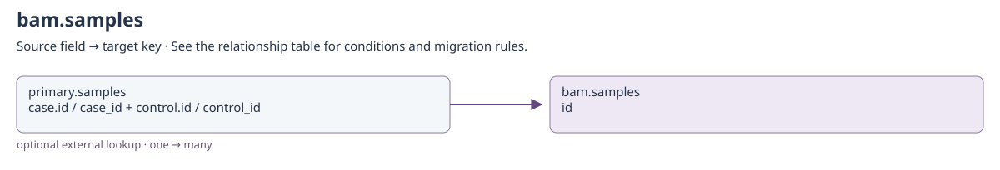
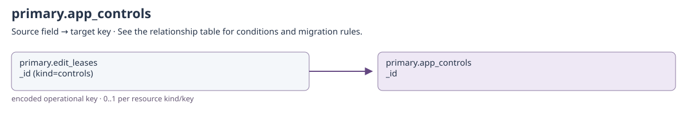
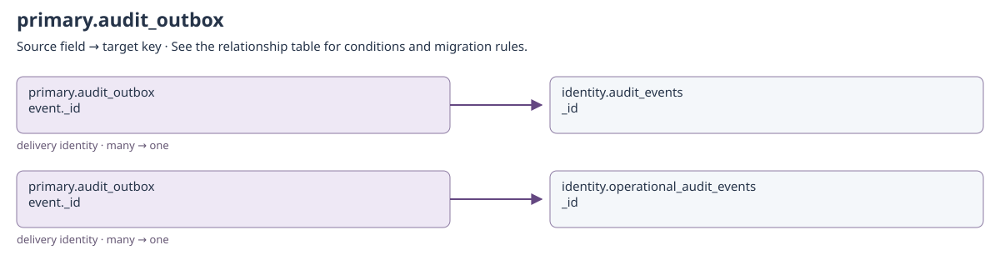
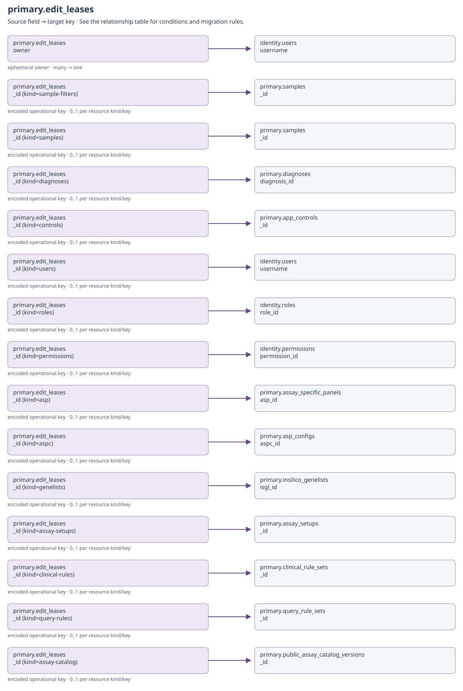
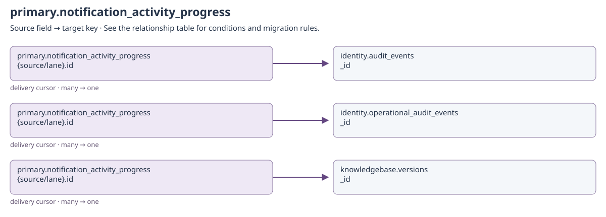
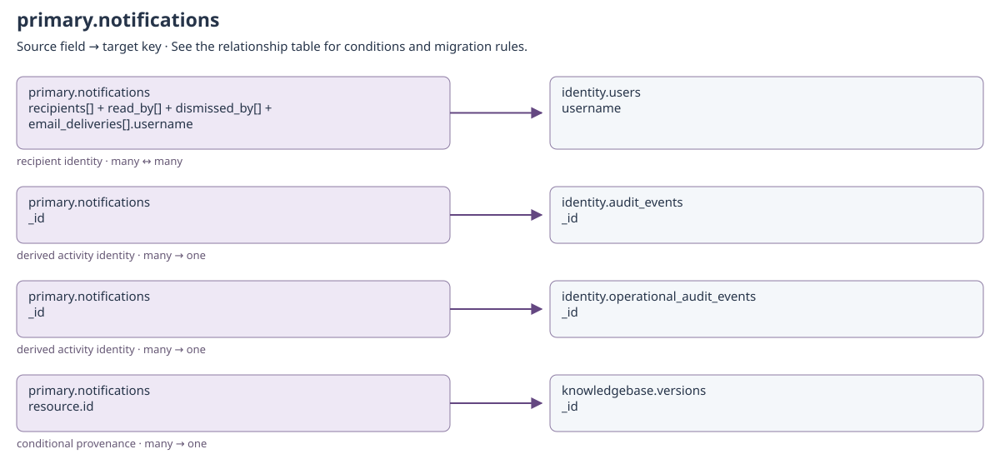
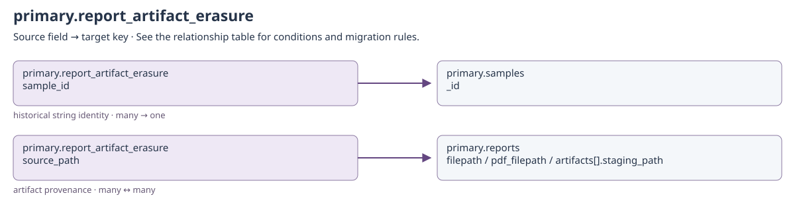

# Operational state and BAM records

<!-- GENERATED: scripts/docs/export_collection_dependencies.py -->

[Relationship guide](README.md) · [All collections](inventory.md)

Arrows run from the referencing field to the target. Snapshot and historical-actor
links preserve provenance; they do not require a live target on every read.

## bam.samples

Binding: `bam_samples`.

External BAM-service database. Its id is the case/control material identifier and bam_path is a filesystem resource. No primary samples._id equality is implied.

Repository-defined storage; no collection-model adapter is registered for this physical namespace.

[Open full-size diagram](../../assets/diagrams/collection-dependencies/bam-samples.svg)

### Outgoing dependencies

No cross-collection business reference is declared in this catalog for this direction.

### Incoming references and migration impact

| Source field | Target key | Relationship / multiplicity | Migration and resolution semantics | Evidence |
| --- | --- | --- | --- | --- |
| [primary.samples](clinical.md#primary-samples): `case.id / case_id + control.id / control_id` | [bam.samples](operations.md#bam-samples): `id` | optional external lookup; one → many | Use authorized case/control identifiers, never the primary sample ObjectId. Returns BAM paths; configured ASP folders can supply alignments without BAM service. | [S7](#s7) |

## primary.app_controls

Binding: `OPERATIONAL_COLLECTIONS.app_controls`.

Single active runtime-control document stored in MongoDB.

Singleton _id=default. Module/task/retention settings are software configuration keys, not references to one collection per setting.

Declared top-level fields: `created_by`, `updated_by`, `system_installed`, `_id`, `control_id`, `email`, `celery`, `retention`, `modules`, `curation`, `created_on`, `updated_on`.

[Field types and validation](../mongodb-collections.md#app_controls). `_id` may also be retained by an open collection model.

[Open full-size diagram](../../assets/diagrams/collection-dependencies/primary-app-controls.svg)

### Outgoing dependencies

| Source field | Target key | Relationship / multiplicity | Migration and resolution semantics | Evidence |
| --- | --- | --- | --- | --- |
| [primary.app_controls](operations.md#primary-app-controls): `created_by + updated_by` | [identity.users](identity.md#identity-users): `username` | historical actor; many → historical identity | Only populated actor fields apply. Preserve system and historical usernames even if no current account exists; never substitute the migration user. | [S9](#s9) |

### Incoming references and migration impact

| Source field | Target key | Relationship / multiplicity | Migration and resolution semantics | Evidence |
| --- | --- | --- | --- | --- |
| [primary.edit_leases](operations.md#primary-edit-leases): `_id (kind=controls)` | [primary.app_controls](operations.md#primary-app-controls): `_id` | encoded operational key; 0..1 per resource kind/key | Length-prefixed encoded identity; not a plain target ObjectId. Expiry/release makes the target editable again; no document backfill is needed. | [S6](#s6) |

## primary.audit_outbox

Binding: `OPERATIONAL_COLLECTIONS.audit_outbox`.

Repository-defined storage; no collection-model adapter is registered for this physical namespace.

[Open full-size diagram](../../assets/diagrams/collection-dependencies/primary-audit-outbox.svg)

### Outgoing dependencies

| Source field | Target key | Relationship / multiplicity | Migration and resolution semantics | Evidence |
| --- | --- | --- | --- | --- |
| [primary.audit_outbox](operations.md#primary-audit-outbox): `event._id` | [identity.audit_events](identity.md#identity-audit-events): `_id` | delivery identity; many → one | Destination follows event retention/routing. Preserve the stable event ID for replay deduplication; the outbox row is removed after delivery. | [S1](#s1) |
| [primary.audit_outbox](operations.md#primary-audit-outbox): `event._id` | [identity.operational_audit_events](identity.md#identity-operational-audit-events): `_id` | delivery identity; many → one | Destination follows event retention/routing. Preserve the stable event ID for replay deduplication; the outbox row is removed after delivery. | [S1](#s1) |

### Incoming references and migration impact

No cross-collection business reference is declared in this catalog for this direction.

## primary.edit_leases

Binding: `OPERATIONAL_COLLECTIONS.edit_leases`.

Resource identity is encoded in _id as length-prefixed resource kind + canonical identifier. Owner + editor_id controls renewal/release. It is operational, 90-second state: do not migrate live leases as clinical history.

Repository-defined storage; no collection-model adapter is registered for this physical namespace.

[Open full-size diagram](../../assets/diagrams/collection-dependencies/primary-edit-leases.svg)

### Outgoing dependencies

| Source field | Target key | Relationship / multiplicity | Migration and resolution semantics | Evidence |
| --- | --- | --- | --- | --- |
| [primary.edit_leases](operations.md#primary-edit-leases): `owner` | [identity.users](identity.md#identity-users): `username` | ephemeral owner; many → one | Owner is authenticated on each operation. editor_id is a per-form UUID, not an api_sessions token. | [S4](#s4) |
| [primary.edit_leases](operations.md#primary-edit-leases): `_id (kind=sample-filters)` | [primary.samples](clinical.md#primary-samples): `_id` | encoded operational key; 0..1 per resource kind/key | Length-prefixed encoded identity; not a plain target ObjectId. Expiry/release makes the target editable again; no document backfill is needed. | [S6](#s6) |
| [primary.edit_leases](operations.md#primary-edit-leases): `_id (kind=samples)` | [primary.samples](clinical.md#primary-samples): `_id` | encoded operational key; 0..1 per resource kind/key | Length-prefixed encoded identity; not a plain target ObjectId. Expiry/release makes the target editable again; no document backfill is needed. | [S6](#s6) |
| [primary.edit_leases](operations.md#primary-edit-leases): `_id (kind=diagnoses)` | [primary.diagnoses](configuration.md#primary-diagnoses): `diagnosis_id` | encoded operational key; 0..1 per resource kind/key | Length-prefixed encoded identity; not a plain target ObjectId. Expiry/release makes the target editable again; no document backfill is needed. | [S6](#s6) |
| [primary.edit_leases](operations.md#primary-edit-leases): `_id (kind=controls)` | [primary.app_controls](operations.md#primary-app-controls): `_id` | encoded operational key; 0..1 per resource kind/key | Length-prefixed encoded identity; not a plain target ObjectId. Expiry/release makes the target editable again; no document backfill is needed. | [S6](#s6) |
| [primary.edit_leases](operations.md#primary-edit-leases): `_id (kind=users)` | [identity.users](identity.md#identity-users): `username` | encoded operational key; 0..1 per resource kind/key | Length-prefixed encoded identity; not a plain target ObjectId. Expiry/release makes the target editable again; no document backfill is needed. | [S6](#s6) |
| [primary.edit_leases](operations.md#primary-edit-leases): `_id (kind=roles)` | [identity.roles](identity.md#identity-roles): `role_id` | encoded operational key; 0..1 per resource kind/key | Length-prefixed encoded identity; not a plain target ObjectId. Expiry/release makes the target editable again; no document backfill is needed. | [S6](#s6) |
| [primary.edit_leases](operations.md#primary-edit-leases): `_id (kind=permissions)` | [identity.permissions](identity.md#identity-permissions): `permission_id` | encoded operational key; 0..1 per resource kind/key | Length-prefixed encoded identity; not a plain target ObjectId. Expiry/release makes the target editable again; no document backfill is needed. | [S6](#s6) |
| [primary.edit_leases](operations.md#primary-edit-leases): `_id (kind=asp)` | [primary.assay_specific_panels](configuration.md#primary-assay-specific-panels): `asp_id` | encoded operational key; 0..1 per resource kind/key | Length-prefixed encoded identity; not a plain target ObjectId. Expiry/release makes the target editable again; no document backfill is needed. | [S6](#s6) |
| [primary.edit_leases](operations.md#primary-edit-leases): `_id (kind=aspc)` | [primary.asp_configs](configuration.md#primary-asp-configs): `aspc_id` | encoded operational key; 0..1 per resource kind/key | Length-prefixed encoded identity; not a plain target ObjectId. Expiry/release makes the target editable again; no document backfill is needed. | [S6](#s6) |
| [primary.edit_leases](operations.md#primary-edit-leases): `_id (kind=genelists)` | [primary.insilico_genelists](configuration.md#primary-insilico-genelists): `isgl_id` | encoded operational key; 0..1 per resource kind/key | Length-prefixed encoded identity; not a plain target ObjectId. Expiry/release makes the target editable again; no document backfill is needed. | [S6](#s6) |
| [primary.edit_leases](operations.md#primary-edit-leases): `_id (kind=assay-setups)` | [primary.assay_setups](workflows.md#primary-assay-setups): `_id` | encoded operational key; 0..1 per resource kind/key | Length-prefixed encoded identity; not a plain target ObjectId. Expiry/release makes the target editable again; no document backfill is needed. | [S6](#s6) |
| [primary.edit_leases](operations.md#primary-edit-leases): `_id (kind=clinical-rules)` | [primary.clinical_rule_sets](workflows.md#primary-clinical-rule-sets): `_id` | encoded operational key; 0..1 per resource kind/key | Length-prefixed encoded identity; not a plain target ObjectId. Expiry/release makes the target editable again; no document backfill is needed. | [S6](#s6) |
| [primary.edit_leases](operations.md#primary-edit-leases): `_id (kind=query-rules)` | [primary.query_rule_sets](workflows.md#primary-query-rule-sets): `_id` | encoded operational key; 0..1 per resource kind/key | Length-prefixed encoded identity; not a plain target ObjectId. Expiry/release makes the target editable again; no document backfill is needed. | [S6](#s6) |
| [primary.edit_leases](operations.md#primary-edit-leases): `_id (kind=assay-catalog)` | [primary.public_assay_catalog_versions](workflows.md#primary-public-assay-catalog-versions): `_id` | encoded operational key; 0..1 per resource kind/key | Length-prefixed encoded identity; not a plain target ObjectId. Expiry/release makes the target editable again; no document backfill is needed. The resource registry calls this editor kind assay-catalog. | [S6](#s6) |

### Incoming references and migration impact

No cross-collection business reference is declared in this catalog for this direction.

## primary.ingest_jobs

Binding: `ingest_jobs_collection`.

Durable ingest job with source payload, lease, attempts, and completion result.

source_payload contains the accepted submission, and result is a workflow receipt. SAMPLE_ID references belong to the resulting clinical documents, not an inferred job._id foreign key. Reconcile in-flight jobs and staging directories before replaying an import.

Declared top-level fields: `created_by`, `updated_by`, `system_installed`, `_id`, `kind`, `state`, `source_payload`, `update_existing`, `increment`, `staging_dir`, `created_at`, `updated_at`, `lease_until`, `lease_token`, `attempts`, `result`, `error`, `submitted_by`.

[Field types and validation](../mongodb-collections.md#ingest_jobs). `_id` may also be retained by an open collection model.

[Open full-size diagram](../../assets/diagrams/collection-dependencies/primary-ingest-jobs.svg)

### Outgoing dependencies

| Source field | Target key | Relationship / multiplicity | Migration and resolution semantics | Evidence |
| --- | --- | --- | --- | --- |
| [primary.ingest_jobs](operations.md#primary-ingest-jobs): `submitted_by` | [identity.users](identity.md#identity-users): `username` | historical actor; many → one | Actor provenance for durable ingestion; source_payload/result/error are workflow records, not arbitrary live foreign keys. | [S8](#s8) |
| [primary.ingest_jobs](operations.md#primary-ingest-jobs): `created_by + updated_by` | [identity.users](identity.md#identity-users): `username` | historical actor; many → historical identity | Only populated actor fields apply. Preserve system and historical usernames even if no current account exists; never substitute the migration user. | [S9](#s9) |

### Incoming references and migration impact

No cross-collection business reference is declared in this catalog for this direction.

## primary.notification_activity_progress

Binding: `OPERATIONAL_COLLECTIONS.notification_activity_progress`.

Repository-defined storage; no collection-model adapter is registered for this physical namespace.

[Open full-size diagram](../../assets/diagrams/collection-dependencies/primary-notification-activity-progress.svg)

### Outgoing dependencies

| Source field | Target key | Relationship / multiplicity | Migration and resolution semantics | Evidence |
| --- | --- | --- | --- | --- |
| [primary.notification_activity_progress](operations.md#primary-notification-activity-progress): `{source/lane}.id` | [identity.audit_events](identity.md#identity-audit-events): `_id` | delivery cursor; many → one | Dynamic cursor lane also stores timestamp. Preserve or intentionally reset with notification deduplication state; this is not a business document reference. | [S2](#s2) |
| [primary.notification_activity_progress](operations.md#primary-notification-activity-progress): `{source/lane}.id` | [identity.operational_audit_events](identity.md#identity-operational-audit-events): `_id` | delivery cursor; many → one | Dynamic cursor lane also stores timestamp. Preserve or intentionally reset with notification deduplication state; this is not a business document reference. | [S2](#s2) |
| [primary.notification_activity_progress](operations.md#primary-notification-activity-progress): `{source/lane}.id` | [knowledgebase.versions](knowledgebase.md#knowledgebase-versions): `_id` | delivery cursor; many → one | Dynamic cursor lane also stores timestamp. Preserve or intentionally reset with notification deduplication state; this is not a business document reference. | [S2](#s2) |

### Incoming references and migration impact

No cross-collection business reference is declared in this catalog for this direction.

## primary.notifications

Binding: `notifications_collection`.

Repository-defined storage; no collection-model adapter is registered for this physical namespace.

[Open full-size diagram](../../assets/diagrams/collection-dependencies/primary-notifications.svg)

### Outgoing dependencies

| Source field | Target key | Relationship / multiplicity | Migration and resolution semantics | Evidence |
| --- | --- | --- | --- | --- |
| [primary.notifications](operations.md#primary-notifications): `recipients[] + read_by[] + dismissed_by[] + email_deliveries[].username` | [identity.users](identity.md#identity-users): `username` | recipient identity; many ↔ many | Persist recipient-specific read/dismissal/delivery state. Do not recreate old notifications on redeploy or change recipients during migration. | [S5](#s5) |
| [primary.notifications](operations.md#primary-notifications): `_id` | [identity.audit_events](identity.md#identity-audit-events): `_id` | derived activity identity; many → one | For activity-derived notifications, source event identities support idempotent delivery. Manual broadcasts have no corresponding source event. | [S2](#s2) |
| [primary.notifications](operations.md#primary-notifications): `_id` | [identity.operational_audit_events](identity.md#identity-operational-audit-events): `_id` | derived activity identity; many → one | For activity-derived notifications, source event identities support idempotent delivery. Manual broadcasts have no corresponding source event. | [S2](#s2) |
| [primary.notifications](operations.md#primary-notifications): `resource.id` | [knowledgebase.versions](knowledgebase.md#knowledgebase-versions): `_id` | conditional provenance; many → one | Only knowledgebase update notifications; the notification's own _id is derived, not a direct release ObjectId. | [S2](#s2) |

### Incoming references and migration impact

No cross-collection business reference is declared in this catalog for this direction.

## primary.report_artifact_erasure

Binding: `OPERATIONAL_COLLECTIONS.report_artifact_erasure`.

Repository-defined storage; no collection-model adapter is registered for this physical namespace.

[Open full-size diagram](../../assets/diagrams/collection-dependencies/primary-report-artifact-erasure.svg)

### Outgoing dependencies

| Source field | Target key | Relationship / multiplicity | Migration and resolution semantics | Evidence |
| --- | --- | --- | --- | --- |
| [primary.report_artifact_erasure](operations.md#primary-report-artifact-erasure): `sample_id` | [primary.samples](clinical.md#primary-samples): `_id` | historical string identity; many → one | Work is intentionally processed after sample/report deletion, so the parent can be absent. Preserve pending filesystem cleanup until reconciled. | [S3](#s3) |
| [primary.report_artifact_erasure](operations.md#primary-report-artifact-erasure): `source_path` | [primary.reports](clinical.md#primary-reports): `filepath / pdf_filepath / artifacts[].staging_path` | artifact provenance; many ↔ many | Captured path, not a live foreign key after deletion; root/device/inode safeguards must still agree on recovery. | [S3](#s3) |

### Incoming references and migration impact

No cross-collection business reference is declared in this catalog for this direction.

## Source evidence

### S1

`api/infra/mongo/repositories/audit_outbox.py`

### S2

`api/infra/mongo/repositories/notification_activity.py`

### S3

`api/infra/mongo/repositories/report_artifact_erasure.py`

### S4

`src/coyote3/application/editing.py`

### S5

`src/coyote3/application/notifications/service.py`

### S6

`src/coyote3/application/operations/application.py`

### S7

`src/coyote3/application/operations/samples.py`

### S8

`src/coyote3/contracts/schemas/ingest_jobs.py`

### S9

`src/coyote3/contracts/schemas/registry.py`
