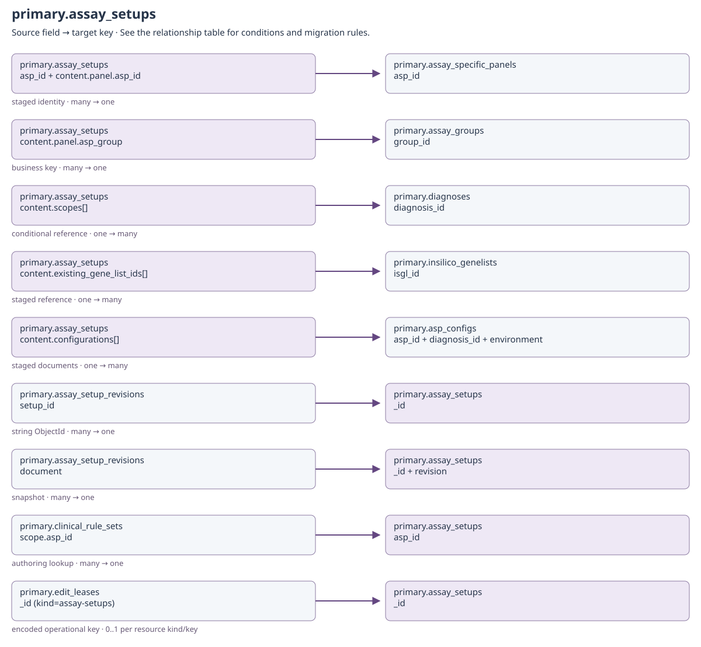
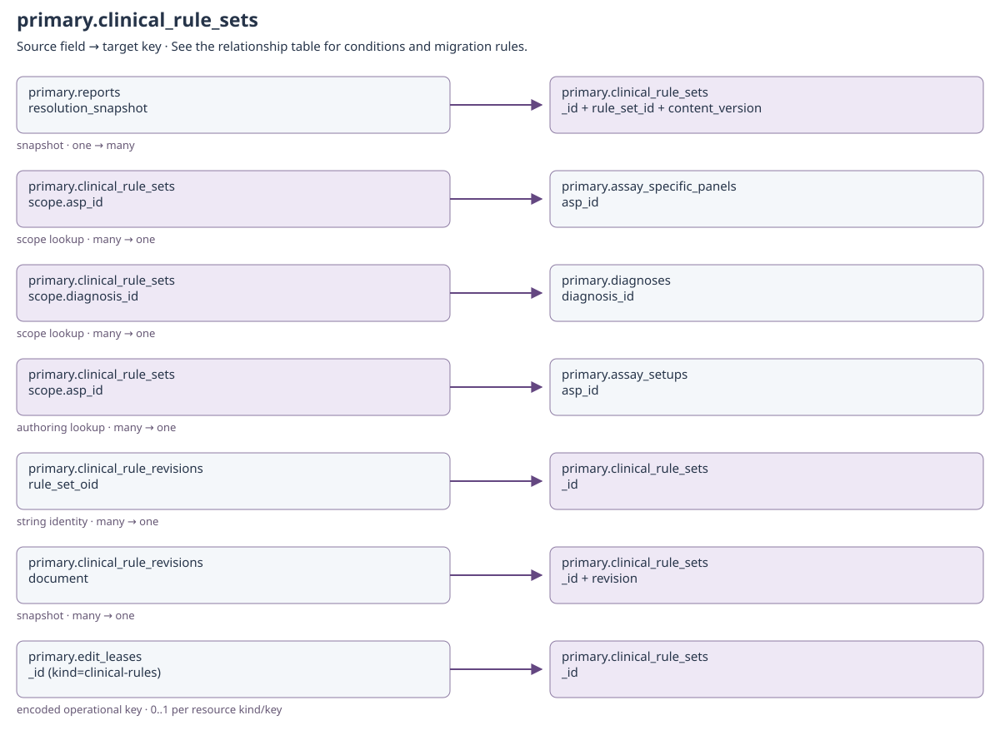
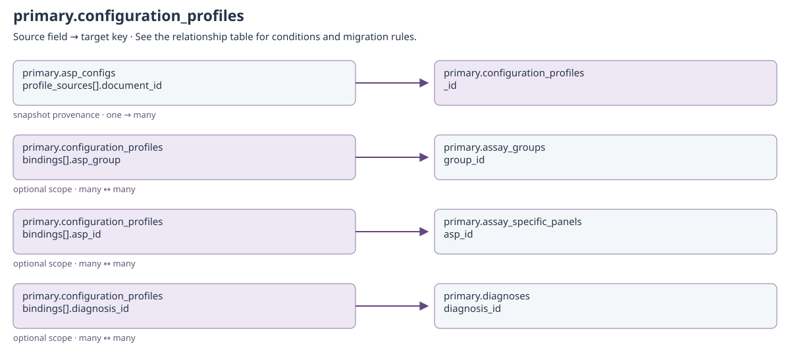
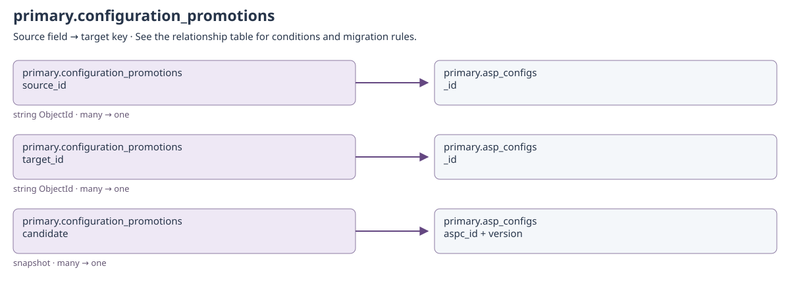
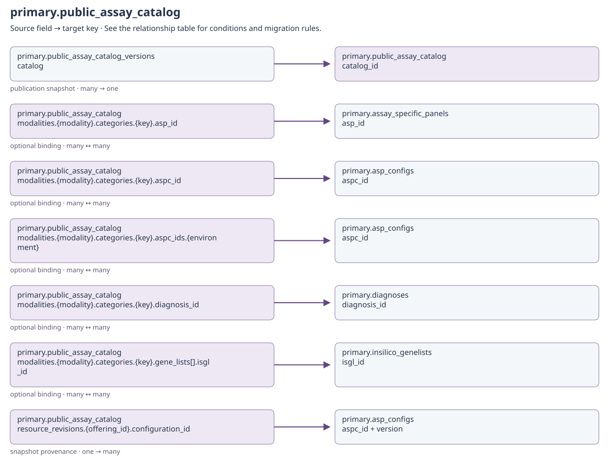
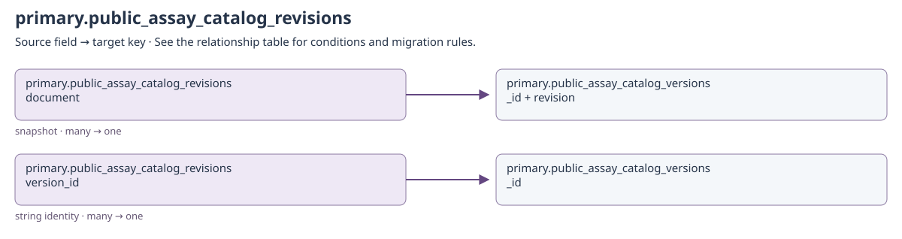
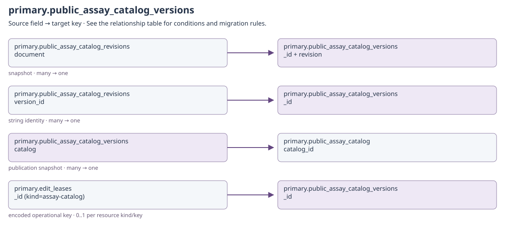
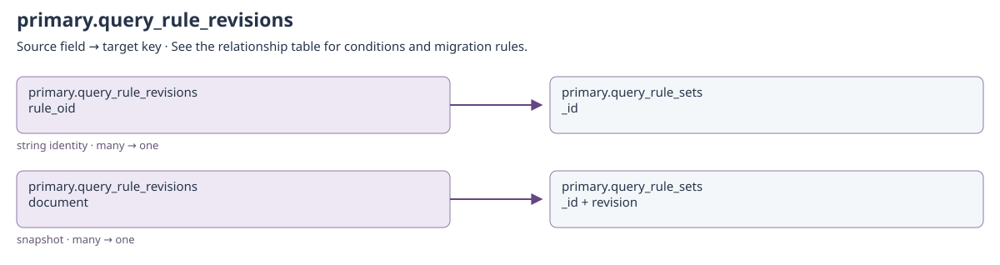
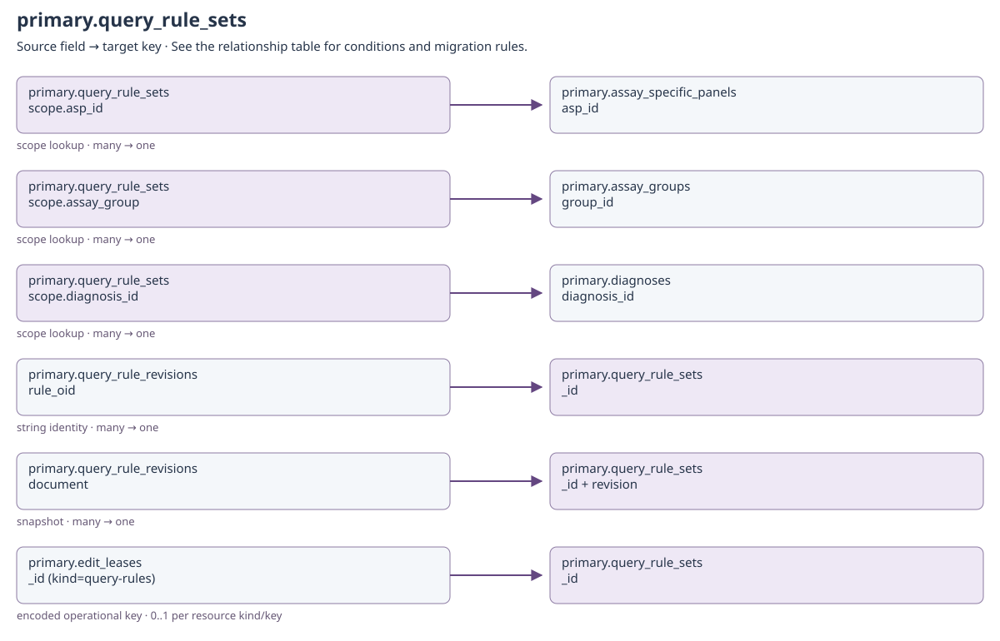

# Drafts, publications and revision history

<!-- GENERATED: scripts/docs/export_collection_dependencies.py -->

[Relationship guide](README.md) · [All collections](inventory.md)

Arrows run from the referencing field to the target. Snapshot and historical-actor
links preserve provenance; they do not require a live target on every read.

## primary.assay_setup_revisions

Binding: `assay_setup_revisions_collection`.

Immutable full snapshot for one setup revision.

Declared top-level fields: `created_by`, `updated_by`, `system_installed`, `_id`, `setup_id`, `revision`, `action`, `document`.

[Field types and validation](../mongodb-collections.md#assay_setup_revisions). `_id` may also be retained by an open collection model.

[Open full-size diagram](../../assets/diagrams/collection-dependencies/primary-assay-setup-revisions.svg)

### Outgoing dependencies

| Source field | Target key | Relationship / multiplicity | Migration and resolution semantics | Evidence |
| --- | --- | --- | --- | --- |
| [primary.assay_setup_revisions](workflows.md#primary-assay-setup-revisions): `setup_id` | [primary.assay_setups](workflows.md#primary-assay-setups): `_id` | string ObjectId; many → one | Exact saved setup; (setup_id, revision) identifies the immutable snapshot. | [S1](#s1) |
| [primary.assay_setup_revisions](workflows.md#primary-assay-setup-revisions): `document` | [primary.assay_setups](workflows.md#primary-assay-setups): `_id + revision` | snapshot; many → one | Full historical document, including content and actors. Do not overwrite document with the latest setup. | [S8](#s8) |
| [primary.assay_setup_revisions](workflows.md#primary-assay-setup-revisions): `created_by + updated_by` | [identity.users](identity.md#identity-users): `username` | historical actor; many → historical identity | Only populated actor fields apply. Preserve system and historical usernames even if no current account exists; never substitute the migration user. | [S15](#s15) |

### Incoming references and migration impact

No cross-collection business reference is declared in this catalog for this direction.

## primary.assay_setups

Binding: `assay_setups_collection`.

Governed setup draft; publication leaves its final content immutable.

Draft content can precede operational resources. Keep original _id, revision and content_editors, created_by/at and updated_by/at. Editing leases live in edit_leases, not in this collection. Published setup revisions are retained.

Declared top-level fields: `created_by`, `updated_by`, `system_installed`, `_id`, `asp_id`, `content`, `status`, `revision`, `content_editors`, `created_at`, `updated_at`, `review_reason`, `published_by`, `review_dependencies`.

[Field types and validation](../mongodb-collections.md#assay_setups). `_id` may also be retained by an open collection model.

[Open full-size diagram](../../assets/diagrams/collection-dependencies/primary-assay-setups.svg)

### Outgoing dependencies

| Source field | Target key | Relationship / multiplicity | Migration and resolution semantics | Evidence |
| --- | --- | --- | --- | --- |
| [primary.assay_setups](workflows.md#primary-assay-setups): `asp_id + content.panel.asp_id` | [primary.assay_specific_panels](configuration.md#primary-assay-specific-panels): `asp_id` | staged identity; many → one | A reserved draft can exist before the operational assay. Publication creates the assay; this is not a required pre-existing parent. | [S8](#s8) |
| [primary.assay_setups](workflows.md#primary-assay-setups): `content.panel.asp_group` | [primary.assay_groups](configuration.md#primary-assay-groups): `group_id` | business key; many → one | Registered group prerequisite, even before activation. | [S8](#s8) |
| [primary.assay_setups](workflows.md#primary-assay-setups): `content.scopes[]` | [primary.diagnoses](configuration.md#primary-diagnoses): `diagnosis_id` | conditional reference; one → many | Selected named scopes become diagnosis_associations at publication; base is implicit. | [S8](#s8) |
| [primary.assay_setups](workflows.md#primary-assay-setups): `content.existing_gene_list_ids[]` | [primary.insilico_genelists](configuration.md#primary-insilico-genelists): `isgl_id` | staged reference; one → many | Existing lists are linked during publication. content.gene_lists[] instead contains new staged documents, not foreign keys. | [S8](#s8) |
| [primary.assay_setups](workflows.md#primary-assay-setups): `content.configurations[]` | [primary.asp_configs](configuration.md#primary-asp-configs): `asp_id + diagnosis_id + environment` | staged documents; one → many | Embedded proposed configurations become operational revisions only after publication validation. | [S8](#s8) |
| [primary.assay_setups](workflows.md#primary-assay-setups): `created_by + updated_by + published_by + content_editors` | [identity.users](identity.md#identity-users): `username` | historical actor; many → historical identity | Only populated actor fields apply. Preserve system and historical usernames even if no current account exists; never substitute the migration user. | [S15](#s15) |

### Incoming references and migration impact

| Source field | Target key | Relationship / multiplicity | Migration and resolution semantics | Evidence |
| --- | --- | --- | --- | --- |
| [primary.assay_setup_revisions](workflows.md#primary-assay-setup-revisions): `setup_id` | [primary.assay_setups](workflows.md#primary-assay-setups): `_id` | string ObjectId; many → one | Exact saved setup; (setup_id, revision) identifies the immutable snapshot. | [S1](#s1) |
| [primary.assay_setup_revisions](workflows.md#primary-assay-setup-revisions): `document` | [primary.assay_setups](workflows.md#primary-assay-setups): `_id + revision` | snapshot; many → one | Full historical document, including content and actors. Do not overwrite document with the latest setup. | [S8](#s8) |
| [primary.clinical_rule_sets](workflows.md#primary-clinical-rule-sets): `scope.asp_id` | [primary.assay_setups](workflows.md#primary-assay-setups): `asp_id` | authoring lookup; many → one | A draft may use a planned assay ID before a setup or operational assay exists. Saved unpublished setups also supply compatible scopes. An available compatible assay/diagnosis is required before rule submission; draft reassociation preserves its document ID and revision chain. | [S8](#s8) |
| [primary.edit_leases](operations.md#primary-edit-leases): `_id (kind=assay-setups)` | [primary.assay_setups](workflows.md#primary-assay-setups): `_id` | encoded operational key; 0..1 per resource kind/key | Length-prefixed encoded identity; not a plain target ObjectId. Expiry/release makes the target editable again; no document backfill is needed. | [S6](#s6) |

## primary.clinical_rule_revisions

Binding: `clinical_rule_revisions_collection`.

Hash-linked audit revision preserving a complete rule-set document.

Declared top-level fields: `created_by`, `updated_by`, `system_installed`, `_id`, `rule_set_oid`, `rule_set_id`, `content_version`, `revision`, `action`, `actor`, `occurred_at`, `reason`, `previous_revision_hash`, `revision_hash`, `document`.

[Field types and validation](../mongodb-collections.md#clinical_rule_revisions). `_id` may also be retained by an open collection model.

[Open full-size diagram](../../assets/diagrams/collection-dependencies/primary-clinical-rule-revisions.svg)

### Outgoing dependencies

| Source field | Target key | Relationship / multiplicity | Migration and resolution semantics | Evidence |
| --- | --- | --- | --- | --- |
| [primary.clinical_rule_revisions](workflows.md#primary-clinical-rule-revisions): `rule_set_oid` | [primary.clinical_rule_sets](workflows.md#primary-clinical-rule-sets): `_id` | string identity; many → one | Exact content-version document; also retain rule_set_id, content_version, revision and previous_revision_hash/revision_hash. | [S2](#s2) |
| [primary.clinical_rule_revisions](workflows.md#primary-clinical-rule-revisions): `document` | [primary.clinical_rule_sets](workflows.md#primary-clinical-rule-sets): `_id + revision` | snapshot; many → one | Full historical content. Preserve snapshot identity and integrity fields; never replace it with current content. | [S12](#s12) |
| [primary.clinical_rule_revisions](workflows.md#primary-clinical-rule-revisions): `created_by + updated_by + actor` | [identity.users](identity.md#identity-users): `username` | historical actor; many → historical identity | Only populated actor fields apply. Preserve system and historical usernames even if no current account exists; never substitute the migration user. | [S15](#s15) |

### Incoming references and migration impact

No cross-collection business reference is declared in this catalog for this direction.

## primary.clinical_rule_sets

Binding: `clinical_rule_sets_collection`.

One draft or immutable released version of a clinical rule scope.

rule_set_id is the stable rule identity, content_version the clinical release, revision the save counter, and _id one content-version document. None are interchangeable. The published document is immutable; reference dependencies are resolution by full scope, not merely matching the display name.

Declared top-level fields: `created_by`, `updated_by`, `system_installed`, `_id`, `schema_version`, `scope`, `name`, `analysis_declarations`, `terminology`, `blocks`, `bulk_annotation_rules`, `test_cases`, `references`, `rule_set_id`, `content_version`, `revision`, `status`, `active`, `provenance`, `change_summary`, `review`, `lifecycle`, `created_at`, `updated_at`, `published_at`, `published_by`, `effective_from`, `retired_at`, `retired_by`, `content_hash`.

[Field types and validation](../mongodb-collections.md#clinical_rule_sets). `_id` may also be retained by an open collection model.

[Open full-size diagram](../../assets/diagrams/collection-dependencies/primary-clinical-rule-sets.svg)

### Outgoing dependencies

| Source field | Target key | Relationship / multiplicity | Migration and resolution semantics | Evidence |
| --- | --- | --- | --- | --- |
| [primary.clinical_rule_sets](workflows.md#primary-clinical-rule-sets): `scope.asp_id` | [primary.assay_specific_panels](configuration.md#primary-assay-specific-panels): `asp_id` | scope lookup; many → one | Preserve all other scope dimensions and publication state. Named diagnosis references exclude implicit base; query scopes may be broad/null. | [S12](#s12) |
| [primary.clinical_rule_sets](workflows.md#primary-clinical-rule-sets): `scope.diagnosis_id` | [primary.diagnoses](configuration.md#primary-diagnoses): `diagnosis_id` | scope lookup; many → one | Preserve all other scope dimensions and publication state. Named diagnosis references exclude implicit base; query scopes may be broad/null. | [S12](#s12) |
| [primary.clinical_rule_sets](workflows.md#primary-clinical-rule-sets): `scope.asp_id` | [primary.assay_setups](workflows.md#primary-assay-setups): `asp_id` | authoring lookup; many → one | A draft may use a planned assay ID before a setup or operational assay exists. Saved unpublished setups also supply compatible scopes. An available compatible assay/diagnosis is required before rule submission; draft reassociation preserves its document ID and revision chain. | [S8](#s8) |
| [primary.clinical_rule_sets](workflows.md#primary-clinical-rule-sets): `created_by + updated_by + published_by + retired_by` | [identity.users](identity.md#identity-users): `username` | historical actor; many → historical identity | Only populated actor fields apply. Preserve system and historical usernames even if no current account exists; never substitute the migration user. | [S15](#s15) |

### Incoming references and migration impact

| Source field | Target key | Relationship / multiplicity | Migration and resolution semantics | Evidence |
| --- | --- | --- | --- | --- |
| [primary.reports](clinical.md#primary-reports): `resolution_snapshot` | [primary.clinical_rule_sets](workflows.md#primary-clinical-rule-sets): `_id + rule_set_id + content_version` | snapshot; one → many | Nested captured rule resolution and evidence; hashes and content remain tied to the saved report. This object is not a scalar foreign key. | [S5](#s5) |
| [primary.clinical_rule_revisions](workflows.md#primary-clinical-rule-revisions): `rule_set_oid` | [primary.clinical_rule_sets](workflows.md#primary-clinical-rule-sets): `_id` | string identity; many → one | Exact content-version document; also retain rule_set_id, content_version, revision and previous_revision_hash/revision_hash. | [S2](#s2) |
| [primary.clinical_rule_revisions](workflows.md#primary-clinical-rule-revisions): `document` | [primary.clinical_rule_sets](workflows.md#primary-clinical-rule-sets): `_id + revision` | snapshot; many → one | Full historical content. Preserve snapshot identity and integrity fields; never replace it with current content. | [S12](#s12) |
| [primary.edit_leases](operations.md#primary-edit-leases): `_id (kind=clinical-rules)` | [primary.clinical_rule_sets](workflows.md#primary-clinical-rule-sets): `_id` | encoded operational key; 0..1 per resource kind/key | Length-prefixed encoded identity; not a plain target ObjectId. Expiry/release makes the target editable again; no document backfill is needed. | [S6](#s6) |

## primary.configuration_profiles

Binding: `configuration_profiles_collection`.

A retained profile revision, independently published before configuration compilation.

Declared top-level fields: `created_by`, `updated_by`, `system_installed`, `_id`, `profile_id`, `name`, `kind`, `bindings`, `content`, `reason`, `version`, `status`, `is_current`, `content_hash`, `created_on`, `published_by`, `published_on`.

[Field types and validation](../mongodb-collections.md#configuration_profiles). `_id` may also be retained by an open collection model.

[Open full-size diagram](../../assets/diagrams/collection-dependencies/primary-configuration-profiles.svg)

### Outgoing dependencies

| Source field | Target key | Relationship / multiplicity | Migration and resolution semantics | Evidence |
| --- | --- | --- | --- | --- |
| [primary.configuration_profiles](workflows.md#primary-configuration-profiles): `bindings[].asp_group` | [primary.assay_groups](configuration.md#primary-assay-groups): `group_id` | optional scope; many ↔ many | Binding dimensions select applicability. Null means no restriction; base diagnosis is represented by no named diagnosis binding. | [S11](#s11) |
| [primary.configuration_profiles](workflows.md#primary-configuration-profiles): `bindings[].asp_id` | [primary.assay_specific_panels](configuration.md#primary-assay-specific-panels): `asp_id` | optional scope; many ↔ many | Binding dimensions select applicability. Null means no restriction; base diagnosis is represented by no named diagnosis binding. | [S11](#s11) |
| [primary.configuration_profiles](workflows.md#primary-configuration-profiles): `bindings[].diagnosis_id` | [primary.diagnoses](configuration.md#primary-diagnoses): `diagnosis_id` | optional scope; many ↔ many | Binding dimensions select applicability. Null means no restriction; base diagnosis is represented by no named diagnosis binding. | [S11](#s11) |
| [primary.configuration_profiles](workflows.md#primary-configuration-profiles): `created_by + updated_by + published_by` | [identity.users](identity.md#identity-users): `username` | historical actor; many → historical identity | Only populated actor fields apply. Preserve system and historical usernames even if no current account exists; never substitute the migration user. | [S15](#s15) |

### Incoming references and migration impact

| Source field | Target key | Relationship / multiplicity | Migration and resolution semantics | Evidence |
| --- | --- | --- | --- | --- |
| [primary.asp_configs](configuration.md#primary-asp-configs): `profile_sources[].document_id` | [primary.configuration_profiles](workflows.md#primary-configuration-profiles): `_id` | snapshot provenance; one → many | String document identity, plus profile_id/version/content_hash/content. Preserve the selected revision and captured content. | [S9](#s9) |

## primary.configuration_promotions

Binding: `configuration_promotions_collection`.

Retain the reviewed candidate, exact source, evidence and publication result.

Declared top-level fields: `created_by`, `updated_by`, `system_installed`, `_id`, `source_id`, `source_hash`, `candidate`, `content_hash`, `expected_target_version`, `evidence`, `reason`, `created_on`, `status`, `approved_by`, `approved_on`, `target_id`.

[Field types and validation](../mongodb-collections.md#configuration_promotions). `_id` may also be retained by an open collection model.

[Open full-size diagram](../../assets/diagrams/collection-dependencies/primary-configuration-promotions.svg)

### Outgoing dependencies

| Source field | Target key | Relationship / multiplicity | Migration and resolution semantics | Evidence |
| --- | --- | --- | --- | --- |
| [primary.configuration_promotions](workflows.md#primary-configuration-promotions): `source_id` | [primary.asp_configs](configuration.md#primary-asp-configs): `_id` | string ObjectId; many → one | Exact source release; verify source_hash before approval. | [S10](#s10) |
| [primary.configuration_promotions](workflows.md#primary-configuration-promotions): `target_id` | [primary.asp_configs](configuration.md#primary-asp-configs): `_id` | string ObjectId; many → one | Populated after approval with the installed target release; null while pending. | [S10](#s10) |
| [primary.configuration_promotions](workflows.md#primary-configuration-promotions): `candidate` | [primary.asp_configs](configuration.md#primary-asp-configs): `aspc_id + version` | snapshot; many → one | Review candidate content and content_hash; not a separate live configuration until approved. | [S11](#s11) |
| [primary.configuration_promotions](workflows.md#primary-configuration-promotions): `created_by + updated_by + approved_by` | [identity.users](identity.md#identity-users): `username` | historical actor; many → historical identity | Only populated actor fields apply. Preserve system and historical usernames even if no current account exists; never substitute the migration user. | [S15](#s15) |

### Incoming references and migration impact

No cross-collection business reference is declared in this catalog for this direction.

## primary.public_assay_catalog

Binding: `public_assay_catalog_collection`.

One center-owned public catalog document stored in the primary database.

published_offerings and resource_revisions are retained publication projections. They do not turn every public read into a live lookup of the newest assay or gene list.

Declared top-level fields: `created_by`, `updated_by`, `system_installed`, `_id`, `catalog_id`, `schema_version`, `version`, `header`, `description`, `maintainer`, `layout`, `modalities`, `published_offerings`, `resource_revisions`, `created_at`, `updated_at`.

[Field types and validation](../mongodb-collections.md#public_assay_catalog). `_id` may also be retained by an open collection model.

[Open full-size diagram](../../assets/diagrams/collection-dependencies/primary-public-assay-catalog.svg)

### Outgoing dependencies

| Source field | Target key | Relationship / multiplicity | Migration and resolution semantics | Evidence |
| --- | --- | --- | --- | --- |
| [primary.public_assay_catalog](workflows.md#primary-public-assay-catalog): `modalities.{modality}.categories.{key}.asp_id` | [primary.assay_specific_panels](configuration.md#primary-assay-specific-panels): `asp_id` | optional binding; many ↔ many | Entry bindings, including inherited category values, resolve resources during publication; folder keys and parent_key are within-document navigation, not collection references. | [S13](#s13) |
| [primary.public_assay_catalog](workflows.md#primary-public-assay-catalog): `modalities.{modality}.categories.{key}.aspc_id` | [primary.asp_configs](configuration.md#primary-asp-configs): `aspc_id` | optional binding; many ↔ many | Entry bindings, including inherited category values, resolve resources during publication; folder keys and parent_key are within-document navigation, not collection references. | [S13](#s13) |
| [primary.public_assay_catalog](workflows.md#primary-public-assay-catalog): `modalities.{modality}.categories.{key}.aspc_ids.{environment}` | [primary.asp_configs](configuration.md#primary-asp-configs): `aspc_id` | optional binding; many ↔ many | Entry bindings, including inherited category values, resolve resources during publication; folder keys and parent_key are within-document navigation, not collection references. | [S13](#s13) |
| [primary.public_assay_catalog](workflows.md#primary-public-assay-catalog): `modalities.{modality}.categories.{key}.diagnosis_id` | [primary.diagnoses](configuration.md#primary-diagnoses): `diagnosis_id` | optional binding; many ↔ many | Entry bindings, including inherited category values, resolve resources during publication; folder keys and parent_key are within-document navigation, not collection references. | [S13](#s13) |
| [primary.public_assay_catalog](workflows.md#primary-public-assay-catalog): `modalities.{modality}.categories.{key}.gene_lists[].isgl_id` | [primary.insilico_genelists](configuration.md#primary-insilico-genelists): `isgl_id` | optional binding; many ↔ many | Entry bindings, including inherited category values, resolve resources during publication; folder keys and parent_key are within-document navigation, not collection references. | [S13](#s13) |
| [primary.public_assay_catalog](workflows.md#primary-public-assay-catalog): `resource_revisions.{offering_id}.configuration_id` | [primary.asp_configs](configuration.md#primary-asp-configs): `aspc_id + version` | snapshot provenance; one → many | configuration_id is the aspc_id business key; configuration_revision supplies its version. This is not an ObjectId. Publication also captures assay_id/revision, group revision, diagnosis revision and gene-list versions. | [S7](#s7) |
| [primary.public_assay_catalog](workflows.md#primary-public-assay-catalog): `created_by + updated_by` | [identity.users](identity.md#identity-users): `username` | historical actor; many → historical identity | Only populated actor fields apply. Preserve system and historical usernames even if no current account exists; never substitute the migration user. | [S15](#s15) |

### Incoming references and migration impact

| Source field | Target key | Relationship / multiplicity | Migration and resolution semantics | Evidence |
| --- | --- | --- | --- | --- |
| [primary.public_assay_catalog_versions](workflows.md#primary-public-assay-catalog-versions): `catalog` | [primary.public_assay_catalog](workflows.md#primary-public-assay-catalog): `catalog_id` | publication snapshot; many → one | Staged full catalog; publication installs the reviewed content as the current public projection. base_version is an optimistic concurrency precondition, not an ObjectId. | [S13](#s13) |

## primary.public_assay_catalog_revisions

Binding: `public_assay_catalog_revisions_collection`.

Preserved catalog-version snapshot identified by version ID and revision.

Declared top-level fields: `created_by`, `updated_by`, `system_installed`, `_id`, `version_id`, `revision`, `document`.

[Field types and validation](../mongodb-collections.md#public_assay_catalog_revisions). `_id` may also be retained by an open collection model.

[Open full-size diagram](../../assets/diagrams/collection-dependencies/primary-public-assay-catalog-revisions.svg)

### Outgoing dependencies

| Source field | Target key | Relationship / multiplicity | Migration and resolution semantics | Evidence |
| --- | --- | --- | --- | --- |
| [primary.public_assay_catalog_revisions](workflows.md#primary-public-assay-catalog-revisions): `document` | [primary.public_assay_catalog_versions](workflows.md#primary-public-assay-catalog-versions): `_id + revision` | snapshot; many → one | Full historical content. Preserve snapshot identity and integrity fields; never replace it with current content. | [S13](#s13) |
| [primary.public_assay_catalog_revisions](workflows.md#primary-public-assay-catalog-revisions): `version_id` | [primary.public_assay_catalog_versions](workflows.md#primary-public-assay-catalog-versions): `_id` | string identity; many → one | Exact draft/content-version parent; revision is the mutation counter within that version. | [S3](#s3) |
| [primary.public_assay_catalog_revisions](workflows.md#primary-public-assay-catalog-revisions): `created_by + updated_by` | [identity.users](identity.md#identity-users): `username` | historical actor; many → historical identity | Only populated actor fields apply. Preserve system and historical usernames even if no current account exists; never substitute the migration user. | [S15](#s15) |

### Incoming references and migration impact

No cross-collection business reference is declared in this catalog for this direction.

## primary.public_assay_catalog_versions

Binding: `public_assay_catalog_versions_collection`.

A draft or immutable published version of the public assay catalog.

Declared top-level fields: `created_by`, `updated_by`, `system_installed`, `_id`, `catalog_key`, `schema_version`, `content_version`, `base_version`, `content_editors`, `revision`, `status`, `catalog`, `review`, `lifecycle`, `change_summary`, `created_at`, `updated_at`, `published_at`, `published_by`.

[Field types and validation](../mongodb-collections.md#public_assay_catalog_versions). `_id` may also be retained by an open collection model.

[Open full-size diagram](../../assets/diagrams/collection-dependencies/primary-public-assay-catalog-versions.svg)

### Outgoing dependencies

| Source field | Target key | Relationship / multiplicity | Migration and resolution semantics | Evidence |
| --- | --- | --- | --- | --- |
| [primary.public_assay_catalog_versions](workflows.md#primary-public-assay-catalog-versions): `catalog` | [primary.public_assay_catalog](workflows.md#primary-public-assay-catalog): `catalog_id` | publication snapshot; many → one | Staged full catalog; publication installs the reviewed content as the current public projection. base_version is an optimistic concurrency precondition, not an ObjectId. | [S13](#s13) |
| [primary.public_assay_catalog_versions](workflows.md#primary-public-assay-catalog-versions): `created_by + updated_by + published_by + content_editors` | [identity.users](identity.md#identity-users): `username` | historical actor; many → historical identity | Only populated actor fields apply. Preserve system and historical usernames even if no current account exists; never substitute the migration user. | [S15](#s15) |

### Incoming references and migration impact

| Source field | Target key | Relationship / multiplicity | Migration and resolution semantics | Evidence |
| --- | --- | --- | --- | --- |
| [primary.public_assay_catalog_revisions](workflows.md#primary-public-assay-catalog-revisions): `document` | [primary.public_assay_catalog_versions](workflows.md#primary-public-assay-catalog-versions): `_id + revision` | snapshot; many → one | Full historical content. Preserve snapshot identity and integrity fields; never replace it with current content. | [S13](#s13) |
| [primary.public_assay_catalog_revisions](workflows.md#primary-public-assay-catalog-revisions): `version_id` | [primary.public_assay_catalog_versions](workflows.md#primary-public-assay-catalog-versions): `_id` | string identity; many → one | Exact draft/content-version parent; revision is the mutation counter within that version. | [S3](#s3) |
| [primary.edit_leases](operations.md#primary-edit-leases): `_id (kind=assay-catalog)` | [primary.public_assay_catalog_versions](workflows.md#primary-public-assay-catalog-versions): `_id` | encoded operational key; 0..1 per resource kind/key | Length-prefixed encoded identity; not a plain target ObjectId. Expiry/release makes the target editable again; no document backfill is needed. The resource registry calls this editor kind assay-catalog. | [S6](#s6) |

## primary.query_rule_revisions

Binding: `query_rule_revisions_collection`.

Preserve a complete query-rule revision and its hash-chain metadata.

Declared top-level fields: `created_by`, `updated_by`, `system_installed`, `_id`, `rule_oid`, `scope_key`, `version`, `revision`, `action`, `actor`, `occurred_at`, `previous_revision_hash`, `revision_hash`, `document`.

[Field types and validation](../mongodb-collections.md#query_rule_revisions). `_id` may also be retained by an open collection model.

[Open full-size diagram](../../assets/diagrams/collection-dependencies/primary-query-rule-revisions.svg)

### Outgoing dependencies

| Source field | Target key | Relationship / multiplicity | Migration and resolution semantics | Evidence |
| --- | --- | --- | --- | --- |
| [primary.query_rule_revisions](workflows.md#primary-query-rule-revisions): `rule_oid` | [primary.query_rule_sets](workflows.md#primary-query-rule-sets): `_id` | string identity; many → one | Exact policy version; scope_key/version/revision and chained hashes provide revision provenance. | [S4](#s4) |
| [primary.query_rule_revisions](workflows.md#primary-query-rule-revisions): `document` | [primary.query_rule_sets](workflows.md#primary-query-rule-sets): `_id + revision` | snapshot; many → one | Full historical content. Preserve snapshot identity and integrity fields; never replace it with current content. | [S14](#s14) |
| [primary.query_rule_revisions](workflows.md#primary-query-rule-revisions): `created_by + updated_by + actor` | [identity.users](identity.md#identity-users): `username` | historical actor; many → historical identity | Only populated actor fields apply. Preserve system and historical usernames even if no current account exists; never substitute the migration user. | [S15](#s15) |

### Incoming references and migration impact

No cross-collection business reference is declared in this catalog for this direction.

## primary.query_rule_sets

Binding: `query_rule_sets_collection`.

Persist one release version; published content cannot be edited.

scope_key/query_id identify a policy scope; version and revision are distinct. Application-provided base conditions live in software, not in a hidden MongoDB base-query collection. Authored rules add to those base conditions.

Declared top-level fields: `created_by`, `updated_by`, `system_installed`, `_id`, `scope`, `name`, `content`, `reason`, `scope_key`, `query_id`, `version`, `revision`, `status`, `created_on`, `updated_on`, `approved_by`, `published_by`, `published_on`.

[Field types and validation](../mongodb-collections.md#query_rule_sets). `_id` may also be retained by an open collection model.

[Open full-size diagram](../../assets/diagrams/collection-dependencies/primary-query-rule-sets.svg)

### Outgoing dependencies

| Source field | Target key | Relationship / multiplicity | Migration and resolution semantics | Evidence |
| --- | --- | --- | --- | --- |
| [primary.query_rule_sets](workflows.md#primary-query-rule-sets): `scope.asp_id` | [primary.assay_specific_panels](configuration.md#primary-assay-specific-panels): `asp_id` | scope lookup; many → one | Preserve all other scope dimensions and publication state. Named diagnosis references exclude implicit base; query scopes may be broad/null. | [S14](#s14) |
| [primary.query_rule_sets](workflows.md#primary-query-rule-sets): `scope.assay_group` | [primary.assay_groups](configuration.md#primary-assay-groups): `group_id` | scope lookup; many → one | Preserve all other scope dimensions and publication state. Named diagnosis references exclude implicit base; query scopes may be broad/null. | [S14](#s14) |
| [primary.query_rule_sets](workflows.md#primary-query-rule-sets): `scope.diagnosis_id` | [primary.diagnoses](configuration.md#primary-diagnoses): `diagnosis_id` | scope lookup; many → one | Preserve all other scope dimensions and publication state. Named diagnosis references exclude implicit base; query scopes may be broad/null. | [S14](#s14) |
| [primary.query_rule_sets](workflows.md#primary-query-rule-sets): `created_by + updated_by + published_by + approved_by` | [identity.users](identity.md#identity-users): `username` | historical actor; many → historical identity | Only populated actor fields apply. Preserve system and historical usernames even if no current account exists; never substitute the migration user. | [S15](#s15) |

### Incoming references and migration impact

| Source field | Target key | Relationship / multiplicity | Migration and resolution semantics | Evidence |
| --- | --- | --- | --- | --- |
| [primary.query_rule_revisions](workflows.md#primary-query-rule-revisions): `rule_oid` | [primary.query_rule_sets](workflows.md#primary-query-rule-sets): `_id` | string identity; many → one | Exact policy version; scope_key/version/revision and chained hashes provide revision provenance. | [S4](#s4) |
| [primary.query_rule_revisions](workflows.md#primary-query-rule-revisions): `document` | [primary.query_rule_sets](workflows.md#primary-query-rule-sets): `_id + revision` | snapshot; many → one | Full historical content. Preserve snapshot identity and integrity fields; never replace it with current content. | [S14](#s14) |
| [primary.edit_leases](operations.md#primary-edit-leases): `_id (kind=query-rules)` | [primary.query_rule_sets](workflows.md#primary-query-rule-sets): `_id` | encoded operational key; 0..1 per resource kind/key | Length-prefixed encoded identity; not a plain target ObjectId. Expiry/release makes the target editable again; no document backfill is needed. | [S6](#s6) |

## Source evidence

### S1

`api/infra/mongo/repositories/assay_setup.py`

### S2

`api/infra/mongo/repositories/clinical_rule_sets.py`

### S3

`api/infra/mongo/repositories/public_assay_catalog_versions.py`

### S4

`api/infra/mongo/repositories/query_rule_revisions.py`

### S5

`api/infra/mongo/repositories/reports.py`

### S6

`src/coyote3/application/operations/application.py`

### S7

`src/coyote3/application/public/offering_snapshots.py`

### S8

`src/coyote3/application/resources/assay_setup.py`

### S9

`src/coyote3/application/resources/configuration_profiles.py`

### S10

`src/coyote3/application/resources/configuration_promotions.py`

### S11

`src/coyote3/contracts/configuration_profiles.py`

### S12

`src/coyote3/contracts/schemas/clinical_rules.py`

### S13

`src/coyote3/contracts/schemas/public_catalog.py`

### S14

`src/coyote3/contracts/schemas/query_rules.py`

### S15

`src/coyote3/contracts/schemas/registry.py`
