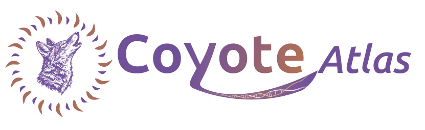

<!-- badges:start -->
  
<!-- badges:end -->

Coyote Atlas owns the HGNC gene snapshot, Ensembl VEP metadata and associated
diagrams distributed with Coyote. Its manifest records dataset identities,
source evidence, record counts and SHA-256 hashes. Offline tools inspect and
validate the bundle without a server or database.

The optional API integration plans and installs the reviewed bundle through the
server's existing administrator authorization, audit and preservation rules.
Installation is explicit; package imports and application startup do not write
reference data.

```bash
pip install coyote-atlas
coyote-atlas inspect
coyote-atlas validate
```

See [installation](docs/getting-started.md), [usage](docs/usage.md),
[configuration](docs/configuration.md), [architecture](docs/architecture.md),
[reference](docs/reference.md) and [development](docs/development.md).

First-party code is GPL-3.0-only. Bundled third-party resources retain their
source notices and terms; see [copyright](COPYRIGHT.txt), [notice](NOTICE.txt)
and the [Ensembl reference notice](src/coyote_atlas/data/reference/NOTICE.txt).
