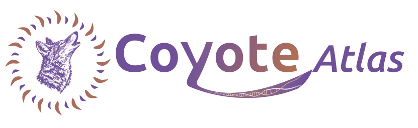

<!-- badges:start -->
  
<!-- badges:end -->

Atlas packages reference resources and verifies their integrity. It can be
installed on a workstation for offline review or with a server for explicit,
authenticated installation into that server's configured knowledgebase.

1. [Install Atlas](getting-started.md).
2. [Inspect, validate and install a reviewed bundle](usage.md).
3. [Configure API access](configuration.md).
4. [Understand package and host responsibilities](architecture.md).
5. [Find commands, resource identities and API contracts](reference.md).
6. [Develop, test and build independently](development.md).
