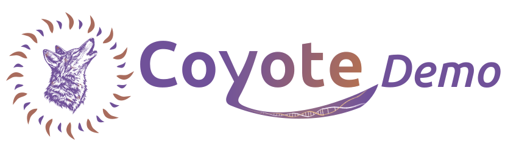

<!-- badges:start -->
  
<!-- badges:end -->

Synthetic datasets and explicit installation workflows for an isolated Coyote
demonstration. The base package contains the datasets and core-based validation.
The `api` extra adds installation commands and an optional server extension.
Demonstration routes remain absent unless the package is explicitly enabled and
its configured databases pass the isolation checks.

Samples use the normal ingestion workflow. Installation retains current
permission checks, resource collision protection and reviewed-sample preservation.
Installing this package does not start services or provide clinical validation.

## Documentation

- [Getting started](docs/getting-started.md): install and enable the package.
- [Usage](docs/usage.md): plan and install synthetic configurations and starter samples.
- [Configuration](docs/configuration.md): isolated settings and credentials.
- [Architecture](docs/architecture.md): package boundaries and protected behavior.
- [Development](docs/development.md): editable installation, tests and coverage.

Version and dependencies belong to [pyproject.toml](pyproject.toml). Changes are
listed in [CHANGELOG.md](CHANGELOG.md). GNU GPL version 3 only; see
[LICENSE.txt](LICENSE.txt), [COPYRIGHT.txt](COPYRIGHT.txt) and [NOTICE.txt](NOTICE.txt).
