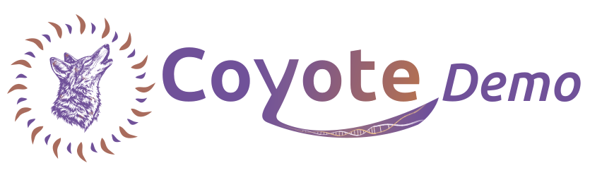

<!-- badges:start -->
  
<!-- badges:end -->

Coyote Demo owns the packaged synthetic resources used for demonstrations and
their explicitly authorized installation workflows.

## Start with a task

- **Try the complete application:** follow the [local and Docker demo installation](../../../docs/deployment/demo-installation.md).
- **Add samples to an existing isolated demo:** check its [settings](configuration.md), then use the [installation commands](usage.md).
- **Change the datasets or package:** use the [development guide](development.md).

Use [datasets](datasets.md) to look up bundled inputs and the
[interface reference](reference.md) for package entry points.
[Architecture](architecture.md) explains ownership and isolation checks.
